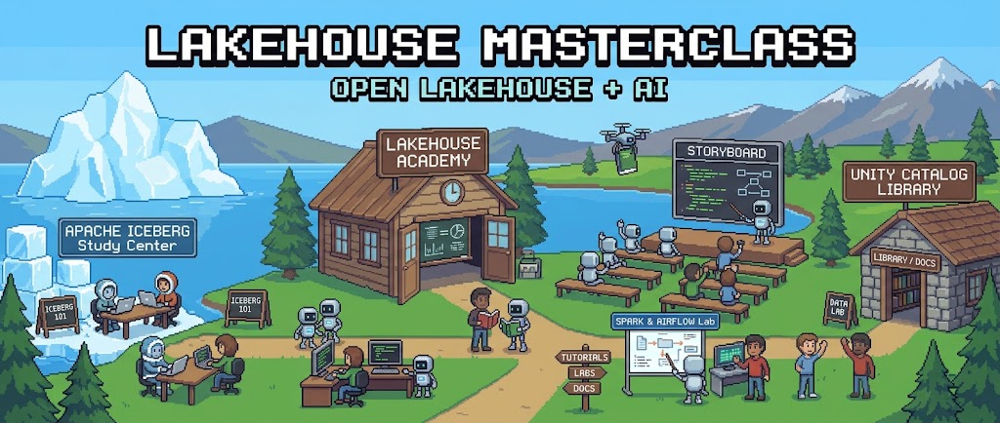

# 🏠 Build Your First Open Lakehouse, from Storage to Agents

**Everybody talks about the "modern data stack." This course makes you build one, the whole thing, on your own machine.**

No cloud account. No credit card. No mystery managed service doing the interesting parts for you behind a paywall. Just you, your machine, and a stack of real, production-grade open-source tools that [...]

By the last chapter, the intimidating architecture diagram you see in every data-engineering blog post won't be intimidating anymore. It'll be *yours*. You'll have typed every command that built it, a[...]