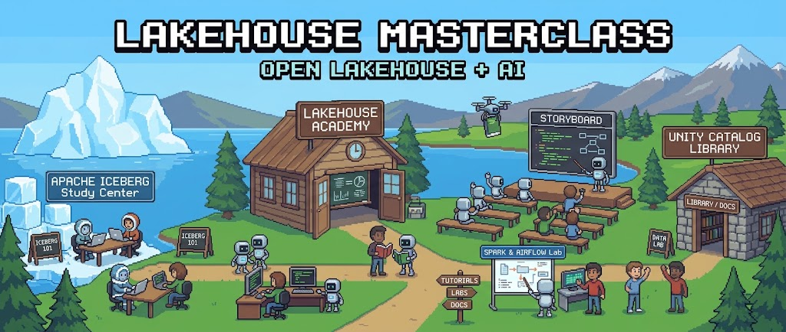

# 🏠 Build Your First Open Lakehouse

A lakehouse is easy to draw and hard to understand until every box has failed in front of you at least once.

Build Your First Open Lakehouse is a practical course that turns the architecture diagram into a system running on one machine. Starting with an empty directory, it builds object storage, Apache Spark, Apache Iceberg, an open catalog, batch and streaming pipelines, orchestration, serving, machine learning, and a policy-constrained agent. No cloud account and no managed service hides the joins between the layers.



The finish line is not “all containers are green.” It is one order stream that can be ingested twice without duplication, transformed into tested Silver and Gold tables, resumed from a streaming checkpoint, backfilled through Airflow, queried from a second engine, tied to the snapshot that trained a model, and operated through explicit agent policies.

**[Read the course](https://open-lakehouse.github.io/lakehouse-masterclass/)** · **[Start Chapter 1](textbook/chapters/ch01-foundations.md)** · **[See every command and checkpoint](COURSE.md)**

## 🏗️ One system, layer by layer

The course develops one system from the infrastructure upward. A stream of order events moves through object storage, Apache Iceberg tables, batch and streaming pipelines, orchestration, serving, and model training. Later chapters add an agent with explicit policies for operating the stack.

The completed stack uses:

- SeaweedFS for S3-compatible object storage
- Apache Spark through Spark Connect for compute
- Apache Iceberg and Unity Catalog OSS for tables and catalog metadata
- Apache Kafka and Structured Streaming for real-time ingestion
- Spark Declarative Pipelines for transformation
- Apache Airflow for orchestration
- DuckDB for an independent serving engine
- MLflow for experiment and model tracking
- Omnigent and Ollama for local agent-driven operations

All services run locally. Each chapter leaves behind a working layer that the next chapter must use, so architecture becomes cause and effect rather than a list of product names.

```text
events -> Kafka -> Spark -> Bronze -> Silver -> Gold
                    |         Apache Iceberg        |
                    +------ Unity Catalog OSS ------+
                                      |
                         Airflow · DuckDB · MLflow
                                      |
                            policy-constrained agent
```

## 🎯 Audience and requirements

The course assumes working knowledge of Python, SQL, and a command-line shell. Prior Spark, Kafka, Docker, or distributed-systems experience is not required.

The full stack requires:

- a machine with approximately 16 GB of memory;
- Docker with Compose v2;
- Python 3.12; and
- Git and a POSIX-compatible shell.

The measured container footprint after a pipeline run is approximately 4.5 GB, with higher short-lived peaks while jobs run. An 8 GB machine can run the course with the Spark worker capped and later services stopped when they are not in use; Chapter 5 describes the resource settings.

## 🧭 How to use the course

Read the chapters in order. Each chapter introduces one architectural layer, adds it to the local system, and ends with a checkpoint that verifies the result.

- [Textbook contents](textbook/README.md)
- [Command and checkpoint reference](COURSE.md)
- [Published course](https://open-lakehouse.github.io/lakehouse-masterclass/)

The chapters contain every required file in full. A separate starter repository is not required.

## 🗺️ Curriculum

| Chapter | Layer | Result |
|---|---|---|
| 1. Foundations | Architecture | Define the system boundaries and the decisions that constrain later layers. |
| 2. Setup | Local environment | Establish the project, container, network, and secret model. |
| 3. Agentic data engineering | Agent and policies | Run a local SDP agent with tested `ALLOW`, `DENY`, and `ASK` controls. |
| 4. Storage | Object storage and table format | Store data through an S3-compatible API and introduce Iceberg tables. |
| 5. Compute | Apache Spark and Spark Connect | Build a Spark image and execute work through a remote Spark Connect session. |
| 5.5. Iceberg for Spark 4.3 | Temporary compatibility build | Build the pinned Iceberg runtime required until an upstream Spark 4.3 artifact is released. |
| 6. Tables and Catalog | Iceberg and Unity Catalog OSS | Create, evolve, time-travel, and restore a transactional table. |
| 7. Ingestion | Raw data to Bronze | Build an idempotent landing and ingestion path. |
| 8. Transformation | Medallion architecture | Produce Silver and Gold tables with Spark Declarative Pipelines. |
| 9. Streaming | Kafka and Structured Streaming | Feed the Bronze layer continuously with restartable, deduplicated processing. |
| 10. Orchestration | Apache Airflow | Schedule, retry, and backfill the pipeline. |
| 11. Serving | DuckDB | Query the same catalog and tables from a second engine. |
| 12. AI | MLflow | Train and track a model against an identifiable Gold-table snapshot. |
| 13. Agents | Lakehouse operations | Operate tested workflows through an agent and constrained tools. |
| 14. Deploy and Teardown | Operations | Map the local design to cloud services and remove the stack cleanly. |

## 📂 Repository layout

| Path | Purpose |
|---|---|
| `textbook/` | Course chapters and figures |
| `COURSE.md` | Chapter commands and verification checkpoints |
| `mkdocs.yml` | Published site configuration and navigation |
| `requirements-docs.txt` | Documentation build dependencies |

## 📚 Build the documentation

```bash
python -m venv .venv
.venv/bin/pip install -r requirements-docs.txt
.venv/bin/mkdocs serve
```

Open <http://127.0.0.1:8000> after MkDocs starts.

## 🚧 Project status

The textbook is complete through Chapter 14. Chapter 5.5 is temporary and documents the pinned source build needed while Apache Iceberg does not publish a Spark 4.3 runtime.

## 📜 License

See [LICENSE](LICENSE).
