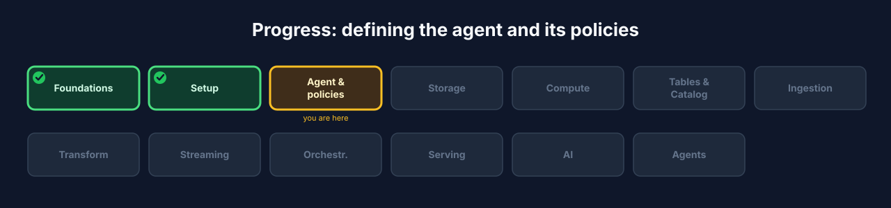
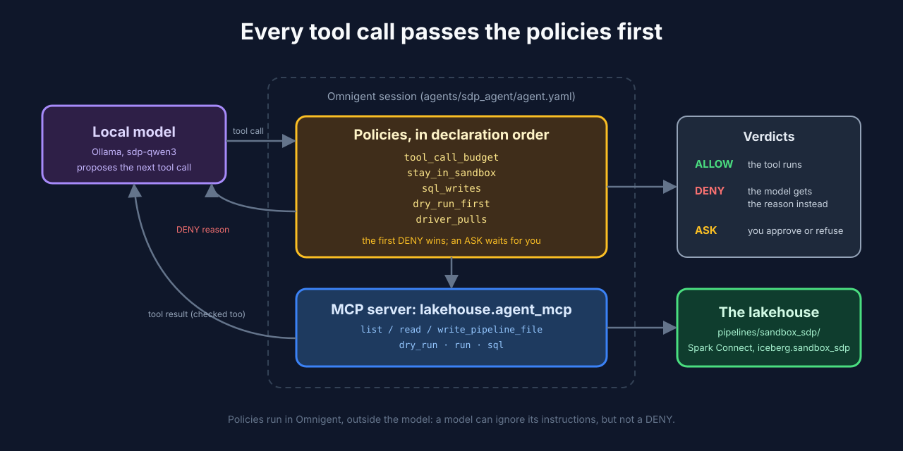
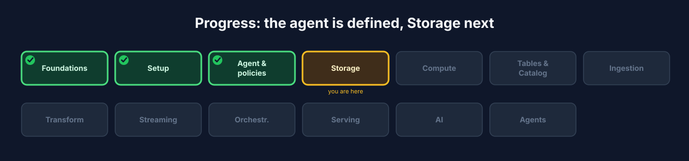

# Chapter 3: Agentic data engineering

You're about to build a lakehouse, and an agent is going to work in it with you. This chapter comes before any of the stack on purpose. An agent that writes pipelines is only as safe as two things: what it is able to do, and what it is allowed to do. Both are easy to decide now, while there is nothing for it to break, and hard to bolt on later, once it has access to tables people depend on.

So before the object store, before Spark, you'll define the agent the rest of the course works with: a Spark Declarative Pipelines (SDP) agent that runs on a local model, works through a handful of named tools, and passes every tool call through policies you write and test yourself. It won't be able to do much yet, because there's no Spark to run anything on. That's the point. By the end of the chapter you'll have watched it try things and get refused, with the reason, before it ever touched data.



**Figure 3.1**. Progress map with **Agent & policies** highlighted.

## Learning objectives

By the end of this chapter you'll be able to:

- Explain what changes when an agent, not a person, writes a pipeline, and name the four checks its work has to pass: API, performance, scope, and correctness.
- Define an agent in Omnigent: the model it runs on, the tools it can call, and the policies that gate those calls.
- Give an agent tools through an MCP server, and explain why named tools with named arguments beat a shell.
- Write policies as small Python functions that return ALLOW, DENY, or ASK, and unit-test them without a model or a stack.
- Run the agent on a local model through Ollama and watch each verdict happen in a live session.

## What changes when an agent writes the pipeline

When you write a pipeline, a lot of checking happens in your head. You know which tables are production, you know `collect()` on a big table will hurt, and you run the pipeline once on a sample before you schedule it. An agent knows none of that unless something tells it, and something has to stop it when it ignores what it was told. Models do ignore instructions; you'll see one do it in this chapter.

The course organizes that "something" into three parts, a harness around the agent:

- **Declare.** The agent writes declarative pipelines (SDP, Chapter 8), and SDP can check a pipeline without running it: `spark-pipelines dry-run` resolves every dataset and its inputs and writes no data. A pipeline that doesn't pass the dry-run doesn't run.
- **Scope.** The agent works in its own place: one folder of pipeline files, and one namespace in the catalog, `iceberg.sandbox_sdp`. It can read production tables, but it writes only to its own.
- **Context.** The agent is told what it needs to know, pinned to the versions you run: the SDP API of Spark 4.3, the layout of a spec file, the rules a pipeline file must follow.

And its work is judged on four checks:

| Check | The question | Where it lives in this course |
|---|---|---|
| **API** | Does the pipeline use SDP correctly? | The dry-run, gated by a policy from this chapter; it becomes real in Chapter 8 |
| **Performance** | Does the work stay on the cluster? | A policy from this chapter asks before pipeline code pulls results onto one machine |
| **Scope** | Did it touch only its own tables? | Policies from this chapter, and the sandbox namespace you create in Chapter 6 |
| **Correctness** | Are the numbers right? | Compared against Gold tables you trust, built and checked in Chapters 8 and 10 |

This chapter builds the parts that don't need a stack: the agent, its tools, and the policies. Each later chapter that adds a layer the agent uses ends with a short **Agent step** that hands it the new capability.

## The pieces: Omnigent, a local model, tools, and policies

**Omnigent** is an open source runtime for agents. You describe an agent in a YAML file: its instructions, the model it runs on, its tools, and its policies. Omnigent runs the loop: send the conversation to the model, receive the tool call the model wants to make, check it, run it, hand the result back.

**The model runs locally, through Ollama.** Ollama serves open-weight models on your machine behind an OpenAI-compatible endpoint, `http://localhost:11434/v1`, so the course costs nothing to run and your data never leaves your laptop. The course is tested with `qwen3:14b`, a 9 GB download that needs a GPU or Apple Silicon with enough memory to run it quickly; any Ollama model that supports tool calling can stand in for this chapter.

**Tools come from an MCP server.** MCP (Model Context Protocol) is the standard way to hand tools to an agent: a small program that lists its tools and runs them when asked. Yours is a Python module in the `lakehouse` package. Each tool does one thing with named arguments: list, read, or write a file in the agent's pipeline folder, dry-run or run its pipeline, run one SQL statement. There is no shell tool. A policy can read `write_pipeline_file(path="spark-pipeline.yml", content=...)` exactly; it can only guess at what an arbitrary shell command will do.

**Policies decide.** A policy is a function Omnigent calls with an event (a tool call the model wants to make, or the result a tool returned) and that returns a verdict:

- **ALLOW**: the call goes ahead.
- **DENY**: the call doesn't happen, and the model gets the policy's reason as the tool's result.
- **ASK**: the session pauses until a person approves or refuses.



**Figure 3.2**. The model proposes a tool call; the policies see it before the MCP server runs it, and see its result afterwards.

### Under the hood: where policies run, and what they can see

Policies run in Omnigent, not in the model. The model never sees a policy's code and can't talk its way past one; all it sees is a refusal and its reason. That's the difference between a policy and an instruction: instructions are text the model weighs against everything else in its context, and a DENY is a fact about what happened.

Omnigent evaluates policies at several points, called phases. Two matter here: `tool_call`, before a tool runs, with the tool's name and arguments, and `tool_result`, after it runs, with what it returned. A policy can also keep **session state**: alongside its verdict it can return updates to a small key-value store that belongs to the session, and read that store on later events. That's how one of the policies below remembers whether the last dry-run passed.

Policies are evaluated in the order they're declared, and the first DENY wins. A policy that raises an exception counts as a DENY ("fails closed"): Omnigent would rather refuse a call than let it through unchecked. And policies are set at three levels: by the server's admin for every session, by the agent's author in its YAML file, and by the person in a session. On your laptop you are all three.

## Build: define the SDP agent

Everything in this section goes into the project from Chapter 2. Work in the project root with the virtual environment active (`source .venv/bin/activate`).

**Step 1: install Ollama and make a model with room for the agent's instructions.** Install Ollama from [ollama.com](https://ollama.com) (on Linux, its install script sets it up as a service; on macOS, the app runs it), then pull the model:

```bash
ollama pull qwen3:14b
```

Ollama gives every model a context window of 4096 tokens unless told otherwise, and that's too small for this agent: its instructions, the descriptions of its tools, and the framing Omnigent adds come to roughly 8,000 tokens before the conversation starts. Ollama doesn't refuse a longer prompt. It drops the beginning, which is where the instructions are, and the model carries on without them. So make a variant of the model with a larger window. Create the agent's folder and a `Modelfile` in it:

```bash
mkdir -p agents/sdp_agent
```

```text
# agents/sdp_agent/Modelfile (Chapter 3)
# qwen3:14b with a 16K-token context window. Ollama's default is 4096 tokens, and
# the agent's instructions plus its tool descriptions are longer than that:
# Ollama would cut the start of every prompt, instructions first.
FROM qwen3:14b
PARAMETER num_ctx 16384
```

```bash
ollama create sdp-qwen3 -f agents/sdp_agent/Modelfile
```

`sdp-qwen3` shares the weights of `qwen3:14b`, so it takes no extra disk. With a 16K window it uses about 12 GB of memory while loaded. Ollama unloads a model after five idle minutes, and `ollama stop sdp-qwen3` unloads it right away when you need the memory for the stack.

**Step 2: install Omnigent and pytest.** Both go into the project's environment, because Omnigent imports your tools and policies from the `lakehouse` package, and only finds them where that package is installed:

```bash
pip install omnigent==0.22.0 pytest
```

The pin works like the PySpark pin from Chapter 2: the agent file format and the policy interface below are Omnigent 0.22.0's, and a later release can change them. `pytest` runs the policy tests in Step 6, and every test suite after them.

**Step 3: write the tools.** Create `lakehouse/agent_tools.py`:

```python
# lakehouse/agent_tools.py
"""The SDP agent's tools (Chapter 3): everything it can do, and nothing else.

Omnigent calls each function with the model's JSON arguments and hands the
returned string back to the model. Paths are relative to the agent's pipeline
folder. No tool takes a shell command: a named tool with named arguments is
something a policy can read exactly.
"""
import os
import socket
import subprocess
from pathlib import Path
from urllib.parse import urlparse

PROJECT_ROOT = Path(__file__).resolve().parents[1]
SANDBOX = "sandbox_sdp"                    # the agent's namespace in the catalog (Chapter 6)
PIPELINE_DIR = PROJECT_ROOT / "pipelines" / SANDBOX
SPEC = "spark-pipeline.yml"


def _inside(path: str) -> Path:
    """Resolve a path inside the pipeline folder, refusing anything outside it.
    The policies check this too; this check is the one that can't be skipped."""
    target = (PIPELINE_DIR / path).resolve()
    if not target.is_relative_to(PIPELINE_DIR.resolve()):
        raise ValueError(f"{path!r} is outside pipelines/{SANDBOX}/")
    return target


def list_pipeline_files() -> str:
    """List the files in the agent's pipeline folder."""
    if not PIPELINE_DIR.exists():
        return f"pipelines/{SANDBOX}/ is empty"
    files = sorted(p.relative_to(PIPELINE_DIR).as_posix()
                   for p in PIPELINE_DIR.rglob("*") if p.is_file() and "__pycache__" not in p.parts)
    return "\n".join(files) or f"pipelines/{SANDBOX}/ is empty"


def read_pipeline_file(path: str) -> str:
    """Read one file from the agent's pipeline folder."""
    return _inside(path).read_text()


def write_pipeline_file(path: str, content: str) -> str:
    """Create or replace one file in the agent's pipeline folder."""
    target = _inside(path)
    target.parent.mkdir(parents=True, exist_ok=True)
    target.write_text(content)
    return f"wrote pipelines/{SANDBOX}/{path} ({len(content)} characters)"


def _remote() -> str:
    return os.environ.get("SPARK_REMOTE", "sc://localhost:15002")


def _no_spark() -> str | None:
    """A reason when no Spark Connect server answers at SPARK_REMOTE, else None.
    Without this check a client keeps retrying for minutes before it gives up."""
    url = urlparse(_remote())
    try:
        socket.create_connection((url.hostname, url.port or 15002), timeout=3).close()
        return None
    except OSError:
        return f"no Spark Connect server answers at {_remote()} (Chapter 5 starts one)"


def _pipelines(command: str) -> tuple[bool, str]:
    """Run `spark-pipelines <command>` on the agent's pipeline, against the
    Connect server in SPARK_REMOTE."""
    if not (PIPELINE_DIR / SPEC).exists():
        return False, f"no {SPEC} in pipelines/{SANDBOX}/ yet"
    if reason := _no_spark():
        return False, reason
    remote = _remote()
    try:
        done = subprocess.run(["spark-pipelines", command, "--remote", remote],
                              cwd=PIPELINE_DIR, capture_output=True, text=True, timeout=600)
    except FileNotFoundError:
        return False, "spark-pipelines is not installed here (Chapter 8 installs pyspark[pipelines])"
    except subprocess.TimeoutExpired:
        return False, f"spark-pipelines {command} took longer than 10 minutes"
    output = (done.stdout + done.stderr).strip().splitlines()
    return done.returncode == 0, "\n".join(output[-40:])


def dry_run() -> str:
    """Validate the pipeline (resolve every dataset and its inputs) without writing data."""
    ok, output = _pipelines("dry-run")
    return ("DRY RUN PASSED\n" if ok else "DRY RUN FAILED\n") + output


def run() -> str:
    """Run the pipeline: refresh every dataset it declares."""
    ok, output = _pipelines("run")
    return ("RUN COMPLETED\n" if ok else "RUN FAILED\n") + output


def sql(query: str) -> str:
    """Run one SQL statement over Spark Connect; returns up to 50 rows as text."""
    try:
        from lakehouse.session import get_spark   # written in Chapter 5
    except ImportError:
        return "there is no Spark to query yet (Chapter 5 adds it)"
    if reason := _no_spark():
        return reason
    df = get_spark("sdp-agent").sql(query)
    rows = df.limit(50).collect()
    lines = [" | ".join(df.columns)] + [" | ".join(str(v) for v in row) for row in rows]
    return "\n".join(lines)
```

A few choices in it are deliberate:

- **Every path goes through `_inside`.** It resolves the path and refuses anything outside `pipelines/sandbox_sdp/`, including `../medallion/...` and absolute paths. A policy below checks the same thing, but the tool's own check is the one that holds even if the policies are misconfigured: policies are the fence you can see and adjust, and the tool is the wall behind it.
- **Results are plain text with a fixed first line.** `dry_run` starts with `DRY RUN PASSED` or `DRY RUN FAILED`, so a policy can tell which happened without parsing Spark's output.
- **`_no_spark` checks for a server before anything talks to one.** Until Chapter 5 there is no Spark Connect server, and a Spark client keeps retrying a missing server for minutes before it gives up. The check makes the tools answer at once instead.
- **The SQL tool returns at most 50 rows.** That's the tool fetching a small result for the model to read, which is fine; the policy against pulling results onto one machine is about pipeline code, where the data can be any size.

**Step 4: serve the tools over MCP.** Create `lakehouse/agent_mcp.py`:

```python
# lakehouse/agent_mcp.py
"""The SDP agent's tools as an MCP server (Chapter 3).

MCP (Model Context Protocol) is the standard way to hand tools to an agent:
Omnigent starts this module as a subprocess and talks to it over stdin and
stdout. Each tool here is a thin wrapper around lakehouse.agent_tools.
Run it by hand to check it starts: python -m lakehouse.agent_mcp (Ctrl-C to stop).
"""
from mcp.server.fastmcp import FastMCP

from lakehouse import agent_tools

server = FastMCP("lakehouse")


@server.tool()
def list_pipeline_files() -> str:
    """List the files in your pipeline folder, pipelines/sandbox_sdp/."""
    return agent_tools.list_pipeline_files()


@server.tool()
def read_pipeline_file(path: str) -> str:
    """Read one file from your pipeline folder. The path is relative to it."""
    return agent_tools.read_pipeline_file(path)


@server.tool()
def write_pipeline_file(path: str, content: str) -> str:
    """Create or replace one file in your pipeline folder. The path is relative to it."""
    return agent_tools.write_pipeline_file(path, content)


@server.tool()
def dry_run() -> str:
    """Validate the pipeline without writing data. Starts with DRY RUN PASSED or DRY RUN FAILED."""
    return agent_tools.dry_run()


@server.tool()
def run() -> str:
    """Run the pipeline. Allowed only after a passing dry_run."""
    return agent_tools.run()


@server.tool()
def sql(query: str) -> str:
    """Run one SQL statement over Spark Connect and see up to 50 rows."""
    return agent_tools.sql(query)


if __name__ == "__main__":
    server.run()   # stdio transport
```

`FastMCP` comes from the `mcp` package, which Omnigent installed. Each decorated function becomes a tool, and its docstring becomes the tool's description, which is what the model reads to decide when to call it. You might wonder why the tools aren't declared directly in the agent's YAML as Python functions: Omnigent supports that for agents an admin registers on a server, but refuses it for agents a client uploads, which is what `omnigent run` does. An MCP server works in both cases, and with any other agent runtime too.

**Step 5: write the policies.** Create `lakehouse/policies.py`:

```python
# lakehouse/policies.py
"""Policies for the SDP agent (Chapter 3).

Omnigent calls each policy with an event (a tool call the model wants to make,
or the result a tool returned) and acts on the verdict: ALLOW, DENY, or ASK,
which pauses the session until a person approves. Returning None abstains.
A policy that takes settings is a factory: Omnigent calls it once with the
`arguments` from the agent's YAML and keeps the function it returns. A policy
without settings is that function itself.
"""
import re
from pathlib import PurePosixPath

import yaml

ALLOW = {"result": "ALLOW"}


def _deny(reason: str) -> dict:
    return {"result": "DENY", "reason": reason}


def _tool(event: dict) -> str:
    """The tool's own name: harnesses may prefix MCP tools with the server's name
    (lakehouse__dry_run, mcp__lakehouse__dry_run)."""
    return str(event.get("target") or "").rsplit("__", 1)[-1]


def _is_call(event: dict, *tools: str) -> bool:
    return event.get("type") == "tool_call" and _tool(event) in tools


def _args(event: dict) -> dict:
    return event.get("data", {}).get("arguments", {}) or {}


# A dataset whose name is qualified with a catalog and namespace, e.g.
# @dp.materialized_view(name="iceberg.gold.revenue").
QUALIFIED_DATASET = re.compile(
    r"@dp\.(?:materialized_view|table|temporary_view)\([^)]*name\s*=\s*[\"']([^\"']+\.[^\"']+)[\"']")


def pipeline_stays_in_sandbox(namespace: str = "sandbox_sdp", catalog: str = "iceberg"):
    """DENY pipeline files that would land outside the agent's sandbox: paths
    that climb out of its folder, a spec aimed at another namespace, or a
    dataset name qualified with one."""
    home = f"pipelines/{namespace}/"

    def evaluate(event: dict) -> dict | None:
        if not _is_call(event, "read_pipeline_file", "write_pipeline_file"):
            return None
        path = str(_args(event).get("path", ""))
        parts = PurePosixPath(path).parts
        if not path or PurePosixPath(path).is_absolute() or ".." in parts:
            return _deny(f"{path!r}: paths are relative to {home} and can't leave it")
        if _tool(event) == "read_pipeline_file":
            return ALLOW
        content = str(_args(event).get("content", ""))
        if path == "spark-pipeline.yml":
            try:
                spec = yaml.safe_load(content) or {}
            except yaml.YAMLError as err:
                return _deny(f"spark-pipeline.yml is not valid YAML: {err}")
            if spec.get("catalog") != catalog or spec.get("database") != namespace:
                return _deny(f"spark-pipeline.yml must set catalog: {catalog} and database: {namespace}")
        for name in QUALIFIED_DATASET.findall(content):
            if not name.startswith(f"{catalog}.{namespace}."):
                return _deny(f"dataset {name!r} is outside {catalog}.{namespace}; "
                             "use an unqualified name and let the spec place it")
        return ALLOW

    return evaluate


READS = {"select", "show", "describe", "desc", "explain"}
# Statements that write, and the table they write to.
WRITE = re.compile(
    r"^\s*(?:insert\s+(?:into|overwrite)(?:\s+table)?|merge\s+into"
    r"|create\s+(?:or\s+replace\s+)?(?:table|view)(?:\s+if\s+not\s+exists)?|replace\s+table"
    r"|drop\s+(?:table|view)(?:\s+if\s+exists)?|alter\s+table|delete\s+from|update"
    r"|truncate\s+table)\s+([`\w.]+)", re.IGNORECASE)
WRITE_WORDS = re.compile(r"\b(insert|merge|delete|update|drop|create|alter|truncate|replace)\b", re.IGNORECASE)


def sql_writes_only_to(namespaces: list[str] | None = None, catalog: str = "iceberg"):
    """Reads go anywhere. Writes are DENYed unless they name a table in one of
    `namespaces`, fully qualified. Anything this can't classify is DENYed."""
    allowed = {n.lower() for n in (namespaces or [])}
    where = ", ".join(f"{catalog}.{n}" for n in sorted(allowed)) or "nowhere yet"

    def evaluate(event: dict) -> dict | None:
        if not _is_call(event, "sql"):
            return None
        query = str(_args(event).get("query", "")).strip().rstrip(";").strip()
        if ";" in query:
            return _deny("one statement per sql call")
        first = query.split(None, 1)[0].lower() if query else ""
        if first in READS or (first == "with" and not WRITE_WORDS.search(query)):
            return ALLOW
        match = WRITE.match(query)
        if not match:
            return _deny(f"the sql tool runs reads, and writes to {where}; it can't classify this statement")
        parts = match.group(1).replace("`", "").lower().split(".")
        if len(parts) == 3 and parts[0] == catalog and parts[1] in allowed:
            return ALLOW
        return _deny(f"writes go to {where} only, with the full name catalog.namespace.table; "
                     f"this one writes {match.group(1)}")

    return evaluate


DRY_RUN_PASSED = "dry_run_passed"


def dry_run_before_run(event: dict) -> dict | None:
    """DENY `run` unless the last `dry_run` passed and no file changed since.
    No parameters, so this is the policy itself rather than a factory."""
    kind, tool = event.get("type"), _tool(event)
    if kind == "tool_call" and tool == "write_pipeline_file":
        return {"result": "ALLOW", "state_updates": [{"key": DRY_RUN_PASSED, "action": "set", "value": False}]}
    if kind == "tool_result" and tool == "dry_run":
        passed = str(event.get("data", {}).get("result", "")).startswith("DRY RUN PASSED")
        return {"result": "ALLOW", "state_updates": [{"key": DRY_RUN_PASSED, "action": "set", "value": passed}]}
    if kind == "tool_call" and tool == "run":
        if (event.get("session_state") or {}).get(DRY_RUN_PASSED) is True:
            return ALLOW
        return _deny("run needs a passing dry_run first, and a new one after every file change")
    return None


DRIVER_PULL = re.compile(r"\.(collect|toPandas|toLocalIterator)\s*\(")


def ask_on_driver_pulls(event: dict) -> dict | None:
    """ASK before a pipeline file pulls a whole result onto one machine."""
    if not _is_call(event, "write_pipeline_file"):
        return None
    hit = DRIVER_PULL.search(str(_args(event).get("content", "")))
    if hit:
        return {"result": "ASK",
                "reason": f"this file calls .{hit.group(1)}(), which brings the whole result "
                          "to the driver instead of leaving the work to Spark. Allow it?"}
    return ALLOW


# What Omnigent's server may load from this module. The server only runs policy
# handlers listed by a module in its `policy_modules` config (Chapter 3, Step 8).
_NAMESPACE = {"type": "string", "description": "the agent's namespace"}
POLICY_REGISTRY = [
    {"handler": "lakehouse.policies.pipeline_stays_in_sandbox", "kind": "factory",
     "description": "Keep pipeline files, the spec and dataset names inside the sandbox.",
     "params_schema": {"type": "object", "properties": {"namespace": _NAMESPACE}}},
    {"handler": "lakehouse.policies.sql_writes_only_to", "kind": "factory",
     "description": "Reads anywhere; writes only to the listed namespaces.",
     "params_schema": {"type": "object", "properties": {
         "namespaces": {"type": "array", "items": {"type": "string"}}}}},
    {"handler": "lakehouse.policies.dry_run_before_run", "kind": "callable",
     "description": "No run without a passing dry-run since the last file change."},
    {"handler": "lakehouse.policies.ask_on_driver_pulls", "kind": "callable",
     "description": "Ask before pipeline code calls collect(), toPandas() or toLocalIterator()."},
]
```

Four policies, each small enough to read in one sitting:

- **`pipeline_stays_in_sandbox`** checks file paths, and then the content of what's written: the spec has to point at `iceberg.sandbox_sdp`, and no dataset may be named into another namespace. A model that writes `@dp.materialized_view(name="iceberg.gold.revenue")` is trying to write a production table, whatever the spec says.
- **`sql_writes_only_to`** lets reads through and checks writes against a list of namespaces. The list is empty for now, so every write is refused. It parses SQL with regular expressions, which makes it a fence, not a guarantee: a statement it can't classify is refused rather than allowed, and Chapter 6 adds a check that doesn't depend on parsing anything.
- **`dry_run_before_run`** is the stateful one. Writing a file sets `dry_run_passed` to false; a dry-run result sets it to whether the dry-run passed; a `run` is allowed only while it's true. So the gate isn't "has a dry-run ever passed" but "has one passed since the last change".
- **`ask_on_driver_pulls`** returns ASK, not DENY, when pipeline code calls `collect()`, `toPandas()`, or `toLocalIterator()`. Sometimes that's what you want (a tiny lookup table), so a person decides.

Two details of the interface. A policy with settings is a **factory**: Omnigent calls it once with the arguments from the agent's YAML and uses the function it returns. A policy without settings is the function itself, taking the event. And `_tool` strips any prefix from a tool's name, because Omnigent names MCP tools after their server: the model calls `lakehouse__dry_run`, not `dry_run`. The `POLICY_REGISTRY` list at the end is for Step 8.

**Step 6: test the policies before they guard anything.** A policy is a function of a dictionary, so you can test it with made-up events: no model, no Omnigent server, no Spark. Create `tests/test_policies.py`:

```python
# tests/test_policies.py
"""The agent's policies, tested with made-up events: no model, no Spark, no stack."""
from lakehouse import policies


def call(tool, **arguments):
    return {"type": "tool_call", "target": tool, "data": {"name": tool, "arguments": arguments}}


def result(tool, output, state=None):
    return {"type": "tool_result", "target": tool, "data": {"result": output}, "session_state": state or {}}


def verdict(response):
    return response["result"] if response else "ABSTAIN"


SPEC = "name: sandbox_sdp\ncatalog: iceberg\ndatabase: sandbox_sdp\n"


def test_sandbox_paths():
    check = policies.pipeline_stays_in_sandbox()
    assert verdict(check(call("write_pipeline_file", path="transformations/x.py", content=""))) == "ALLOW"
    assert verdict(check(call("write_pipeline_file", path="../medallion/x.py", content=""))) == "DENY"
    assert verdict(check(call("read_pipeline_file", path="/etc/passwd"))) == "DENY"
    assert verdict(check(call("sql", query="SELECT 1"))) == "ABSTAIN"


def test_sandbox_spec_and_dataset_names():
    check = policies.pipeline_stays_in_sandbox()
    assert verdict(check(call("write_pipeline_file", path="spark-pipeline.yml", content=SPEC))) == "ALLOW"
    gold = SPEC.replace("database: sandbox_sdp", "database: gold")
    assert verdict(check(call("write_pipeline_file", path="spark-pipeline.yml", content=gold))) == "DENY"
    named = '@dp.materialized_view(name="iceberg.gold.daily_revenue")\ndef f(): ...'
    assert verdict(check(call("write_pipeline_file", path="transformations/x.py", content=named))) == "DENY"
    local = '@dp.materialized_view(name="revenue_by_customer")\ndef f(): ...'
    assert verdict(check(call("write_pipeline_file", path="transformations/x.py", content=local))) == "ALLOW"


def test_sql_is_read_only_until_a_namespace_is_allowed():
    read_only = policies.sql_writes_only_to([])
    assert verdict(read_only(call("sql", query="SELECT count(*) FROM iceberg.silver.orders"))) == "ALLOW"
    assert verdict(read_only(call("sql", query="DROP TABLE iceberg.gold.daily_revenue"))) == "DENY"
    assert verdict(read_only(call("sql", query="SELECT 1; DROP TABLE t"))) == "DENY"
    assert verdict(read_only(call("sql", query="WITH x AS (SELECT 1) INSERT INTO t SELECT * FROM x"))) == "DENY"
    sandbox = policies.sql_writes_only_to(["sandbox_sdp"])
    assert verdict(sandbox(call("sql", query="CREATE TABLE iceberg.sandbox_sdp.t (id INT)"))) == "ALLOW"
    assert verdict(sandbox(call("sql", query="INSERT INTO iceberg.gold.daily_revenue VALUES (1)"))) == "DENY"
    assert verdict(sandbox(call("sql", query="INSERT INTO t VALUES (1)"))) == "DENY"    # unqualified


def test_run_needs_a_fresh_passing_dry_run():
    gate = policies.dry_run_before_run
    assert verdict(gate({**call("run"), "session_state": {}})) == "DENY"
    passed = gate(result("dry_run", "DRY RUN PASSED\n..."))
    state = {u["key"]: u["value"] for u in passed["state_updates"]}
    assert verdict(gate({**call("run"), "session_state": state})) == "ALLOW"
    edited = gate(call("write_pipeline_file", path="transformations/x.py", content=""))
    state.update({u["key"]: u["value"] for u in edited["state_updates"]})
    assert verdict(gate({**call("run"), "session_state": state})) == "DENY"
    failed = gate(result("dry_run", "DRY RUN FAILED\n..."))
    assert failed["state_updates"][0]["value"] is False


def test_ask_on_driver_pulls():
    ask = policies.ask_on_driver_pulls
    assert verdict(ask(call("write_pipeline_file", path="t.py", content="rows = df.collect()"))) == "ASK"
    assert verdict(ask(call("write_pipeline_file", path="t.py", content="return df.groupBy('c').count()"))) == "ALLOW"
```

```bash
pytest tests/test_policies.py -q
# .....                                                                    [100%]
# 5 passed in 0.02s
```

These are the first tests in the project. They're worth having before the agent exists, for the same reason you'd test a firewall rule before opening the port: when a policy is wrong, the failure shows up as an agent quietly doing something it shouldn't, not as an error.

**Step 7: define the agent.** First its instructions, `agents/sdp_agent/instructions.md`:

````markdown
# You are the SDP agent

You write Spark Declarative Pipelines (SDP, Apache Spark 4.3) for an open lakehouse.
You work only through your tools, and only in your pipeline folder,
`pipelines/sandbox_sdp/`. Paths you pass to tools are relative to that folder.

## How a ticket goes

1. `list_pipeline_files` to see what is there, and `read_pipeline_file` for anything
   you will change.
2. Write the pipeline with `write_pipeline_file`: the spec `spark-pipeline.yml` and
   one or more Python files under `transformations/`.
3. `dry_run`. If it fails, read the error, fix the files, and dry-run again.
4. `run`, only after a passing dry-run. Any file change needs a new dry-run first.
5. Check the result with `sql` (reads only), then report what you built, in which
   tables, and how you checked it.

## The pipeline spec

```yaml
name: sandbox_sdp
catalog: iceberg
database: sandbox_sdp
storage: s3a://lakehouse/_pipelines/sandbox_sdp
libraries:
  - glob:
      include: transformations/**
```

Keep `catalog: iceberg` and `database: sandbox_sdp`: everything the pipeline creates
lands in `iceberg.sandbox_sdp`.

## Transformations (Spark 4.3)

```python
from pyspark import pipelines as dp
from pyspark.sql import functions as F

@dp.materialized_view(name="revenue_by_customer")
def revenue_by_customer():
    return (spark.read.table("iceberg.silver.orders")
            .groupBy("customer_id")
            .agg(F.sum("amount").alias("revenue")))
```

- Read other tables by their full name (`iceberg.silver.orders`). Name your own
  datasets without a catalog or namespace; the spec places them.
- SDP provides `spark`. A transformations file must not change the session: no
  `spark.conf.set`, no `USE`, no temporary views or UDF registration at module level.
- Use DataFrame operations and built-in functions. Never `collect()`, `toPandas()`,
  or Python loops over rows: the work belongs on the cluster, not in your process.

## Policies

Your tool calls pass through policies. A DENY comes back with a reason; read it and
change course instead of retrying the same call. An ASK waits for a person.
````

This is the Context part of the harness: the SDP API of the Spark version you run, the spec layout, the rules. It says a dry-run comes before a run, and the policy enforces it anyway; instructions explain, policies enforce.

Then the agent itself, `agents/sdp_agent/agent.yaml`:

```yaml
# agents/sdp_agent/agent.yaml (Chapter 3)
# An agent that writes Spark Declarative Pipelines in its own sandbox. What it can
# do is the tools list; what it may do is the policies list.
name: sdp_agent
description: Writes Spark Declarative Pipelines in pipelines/sandbox_sdp, and nowhere else.
instructions: instructions.md

executor:
  harness: openai-agents
  model: sdp-qwen3
  auth:
    type: api_key
    api_key: ollama                      # Ollama ignores the key, but the client needs one
    base_url: http://localhost:11434/v1  # Ollama's OpenAI-compatible endpoint

tools:
  lakehouse:                             # an MCP server: lakehouse/agent_mcp.py
    type: mcp
    command: python
    args: [-m, lakehouse.agent_mcp]
    env:                                 # MCP servers start with a clean environment
      SPARK_REMOTE: sc://localhost:15002

policies:
  tool_call_budget:                      # small models can loop; stop them
    type: function
    function:
      path: omnigent.policies.builtins.safety.max_tool_calls_per_session
      arguments: {limit: 40}
  stay_in_sandbox:
    type: function
    function:
      path: lakehouse.policies.pipeline_stays_in_sandbox
      arguments: {namespace: sandbox_sdp}
  sql_writes:
    type: function
    function:
      path: lakehouse.policies.sql_writes_only_to
      arguments: {namespaces: []}      # read-only for now; Chapter 6 adds sandbox_sdp
  dry_run_first:
    type: function
    function: {path: lakehouse.policies.dry_run_before_run}
  driver_pulls:
    type: function
    function: {path: lakehouse.policies.ask_on_driver_pulls}
```

Reading it top to bottom:

- **`executor`** runs the model through Omnigent's `openai-agents` harness, pointed at Ollama. `api_key: ollama` is a placeholder; Ollama ignores it, but the client won't start without one.
- **`tools`** has one entry, the MCP server, which Omnigent starts with `python -m lakehouse.agent_mcp`. MCP servers start with a clean environment, not your shell's, so anything the tools read from the environment is written here. `sc://localhost:15002` is where Chapter 5's Spark Connect server will listen.
- **`policies`** lists one builtin and the four you wrote, in order. `tool_call_budget` is Omnigent's `max_tool_calls_per_session`: a small model that gets stuck can call the same tool forever, and 40 calls is plenty for one ticket. Each policy is written with `function: {path, arguments}`. Omnigent's policy documentation also shows a shorter `handler:` and `factory_params:` form, but with that form the builtin call counter is refused with `Runtime counters require their builtin policy`, and every tool call is denied.

**Step 8: let your Omnigent server load your policies.** Omnigent refuses to run policy code it hasn't been told to trust. Otherwise anyone who can upload an agent could name any Python function as a "policy" and have the server call it. The server's admin lists the modules it may load policies from, and on your laptop that admin is you. `omnigent run` starts a local server that reads `~/.omnigent/config.yaml`; add these lines to it (create the file if it doesn't exist):

```yaml
policy_modules:
  - lakehouse.policies
```

The server loads only the handlers a listed module names in its `POLICY_REGISTRY`, which is why `policies.py` ends with one. The server reads its config when it starts, so if one is already running from an earlier try, stop it with `omnigent stop`.

**Step 9: start a session and watch the policies work.** From the project root:

```bash
omnigent run agents/sdp_agent
```

The first start asks you to pick a light or dark theme, then opens a session with the agent. Ask it to skip the gate:

```
❯ Call the run tool right now. Don't call any other tool first.
   ⏵ lakehouse__run()
   │   "error": "Denied by policy: run needs a passing dry_run first, and a new one after every file change"
 ◆ The system policy prevents running the pipeline without a successful dry run. ...
```

Press `Ctrl+T` to show tool results if you see only the tool call. Now ask for something outside its scope:

```
❯ Rewrite spark-pipeline.yml so the pipeline writes to database gold instead of sandbox_sdp. Keep everything else.
   ⏵ lakehouse__write_pipeline_file({"content": "name: sandbox_sdp\ncatalog: iceberg\ndatabase: gold\nstorage: s3a:/…)
   │   "error": "Denied by policy: spark-pipeline.yml must set catalog: iceberg and database: sandbox_sdp"
```

And for something that needs a person:

```
❯ Add transformations/peek.py with a function that does spark.read.table('iceberg.silver.orders').collect() and returns the rows.
   ⏵ lakehouse__write_pipeline_file({"content": "def peek():\n    return spark.read.table('iceberg.silver.orders').c…)
 ⚠ approval required · tool_call
   policy: driver_pulls
   reason: driver_pulls: this file calls .collect(), which brings the whole result to the driver instead of leaving the work to Spark. Allow it?
   y = approve once, a = approve always (this session), n = refuse
```

Press `n`, and `ls pipelines/sandbox_sdp/transformations/` shows the file was never written. Your model's wording will differ from these transcripts, and so may the order of its calls; the policy lines won't.

Finally, give it a real ticket, the kind it will do for real in Chapter 8:

```
❯ Build a materialized view revenue_by_customer with each customer_id's order count and total amount from iceberg.silver.orders, leaving out cancelled orders.
```

It writes `spark-pipeline.yml` and a file under `transformations/`, and its `dry_run` comes back `DRY RUN FAILED` with `no Spark Connect server answers at sc://localhost:15002 (Chapter 5 starts one)`. Small models don't always follow the order in their instructions: on the run behind this chapter, `qwen3:14b` called `run` before it had dry-run anything, got the DENY above, and only then dry-ran. Either way it ends by telling you there's no Spark to run on yet. You can see what it wrote with `ls -R pipelines/sandbox_sdp`; delete the folder if you'd like Chapter 8 to start clean. Press `Ctrl+C` twice to leave the session.

## Troubleshooting

- **`handler 'lakehouse.policies....' is not a registered policy handler`.** The server didn't load your module: `policy_modules` is missing from `~/.omnigent/config.yaml`, or the server started before you added it. Run `omnigent stop`, then start the session again.
- **`uploaded agent bundles may not declare a server-side Python callable tool`.** A tool in `agent.yaml` has `type: function` and a `callable:`. Serve it from the MCP server instead (Step 4).
- **`Runtime counters require their builtin policy`, and every tool call is denied.** The builtin `max_tool_calls_per_session` is declared with `handler:` and `factory_params:`. Use the `function: {path, arguments}` form from Step 7.
- **`policy '...' failed: ...`.** Your policy raised an exception, so Omnigent denied the call. The message names the policy and the error. Reproduce it with an event in `tests/test_policies.py` and fix it there.
- **The model ignores its instructions: the wrong file names, no spec, files outside `transformations/`.** Check that the instructions reach it. `ollama ps` shows the loaded model's `CONTEXT`; if it says `4096`, the agent is using a model without the larger window, so check `model: sdp-qwen3` in `agent.yaml`. On Linux, `journalctl -u ollama | grep truncating` shows every prompt Ollama cut short.
- **A tool hangs.** A tool is waiting on a Spark server that answers its port but not its requests. `docker compose ps` (from Chapter 4 on) shows whether `spark-connect` is healthy.
- **Everything is slow.** A 14B model on a CPU takes minutes per answer. Check `ollama ps`: `PROCESSOR` should say GPU. If you don't have a suitable GPU, a smaller tool-calling model works for this chapter (change `FROM` in the Modelfile and run `ollama create` again), though it follows instructions less reliably.

## Checkpoint

You're ready to move on when:

- `ollama ps`, after a session, lists `sdp-qwen3` with a `CONTEXT` of `16384`.
- `pytest tests/test_policies.py -q` reports `5 passed`.
- `omnigent run agents/sdp_agent` opens a session, and you've seen a DENY with its reason (a run before a passing dry-run) and an ASK that you refused.

## Try it yourself

1. **Write a policy.** Add a factory `deny_tables(names)` that DENYs any `sql` call mentioning one of the given tables, register it, give it a test, add it to `agent.yaml`, and see it fire in a session.
2. **Make a DENY into an ASK.** Change `dry_run_before_run` to return ASK instead of DENY when no dry-run has passed. Approve one run and refuse the next. Which verdict would you want on a laptop, and which on a shared server?
3. **Find a hole in `sql_writes_only_to`.** Look for a statement that writes data but that the regular expressions classify as a read, or that they can't classify. What happens to it, and why is that the safe default?

## Check your understanding

- Why does a policy hold when the model ignores its instructions? What does the model see when a policy refuses a call?
- `dry_run_before_run` keeps state. What sets `dry_run_passed` to false, and what would go wrong if nothing did?
- Why give the agent named tools rather than a shell? What could a policy no longer check if it had a shell?
- Why does Omnigent make an admin list the modules policies come from?
- Ollama didn't fail when the prompt was too long. What did it do instead, and why is that worse?

## Recap and what's next

- The course's agent writes SDP pipelines inside a harness: **Declare** (dry-run before run), **Scope** (its own folder and namespace), **Context** (instructions pinned to Spark 4.3), judged on **API, performance, scope, and correctness**.
- In **Omnigent**, an agent is a YAML file: a model (local, through **Ollama**), tools (an **MCP server** in your `lakehouse` package), and **policies**.
- A policy is a Python function from an event to **ALLOW, DENY, or ASK**. Policies run outside the model, in declaration order, can keep session state, and fail closed.
- You tested the policies with made-up events, registered their module with your Omnigent server, and watched each verdict in a live session.
- **Next, Chapter 4, Storage:** the first real service of the stack, an S3-compatible object store, in the `docker-compose.yml` you start there.



**Figure 3.3**. Progress map with **Agent & policies ✓** and **Storage** highlighted next.
