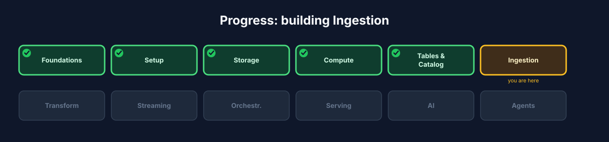
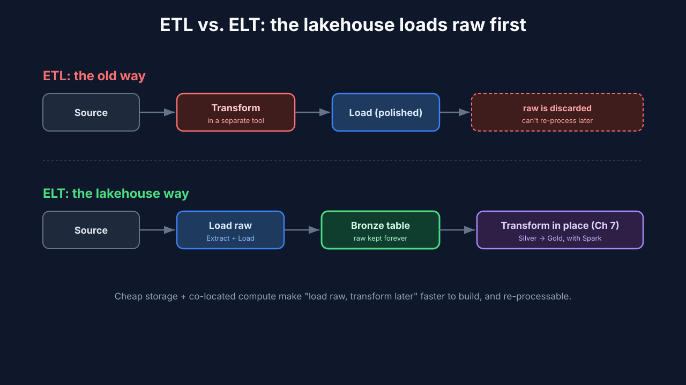
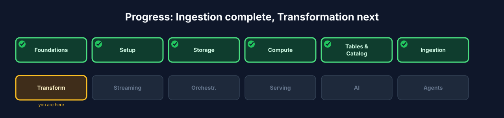

# Chapter 6: Ingestion

This is the first data flow, and a turning point in the course. You have storage (Chapter 3), compute (Chapter 4), and real tables (Chapter 5). Now you get data into them. You'll generate realistic order data, stand in for a source system, and ingest it as-is into a Bronze table: the raw, faithful landing zone that every later transformation builds on. Along the way you'll meet the ingestion vocabulary a practitioner uses every day, batch, ELT, and idempotency, and see why "land raw first" is the modern default.

Chapter 5's `bronze.orders` was a hands-on scratch table for learning Iceberg's mechanics (inserts, schema evolution, time travel, deliberately breaking it and rolling back). Here you build the pipeline's real Bronze table, `bronze.orders_raw`, the one Chapter 7 transforms into Silver and Gold and Chapter 8 streams into. From here on, `orders_raw` is the Bronze table that matters.

Everything before this was infrastructure: places to put data and engines to act on it. From here on, you're moving actual data through the system. Ingestion is where the lakehouse stops being a set of empty rooms and starts being a working home for your data. And the single most important habit you'll build here, landing raw data faithfully before touching it, is the one that separates engineers who sleep well from engineers who get paged.



**Figure 6.1**. Progress map with **Ingestion** highlighted.

## Learning objectives

By the end of this chapter you'll be able to:

- Define ingestion and explain the role of the Bronze layer.
- Contrast ELT with ETL and say why lakehouses default to ELT.
- Explain idempotency and why an ingestion job must be safely re-runnable.
- Write a reusable, date-parameterized `lakehouse.ingest.ingest_orders` module that lands data into an Iceberg Bronze table idempotently, the same function Chapter 9 will schedule.

## What ingestion is, and the golden rule of Bronze

> **Ingestion** *(canonical term)*: getting raw data from a source system into the lakehouse, with as little transformation as possible.

The guiding principle of Bronze is fidelity: capture the source data exactly as it arrived, same fields, same values, warts and all, plus a little metadata about when and how you got it. You do not clean, join, or reshape here. Why? Because raw data you've faithfully stored can always be re-processed later if your logic changes; data you "cleaned" on the way in and threw away is gone forever.

Let this sink in, because it's counterintuitive to beginners who want to "fix" data immediately. Imagine you ingest orders and, being helpful, you drop rows with a null `customer_id` because "those are obviously broken." Six months later you learn that a null `customer_id` actually meant "guest checkout," a huge, valuable segment. If you'd kept the raw data, you'd just re-run your transformations with the new understanding. But you threw those rows away at ingest, so they're gone. The golden rule of Bronze: never lose information you can't recreate. Clean data in later layers, where mistakes are reversible.

> **Bronze / raw** *(canonical term)*: the first medallion tier, an as-faithful-as-possible copy of source data, the immutable foundation for everything downstream.

Think of Bronze as the crime-scene photographer. The photographer doesn't tidy up the scene, move the furniture, or decide what's relevant; they capture exactly what's there, timestamped, so any later investigation can rely on a faithful record. Your Bronze table is that faithful record of what the source actually sent.

## ELT, not ETL

> **ELT** *(canonical term)*: extract and load the raw data first, then transform it inside the lakehouse, as opposed to ETL, which transforms before loading.

The classic warehouse world did ETL: transform data in a separate tool, then load only the polished result. The lakehouse inverts this. Storage is cheap and compute is powerful and co-located, so you load raw first (that's Bronze) and transform in place with Spark (that's Chapter 7). This is faster to build, keeps the untouched source for re-processing, and means your transformations are just more queries against tables you already have.

The reason the industry flipped from ETL to ELT is economics plus regret-avoidance. In the old world, storage was expensive, so you couldn't afford to keep raw data: you transformed it down to just what you needed and discarded the rest (and lived with the golden-rule violations that caused). In the lakehouse world, storage is so cheap that keeping every raw byte forever is affordable, and compute is powerful enough to transform on demand. So the calculus reversed: load everything raw, transform later, keep the raw around forever as insurance. Every serious lakehouse follows this pattern.



**Figure 6.2**. ETL transforms before loading and discards the raw; ELT loads raw into Bronze first, then transforms inside the lakehouse, keeping the source.

## Idempotency: the property that makes ingestion safe

> **Idempotency** *(canonical term)*: re-running a job produces the same result as running it once, no duplicates, no drift.

Ingestion jobs fail and get retried: a network blip, a restarted worker, a manual re-run. If a retry double-inserts yesterday's orders, your Bronze table is now wrong, and so is everything built on it. An idempotent ingest is one you can run twice safely. The usual techniques: ingest a bounded, identified batch (for example, "orders for 2026-01-05"), and either overwrite that partition or merge on a key rather than blindly appending.

This is not a theoretical nicety; it's the difference between a pipeline you trust and one you babysit. Real pipelines fail constantly for boring reasons: a cloud region hiccups, a container gets OOM-killed, someone bumps a deploy. The pipelines that survive are the ones where "just run it again" is always safe. If re-running might duplicate data, then every failure becomes a delicate manual cleanup, and every 3 a.m. page becomes a judgment call about whether it's safe to retry. Idempotency turns retries from scary into routine. It's arguably the single most important property of a production data job.

A quick mental test for idempotency: "If I run this exact job twice in a row, is the table identical to running it once?" If yes, you're idempotent. If running it twice doubles rows, drifts counts, or changes results, you're not, and you have a latent bug waiting for the next retry.

### Under the hood: why append-only bites you

A naive `INSERT INTO ... SELECT * FROM source` is not idempotent: run it twice and every row is duplicated. The fixes Iceberg gives you: `INSERT OVERWRITE` a specific partition (replaces just that slice), or `MERGE INTO ... WHEN MATCHED / WHEN NOT MATCHED` on a business key (upsert). We use a partition overwrite below because Bronze is organized by ingest date, so re-running a day's ingest simply replaces that day.

When would you choose merge instead of partition overwrite? When you're ingesting updates to existing records rather than fresh daily batches, for example an order whose status changes from `pending` to `shipped`. A merge on `order_id` updates the matched row in place and inserts genuinely new ones, so you converge on the correct latest state no matter how many times you run it. Partition overwrite is simpler and perfect for append-mostly daily data; merge is the tool when records mutate. Both are idempotent; they just fit different shapes of source data.

## Build: generate data and ingest into Bronze

In production, the source would be an application database, an event stream, a partner's API export, or a file drop. To keep this chapter self-contained, you'll generate a batch of realistic, deliberately messy order records and write them to a raw location in object storage, standing in for a real source system. (When you have a real dataset, this is where it slots in: write it to `s3a://lakehouse/raw/orders/` and the ingest below is unchanged.)

You'll write two real modules in your `lakehouse` package, not throwaway scripts: a generator and an ingest. The ingest in particular is the one your Airflow DAG imports and schedules in Chapter 9, so it's worth writing properly now.

First, add the raw location to your config so the generator and ingest agree on where raw data lands. Extend `lakehouse/config.py` from Chapter 4:

```python
# lakehouse/config.py  (add this line)
RAW_PREFIX = os.environ.get("RAW_PREFIX", "s3a://lakehouse/raw")
```

**Step 1: write the generator.** Save this as `lakehouse/generate.py`. It uses the project's `get_spark()` factory to synthesize orders and write them as JSON to the raw location, with nulls and odd values on purpose so Chapter 7's cleaning is real rather than a toy:

```python
# lakehouse/generate.py
import random
from datetime import datetime, timedelta
from lakehouse.session import get_spark
from lakehouse.config import RAW_PREFIX

def generate_orders(n: int = 1000, start: datetime = datetime(2026, 1, 5, 9)) -> int:
    """Write n deliberately-messy raw order records to the raw drop."""
    spark = get_spark("generate-orders")
    statuses = ["placed", "shipped", "cancelled", "placed", "placed"]
    rows = [(
        f"o-{1000 + i}",
        random.choice([f"c-{random.randint(1, 200)}", None]),      # some guest checkouts (null)
        round(random.choice([random.uniform(5, 500), -1.0]), 2),   # a few bad amounts
        random.choice(statuses),
        (start + timedelta(minutes=i)).isoformat(),
    ) for i in range(n)]
    df = spark.createDataFrame(rows, ["order_id", "customer_id", "amount", "status", "created_at"])
    df.write.mode("overwrite").json(f"{RAW_PREFIX}/orders/")
    return df.count()

if __name__ == "__main__":
    print("wrote", generate_orders(), "raw order records")
```

Run it as a module:

```bash
python -m lakehouse.generate
# -> wrote 1000 raw order records
```

**What just happened?** You stood in for a source system, but notice this is a *function in your package*, not a loose script: it can be called from a test, a notebook, or another module, and it gets its Spark session and raw location from the same shared config as everything else. The run wrote 1000 raw records to `s3a://lakehouse/raw/orders/`, nulls and negative amounts included. That messiness is deliberate; it is what makes Chapter 7's cleaning meaningful.

See what actually landed. The write didn't produce one file; Spark writes one file per partition of the DataFrame, so list the raw prefix:

```bash
aws --endpoint-url http://localhost:8333 s3 ls --recursive s3://lakehouse/raw/orders/
# .../raw/orders/part-00000-....json
# .../raw/orders/_SUCCESS
```

The `_SUCCESS` marker is Spark's "this write finished cleanly" flag, and the `part-*` files hold the JSON. This is a raw drop, plain JSON, no table semantics yet; that comes when you land it into Iceberg below.

**Step 2: write the ingest.** This module reads the raw drop, tags it with ingestion metadata (the "faithful capture" part of Bronze), and lands it into the Bronze Iceberg table idempotently. It's the one Chapter 9 schedules, so write it as a real, parameterized function. Save it as `lakehouse/ingest.py`:

```python
# lakehouse/ingest.py
import logging
from pyspark.sql import functions as F
from lakehouse.session import get_spark
from lakehouse.config import CATALOG, RAW_PREFIX

log = logging.getLogger(__name__)

def ingest_orders(ingest_date: str) -> int:
    """Land one day's raw orders into the Bronze table, idempotently.
    Re-running the same ingest_date overwrites only that partition, so a retry
    never duplicates. `ingest_date` (YYYY-MM-DD) is the batch's logical date,
    which is what lets Chapter 9 backfill any past day."""
    spark = get_spark("ingest-orders")

    # Create the Bronze table once, partitioned by ingest date.
    spark.sql(f"""
        CREATE TABLE IF NOT EXISTS {CATALOG}.bronze.orders_raw (
            order_id STRING, customer_id STRING, amount DOUBLE, status STRING,
            created_at STRING, _ingested_at TIMESTAMP, _source STRING, _ingest_date DATE
        ) USING iceberg PARTITIONED BY (_ingest_date)
    """)

    # Faithful capture: keep the source data as-is, add only ingestion metadata.
    bronze = (spark.read.json(f"{RAW_PREFIX}/orders/")
        .withColumn("_ingested_at", F.current_timestamp())            # when we landed it
        .withColumn("_source",      F.lit("orders-generator"))        # where it came from
        .withColumn("_ingest_date", F.lit(ingest_date).cast("date"))) # which batch

    # Idempotent load: replace only this date's partition.
    bronze.writeTo(f"{CATALOG}.bronze.orders_raw").overwritePartitions()

    n = spark.table(f"{CATALOG}.bronze.orders_raw").count()
    log.info("bronze.orders_raw now has %d rows", n)
    return n

if __name__ == "__main__":
    import sys
    date = sys.argv[1] if len(sys.argv) > 1 else "2026-01-05"
    print(ingest_orders(date), "rows in bronze.orders_raw")
```

Run it for one day's batch:

```bash
python -m lakehouse.ingest 2026-01-05
# -> 1000 rows in bronze.orders_raw
```

**What just happened?** Two production habits worth calling out. First, the three `_`-prefixed metadata columns answer questions you'll be grateful for later: when we landed it (`_ingested_at`), where it came from (`_source`), and which batch it is (`_ingest_date`, the partition key). Recording the circumstances of ingestion is the one exception to "don't touch the data": it's faithful capture, not transformation. Second, and this is the one that matters, `_ingest_date` is a *parameter*, not `today()`. The job lands "the 2026-01-05 batch" no matter when it runs, which is exactly what makes re-running and backfilling correct. `overwritePartitions()` then replaces only that date's partition, so running it again is a no-op on the row count. Pass a date, overwrite that partition: idempotent by construction, and in Chapter 9 the orchestrator will pass a different date to backfill history, reusing this exact function unchanged.

**Step 3: prove idempotency** by running the ingest a second time and confirming the count does not change.

```bash
python -m lakehouse.ingest 2026-01-05    # run the exact same batch again
# -> 1000 rows in bronze.orders_raw       (unchanged)
```

Expected: the second run leaves the row count at exactly `1000`. That's idempotency you can see, and because `ingest_orders` overwrites only the `2026-01-05` partition, running it ten more times still leaves 1000. This is worth doing deliberately once, because "the count didn't change when I ran it twice" is the most satisfying and concrete proof that your ingest is safe to retry. If you'd used a naive append, the count would have doubled to `2000`; try that too (in a scratch table) so you feel the difference.

Now look at how Iceberg laid the Bronze table out, because the partitioning is physical. List the table's data prefix:

```bash
aws --endpoint-url http://localhost:8333 s3 ls --recursive s3://lakehouse/warehouse/ | grep "orders_raw/data"
# .../bronze/orders_raw/data/_ingest_date=2026-01-05/00000-....parquet
```

Notice the `_ingest_date=2026-01-05/` directory in the path: that is `PARTITIONED BY (_ingest_date)` made concrete. Each day's batch lands under its own partition prefix, which is exactly why `overwritePartitions()` can replace one day without touching another, it rewrites only the objects under that one `_ingest_date=` prefix. Partitioning isn't an abstract tuning knob; it's a directory layout you can see, and it's what makes the idempotent per-day overwrite physically possible.

## Batch now, streaming later

What you just built is batch ingestion:

> **Batch** *(canonical term)*: processing a bounded chunk of data (for example, "today's orders") on a schedule or on demand.

Batch is the right default for most ingestion and the easiest to reason about, precisely because "a bounded chunk with a clear identity" (today's orders) makes idempotency straightforward: you know exactly which partition to overwrite. In Chapter 8 you'll build the streaming counterpart, the same Bronze table fed continuously from Kafka as events arrive, and see when each approach fits. Streaming trades batch's simplicity for freshness, and it makes idempotency harder (there's no neat "today's batch" boundary), which is why we build batch first. For now, bounded batches keep the mental model clean.

## Troubleshooting

- **`spark.read.json` finds no data or an empty DataFrame.** The path doesn't match where Step 1 wrote. Confirm the generator wrote to `s3a://lakehouse/raw/orders/` and that you're reading the same path.
- **Row count doubles on the second run.** You're appending, not overwriting. Confirm you're using `.overwritePartitions()` (or a merge), not `INSERT INTO` or `.append()`.
- **`CREATE TABLE` fails with a catalog error.** The Iceberg catalog isn't wired up or Unity Catalog OSS isn't running. Revisit Chapter 5: the catalog must be configured server-side and the service up before writes succeed.
- **Schema mismatch on write.** The DataFrame's columns don't line up with the table definition. Check that your added metadata columns match the `CREATE TABLE` schema exactly (names and types). Note `created_at` is kept as a `STRING` in Bronze: faithful capture means not reinterpreting the source's timestamp format yet; that typing happens in Silver.

## Checkpoint

- `lakehouse/generate.py` wrote raw order records to `s3a://lakehouse/raw/orders/`.
- You ingested the raw orders into `iceberg.bronze.orders_raw` over `sc://`, adding `_ingested_at`, `_source`, and `_ingest_date` metadata.
- The Bronze table is partitioned by `_ingest_date`.
- Running the write twice left the row count unchanged: the ingest is idempotent.
- You can explain the golden rule of Bronze and why it matters.

## Try it yourself

1. **Prove non-idempotency, safely.** In a scratch table, ingest the same batch with a plain append twice and watch the count double. Now you've felt why `overwritePartitions()` matters.
2. **Add a second day.** Generate another batch, set its `_ingest_date` to a different day, and ingest it. Confirm both partitions coexist and re-running either day only touches that day.
3. **Inspect the metadata columns.** Query a few rows and look at `_ingested_at` and `_source`. Imagine debugging a data issue in six months: how would these columns help you?
4. **Design a merge.** Sketch (in SQL) how you'd ingest order status updates with a `MERGE INTO ... ON order_id` instead of a partition overwrite. When would you prefer each?

## Check your understanding

- State the golden rule of Bronze and give an example of violating it.
- Why did the industry shift from ETL to ELT? Name the two forces.
- What is idempotency, and what's the quick mental test for whether a job has it?
- When would you choose a key-based merge over a partition overwrite?

## Recap and what's next

- Ingestion lands raw source data into Bronze with maximum fidelity and minimal transformation: never lose information you can't recreate.
- Lakehouses default to ELT: load raw first, transform in place later, keep the raw forever.
- Ingestion must be idempotent: use partition overwrite or key-based merge, not blind append, so retries are always safe.
- You wrote it as real package modules (`lakehouse/generate.py`, `lakehouse/ingest.py`) with the ingest parameterized by date, so Chapter 9 can schedule and backfill it by importing the same function, not copying it.
- This was batch; streaming ingestion of the same table comes in Chapter 8.
- **Next, Chapter 7, Transformation:** turn raw Bronze into clean Silver and business-ready Gold with Spark Declarative Pipelines.



**Figure 6.3**. Progress map with **Ingestion done** and **Transformation** next.
