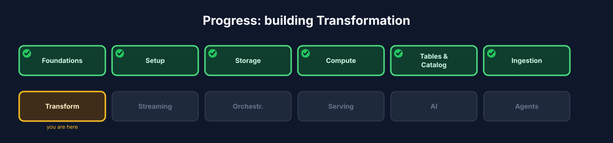
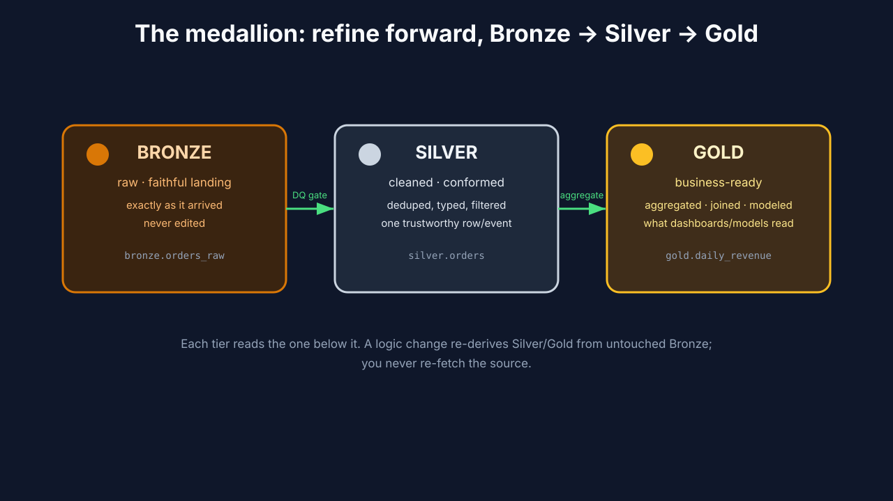
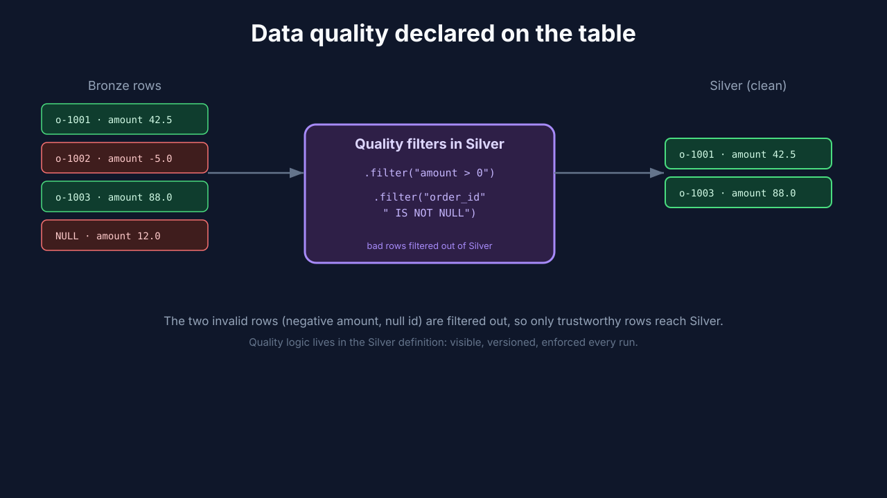
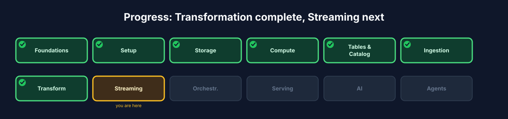

# Chapter 7: Transformation

This is the heart of the lakehouse. You have raw orders in Bronze (Chapter 6); now you refine them into clean Silver and business-ready Gold, the medallion pattern. And you'll build it the modern way, with Spark Declarative Pipelines (SDP), where you declare each table and its dependencies and let the engine figure out the execution graph and incremental refresh. You describe the what; SDP handles the how.

This is the chapter people remember, because it's where raw data becomes useful. Bronze is faithful but ugly: duplicates, nulls, inconsistent casing, no aggregation. Nobody builds a dashboard on Bronze. The medallion is the assembly line that turns that raw material into something a business analyst, a dashboard, or a model can actually trust and use. And by building it declaratively, you write dramatically less plumbing than the old hand-scripted way, which is exactly how modern data teams work.



**Figure 7.1**. Progress map with **Transformation** highlighted.

## Learning objectives

By the end of this chapter you'll be able to:

- Explain the medallion architecture: Bronze to Silver to Gold, and what each tier is for.
- Explain what Spark Declarative Pipelines are and how they differ from hand-written pipeline scripts.
- Declare Silver and Gold datasets with dependencies and let SDP derive the graph.
- Enforce data quality inside a dataset definition, and know what OSS SDP does and does not give you here.

## The medallion: Bronze to Silver to Gold

> **Medallion (Bronze/Silver/Gold)** *(canonical term)*: a layered refinement pattern, raw (Bronze) to cleaned and conformed (Silver) to aggregated, business-ready (Gold).

Each tier has one job:

- **Bronze**: raw, faithful landing (built in Chapter 6). Never edited.
- **Silver**: cleaned and conformed. Valid types, deduplicated, bad rows filtered, columns standardized. One trustworthy row per real-world event.
- **Gold**: business-ready. Aggregated, joined, modeled for how people actually consume it (for example, daily revenue by status). This is what dashboards and models read.

Why three tiers and not one big "clean it all up" step? Because each tier serves a different audience and changes at a different rate, and separating them makes the whole pipeline more robust and reusable. Think of an ore refinery: Bronze is the raw ore straight from the mine (kept exactly as dug), Silver is the refined metal (impurities removed, standardized into ingots), and Gold is the finished product (shaped into exactly what a customer ordered). You could try to go from ore to finished product in one giant step, but then every product change means re-mining. By keeping distinct tiers, a new Gold table (say, "revenue by customer region") just reads the existing trustworthy Silver, with no re-cleaning and no re-ingesting.

There's a practical reuse point hiding here. Silver is shared infrastructure: many different Gold tables read from the same clean Silver. You clean and deduplicate orders once in Silver, and then build a dozen business views on top. If you cleaned inside each Gold table instead, you'd repeat that logic a dozen times and they'd inevitably drift apart. Clean once in Silver; aggregate many ways in Gold.

You refine forward, each tier reading the one below it, so a logic change means re-deriving Silver and Gold from the untouched Bronze, never re-fetching the source. This is the ELT golden rule from Chapter 6 paying off: because Bronze is a faithful, permanent record, you can rebuild everything above it whenever your understanding improves.



**Figure 7.2**. Bronze (raw) to Silver (clean/conform) to Gold (aggregate/model), each tier reading the one below, with quality filtering between them.

## What Spark Declarative Pipelines are

> **Spark Declarative Pipelines (SDP)** *(canonical term)*: a framework (`pyspark.pipelines`, shipped with Spark 4.1+) where you declare the datasets that make up a pipeline and their dependencies; the engine derives the execution order and handles incremental refresh.

With a hand-written script you'd have to sequence the steps yourself, wire up dependencies, and decide what to recompute. SDP flips that: you write one function per dataset, decorated to say "this is the `silver.orders` materialized view," and reference other tables by reading them. SDP reads all the declarations, builds the dependency graph, and runs them in the right order: the same declarative model that makes tools like dbt so productive, but native to Spark and built on Spark Connect (Chapter 4).

The distinction between imperative and declarative is worth making crisp, because it's the core idea of the chapter. Imperative means you write the exact steps in order: "first build Silver, then build Gold, and if Silver changed also rebuild Gold." You're the one holding the whole sequence in your head. Declarative means you describe the desired result, "Silver is Bronze cleaned; Gold is Silver aggregated," and let the engine figure out the order, the dependencies, and what needs recomputing. It's the difference between giving someone turn-by-turn driving directions (imperative) and just giving them the destination address and a GPS (declarative). As pipelines grow to dozens or hundreds of tables, holding the imperative sequence in your head becomes impossible; the declarative approach scales because the engine does the bookkeeping.

Two primitives cover almost everything you'll do:

- `@dp.materialized_view`: a batch dataset, fully recomputed from its inputs each run. This is what Silver and Gold are in a batch medallion.
- `@dp.table`: a streaming table, fed incrementally by a streaming read. You'll use this in Chapter 8 when the same Silver is fed from Kafka.

Dependencies are not passed as arguments and are never called by you. SDP infers them from the reads inside each function: if `gold.daily_revenue`'s function reads `iceberg.silver.orders`, SDP knows Gold depends on Silver.

### Under the hood: SDP runs on Spark Connect

`pyspark.pipelines` runs on Spark Connect machinery. That's why we standardized on Connect back in Chapter 4: the transformation layer is built on it. The `spark-pipelines` CLI accepts `--remote sc://host:15002` to target your running Connect server, so your pipeline definitions execute on the same remote engine as everything else. Everything you learned about the thin-client model applies directly.

## Build: declare the medallion pipeline

SDP projects have a standard shape, and the tooling scaffolds it for you. Back in Chapter 2 you left a `pipelines/` folder empty for exactly this moment.

**Step 1: scaffold the pipeline project.** Install the pipelines extra on your host (the same thin-client idea as the rest of the course), then let SDP create the project structure:

```bash
pip install 'pyspark[pipelines]'
cd pipelines
spark-pipelines init --name medallion
```

That creates a `medallion/` subdirectory with a `spark-pipeline.yml` spec and a `transformations/` folder holding example definitions. Delete the two example files in `transformations/`; you'll write your own.

**Step 2: point the spec at your catalog.** Edit `medallion/spark-pipeline.yml` so the pipeline writes into your Iceberg catalog and finds your transformation files:

```yaml
name: medallion
catalog: iceberg
storage: file:///tmp/medallion-storage
libraries:
  - glob:
      include: transformations/**
```

The `catalog` is the Unity Catalog OSS catalog you built in Chapter 5. `storage` is a local directory SDP uses for streaming-table checkpoints and pipeline state. `libraries` tells SDP where your dataset definitions live.

**Step 3: declare the datasets.** Create `medallion/transformations/medallion.py`. Each function returns a DataFrame and is registered as a dataset; dependencies are expressed by reading other tables with `spark.read.table(...)`.

```python
from pyspark import pipelines as dp
from pyspark.sql import SparkSession, functions as F

# SDP loads this file directly, so bind the active session explicitly;
# nothing injects `spark` into a transformations module for you.
spark = SparkSession.active()


# SILVER: clean and conform the raw Bronze orders.
@dp.materialized_view(name="silver.orders")
def silver_orders():
    return (
        spark.read.table("iceberg.bronze.orders_raw")
        .filter("order_id IS NOT NULL")          # quality: must have a key
        .filter("amount > 0")                    # quality: drop bad amounts
        .dropDuplicates(["order_id"])            # one row per order
        .withColumn("status", F.lower(F.col("status")))   # conform casing
        .withColumn("created_at", F.to_timestamp("created_at"))  # type the timestamp
        .select("order_id", "customer_id", "amount", "status", "created_at")
    )


# GOLD: daily revenue by status, business-ready.
@dp.materialized_view(name="gold.daily_revenue")
def gold_daily_revenue():
    return (
        spark.read.table("iceberg.silver.orders")
        .withColumn("order_date", F.to_date("created_at"))
        .groupBy("order_date", "status")
        .agg(F.sum("amount").alias("revenue"),
             F.count("*").alias("order_count"))
    )
```

**What just happened?** Read the two functions and notice what's absent: nowhere do you say "run Silver before Gold," and you never call these functions yourself. `gold_daily_revenue` reads `iceberg.silver.orders`, and that read is the dependency. SDP scans the declarations, sees that Gold depends on Silver (which depends on Bronze), and infers the whole graph. You wrote what each dataset is, not when to build it. That's the declarative model in one screen of code.

**Step 4: run the pipeline against your Connect server.** From inside the project, SDP auto-discovers the spec:

```bash
cd medallion
spark-pipelines run --remote sc://localhost:15002
```

Expected: SDP reports the resolved graph and materializes `iceberg.silver.orders`, then `iceberg.gold.daily_revenue`. You did not sequence them; SDP inferred that Gold depends on Silver, which depends on Bronze. (Use `spark-pipelines dry-run` first if you want SDP to validate the graph and schemas without reading or writing anything.)

**What just happened?** SDP did the orchestration you'd otherwise hand-code. It resolved the graph, ran Silver first (applying the quality filters), then ran Gold against the freshly-materialized Silver. If you later add a third dataset that reads Gold, SDP slots it into the graph automatically; you won't touch the run command. This is why declarative pipelines scale: adding a dataset is a local change, not a rewrite of the sequence.

**Step 5: query the Gold table over a thin client.**

```python
from lakehouse.session import get_spark
spark = get_spark()
spark.table("iceberg.gold.daily_revenue").orderBy("order_date", "status").show()
```

Expected output: a small table of `order_date`, `status`, `revenue`, `order_count`. The exact numbers depend on the randomly generated Bronze data from Chapter 6 (around 1000 orders across several statuses), so yours will differ; the shape is what matters:

```
+----------+---------+--------+-----------+
|order_date|   status| revenue|order_count|
+----------+---------+--------+-----------+
|2026-01-05|cancelled| 4821.17|         63|
|2026-01-05|   placed|41235.90|        548|
|2026-01-05|  shipped| 9977.42|        131|
+----------+---------+--------+-----------+
```

**Step 6: see the cleaning actually happen.** The quality filters aren't theoretical, they removed rows. Compare the counts across the three tiers:

```python
spark.table("iceberg.bronze.orders_raw").count()  # ~1000: everything, warts and all
spark.table("iceberg.silver.orders").count()      # fewer: nulls, bad amounts, dupes dropped
# the shrinkage IS the data-quality work, made visible
```

Expected: Silver has visibly fewer rows than Bronze. Chapter 6's generator deliberately injected null `order_id`s, negative `amount`s, and the odd duplicate; the three `.filter`/`.dropDuplicates` lines in `silver_orders` dropped exactly those. The gap between the Bronze and Silver counts is the amount of bad data you kept out of Gold. Spot-check it directly, this should return zero rows, because Silver is clean by construction:

```python
spark.sql("SELECT * FROM iceberg.silver.orders WHERE amount <= 0 OR order_id IS NULL").show()
# empty result: no bad rows survived into Silver
```

That empty result is the point of the medallion: Gold's revenue numbers are trustworthy because the bad data was filtered out one tier below, and you can prove it with a query rather than take it on faith.

**What just happened?** You're reading a business-ready table: daily revenue and order counts by status. Trace its lineage in your head. These numbers came from Silver (clean, deduplicated orders), which came from Bronze (the raw landing), which came from the generator standing in for a source system. That full path, from raw event to business metric, is the entire data engineering flow in miniature, and you built it declaratively.

## Data quality in OSS Spark Declarative Pipelines

> **Data quality** *(canonical term)*: checks that data meets expectations before it's trusted downstream.

Look again at the Silver definition. The two `.filter(...)` calls are the data-quality enforcement: a row with no `order_id` or a non-positive `amount` never reaches Silver. The quality logic lives right in the dataset definition, so it's visible, versioned with the code, and enforced on every run. There's no separate validation job to forget.

It's worth being honest about a distinction here, because the Databricks documentation you'll find online describes something OSS doesn't have. Databricks' managed pipelines (the product formerly called DLT) ship a declarative expectations API: decorators like `@expect_or_drop` and `@expect_or_fail` that attach named rules to a dataset and track how many rows each one dropped. That API is Databricks-only. The open-source `pyspark.pipelines` that you're running does not include it. In OSS, you express the same intent with ordinary DataFrame operations: filter to drop bad rows, and raise an error in the function to fail the run.

The design decision behind the filters is the same one you'd make either way, so think it through:

- **Drop the row** (a `.filter(...)`, as above). Good when a few malformed records shouldn't block the whole pipeline and you're fine excluding them from downstream tables. Remember the dropped rows still exist in Bronze, which is exactly why Bronze fidelity matters.
- **Fail the run** (check a condition in the function and `raise` if it's violated). Reserve this for conditions that mean something is catastrophically wrong, for example a null primary key in a table that must have one, where continuing would corrupt everything downstream.

The instinct to reach for is: fail loud on things that must never happen; drop on messiness you expect. A null `order_id` where every order must have one could justify a hard failure; a negative `amount` from a known-flaky source is a drop. Encoding these decisions right in the Silver definition means the next engineer sees your data-quality intent without hunting through a separate script.



**Figure 7.3**. Rows flow through the Silver definition's filters; invalid rows are filtered out so only trustworthy rows reach Silver.

## Troubleshooting

- **SDP reports a cycle or can't resolve the graph.** Two datasets read each other, or a function reads a table that isn't declared and doesn't exist. Check that every table you read either exists (like Bronze) or is declared in the pipeline.
- **A dataset materializes empty.** Often an over-strict filter removed every row, or the upstream table was empty. Check your filter conditions and confirm Bronze actually has data.
- **`ModuleNotFoundError: pyspark.pipelines` or `spark-pipelines: command not found`.** The pipelines extra isn't installed, or you're on a Spark older than 4.1. Run `pip install 'pyspark[pipelines]==4.1.0'` (pin the version to match your 4.1 Connect server, since a bare `pip install pyspark` now pulls a newer release) and confirm your version.
- **`spark-pipelines` fails to launch with a Java error.** The CLI starts a JVM under the hood (via `spark-class`), so it needs a JDK (Java 17+) on your host, even though Spark itself runs in a container. This is the one host tool in the course that needs Java; install a JDK if you don't have one.
- **Connect-style error during run.** SDP runs on Spark Connect, so failures surface as Connect errors; read the last line, as in Chapter 4. Confirm `--remote sc://localhost:15002` points at your running Connect server.
- **Tables land in the wrong catalog or schema.** Check `catalog:` in `spark-pipeline.yml` and the schema-qualified `name=` on each dataset (`silver.orders`, `gold.daily_revenue`).

## Checkpoint

- `spark-pipelines init` scaffolded `pipelines/medallion/` with a spec and a `transformations/` folder.
- `medallion.py` declares `silver.orders` and `gold.daily_revenue`, with dependencies expressed by `spark.read.table(...)`.
- `spark-pipelines run --remote sc://localhost:15002` materialized both datasets in the correct order without you sequencing them.
- Silver's `.filter(...)` calls dropped invalid rows.
- Querying `iceberg.gold.daily_revenue` returns aggregated, business-ready results.
- You can explain the difference between imperative and declarative pipelines.

## Try it yourself

1. **Add a Gold table.** Declare a second Gold materialized view, say revenue by `customer_id`, that also reads Silver. Re-run the pipeline and confirm SDP builds it without you changing the run command. That's the "clean once, aggregate many ways" payoff.
2. **Tighten a filter.** Add a quality filter to Silver (for example, `status IN ('placed', 'shipped', 'cancelled')`) and see how many rows it drops. Then relax it and compare.
3. **Make it fail loud.** In the Silver function, after the filters, check a must-hold condition (for example, that the row count is non-zero) and `raise` if it's violated. Introduce a scenario that trips it and watch the run stop. Reflect on when that behavior is what you want.
4. **Trace the lineage.** Pick one number in the Gold output and, in words, trace it back through Silver to Bronze to the generator. Being able to explain "where did this number come from?" is a core data-engineering skill.

## Check your understanding

- What is each medallion tier for, and why keep them separate instead of one big cleanup step?
- Explain "clean once in Silver, aggregate many ways in Gold."
- What's the difference between an imperative and a declarative pipeline? Give the GPS analogy.
- How do you enforce data quality in OSS Spark Declarative Pipelines, and what does OSS not give you that Databricks DLT does?

## Recap and what's next

- The medallion refines data forward: Bronze (raw) to Silver (clean) to Gold (business-ready). Clean once, aggregate many ways.
- Spark Declarative Pipelines let you declare datasets and dependencies; the engine derives the graph and refresh, built on Spark Connect.
- Data quality lives in the dataset definition as ordinary filters (drop) or raised errors (fail). The named-expectations API is a Databricks feature, not part of OSS.
- **Next, Chapter 8, Streaming:** feed the same Silver continuously from Kafka with a streaming table, and contrast streaming with the batch pipeline you just built.



**Figure 7.4**. Progress map with **Transformation done** and **Streaming** next.
