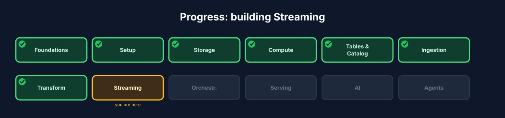
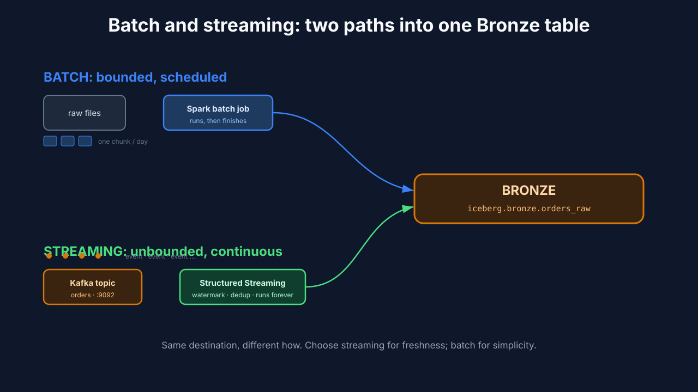
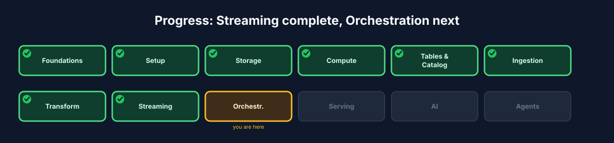

# Chapter 8: Streaming

This is the real-time path. In Chapter 6 you ingested a bounded batch of orders. Now you'll feed the same Bronze table continuously: orders arrive as an event stream on Kafka, and a Spark Structured Streaming job lands them into Iceberg as they happen. You'll handle the hard parts of streaming honestly, unbounded data, late events with watermarks, and exactly-once deduplication. Then you'll go one step further than landing events: a second streaming job keeps its own state for every customer, using Spark's `transformWithState`, and writes one row per customer visit to an Iceberg Gold table.

Streaming is where a lot of learners get intimidated, and understandably: "process data that never stops arriving, in the right order, exactly once, even when things fail" sounds daunting. It's not, once you have the right mental model, and building it here demystifies a topic that reads like black magic in job descriptions. The reassurance up front: streaming in Spark uses the same DataFrame API you already know. If you can write a batch transformation, you're most of the way to a streaming one.



**Figure 8.1**. Progress map with **Streaming** highlighted.

## Learning objectives

By the end of this chapter you'll be able to:

- Explain what an event stream and unbounded data are.
- Read from a Kafka topic with Spark Structured Streaming and write to Iceberg.
- Use a watermark to bound state and handle late-arriving events.
- Deduplicate a stream so the same event isn't landed twice.
- Keep your own per-key state across micro-batches with `transformWithState`, and close it with event-time timers.
- Stop a streaming query that runs on a Spark Connect server, and restart it from its checkpoint.
- Decide when streaming is the right tool versus batch.

## Streaming vs. batch

> **Streaming** *(canonical term)*: processing unbounded data continuously, as each event arrives, rather than in scheduled bounded chunks.

> **Event stream** *(canonical term)*: an unbounded, ordered sequence of records, here a Kafka topic of order events.

Batch asks "process today's orders." Streaming asks "process each order the moment it appears, forever." The data never ends, it's unbounded, so a streaming job is a long-running process, not a script that finishes. You choose streaming when freshness matters (fraud checks, live dashboards, alerting); you choose batch when periodic is fine and simplicity wins. Crucially, both can feed the same Bronze table: streaming is a different how, not a different destination.

The honest trade-off, stated plainly: streaming buys you freshness and costs you simplicity. A batch job starts, processes a known chunk, and stops, easy to reason about, easy to retry, easy to test. A streaming job runs forever, holds state, must cope with events arriving out of order and late, and can never just "start over" cleanly. That complexity is worth paying when minutes or seconds matter; a fraud check that runs nightly is useless. It's not worth paying when a daily refresh is fine. A common and healthy instinct in the industry: default to batch; reach for streaming only when the freshness requirement genuinely demands it. Plenty of "real-time" requirements turn out to be "within an hour is fine," which batch handles with far less operational burden.



**Figure 8.2**. Batch lands bounded chunks on a schedule; streaming lands individual events continuously. Both write to the same Iceberg Bronze table.

### Under the hood: a stream is really a table that never stops growing

Spark's Structured Streaming has a beautifully simple core idea: treat the unbounded stream as an unbounded table that new rows keep getting appended to. Your streaming query is conceptually the same query you'd write against a static table; Spark just re-runs it incrementally as new rows arrive, in small micro-batches. This is why the API is identical to batch: in Spark's model, a stream literally is a table, just one that's never finished. Hold onto this mental image; it's what makes streaming feel manageable instead of alien.

## The streaming challenges: order, lateness, duplicates

Real streams are messy. Events arrive out of order and late (a phone was offline; a retry fired an hour later), and the same event can arrive twice (an at-least-once producer). A correct streaming job must handle all three.

To make this concrete: imagine a customer places an order on a train, loses signal in a tunnel, and their phone re-sends the order three times over the next ten minutes as it reconnects. Your stream now has the same order arriving three times, out of order relative to other customers' orders, and later than when it was actually placed. A naive job would land three duplicate orders. A correct job lands exactly one, dated to when the order was really placed. The tools for that are watermarks and deduplication.

> **Watermark** *(canonical term)*: the streaming engine's moving clock, "I will not wait for events older than this," which bounds how much state is kept and decides when late data is too late to include.

> **Dedup / idempotency** *(canonical term)*: dropping repeated events (by key plus event time) so each real event lands exactly once.

Without a watermark, the engine would have to remember every event forever to catch possible late-arrivers, unbounded state, eventual crash. The watermark says "after this much lateness, stop waiting," letting Spark drop old state safely.

Think of the watermark as a restaurant's kitchen closing time. The kitchen will happily serve you if you order a little late, but at some point it closes; it can't stay open all night on the chance one more diner shows up. The watermark is that closing time for late data: "I'll accept events up to 10 minutes late, but after that the kitchen's closed and I've cleaned up." Without a closing time, the kitchen (your job's memory of past events) would have to stay staffed forever, which is impossible. The watermark is the promise that lets Spark forget old state and keep running indefinitely.

Concretely, Spark computes the watermark at the end of each micro-batch as the latest event time it has seen minus the allowed lateness, and applies it to the next micro-batch. One consequence you'll meet later in this chapter: the very first micro-batch runs before any watermark exists, so it accepts everything, however late.

### Under the hood: Structured Streaming on Connect

Structured Streaming runs through the same Spark Connect server you started in Chapter 4 (Spark Connect has supported streaming since Spark 3.5.0). The streaming DataFrame API is identical to batch, `readStream`/`writeStream` instead of `read`/`write`, so everything you learned transfers directly. Your streaming code is a thin client shipping a plan to the same remote engine, just one that runs continuously.

That last point has a practical edge. The query runs on the Connect server, not in your Python process. If your client exits without stopping the query, the query keeps running on the server: on this stack, a stream whose client was interrupted kept writing to Bronze for as long as it was watched. The server only cleans it up when it closes the abandoned session, after `spark.connect.session.manager.defaultSessionTimeout` (60 minutes by default) with no requests from the client. The streaming modules in this chapter therefore stop their own query when you press Ctrl-C.

## Build: stream orders from Kafka into Bronze

Streaming adds one new service, Kafka, the event streaming platform that holds the `orders` topic and buffers events between the producer and your Spark job. Kafka needs a coordination service (Zookeeper here), and because every other service in this course runs on the bridge network, Kafka does too.

**Step 1: add Kafka to your Compose file.** The one subtlety is listeners. Your Spark Connect server reaches Kafka from inside the network at `kafka:9092`, but a producer you run from your host reaches it on a published port at `localhost:29092`. Kafka has to advertise both, which is what the dual-listener config below does.

```yaml
  zookeeper:
    image: confluentinc/cp-zookeeper:7.5.0
    environment:
      ZOOKEEPER_CLIENT_PORT: 2181
      ZOOKEEPER_TICK_TIME: 2000
    volumes:
      - zookeeper-data:/var/lib/zookeeper/data
      - zookeeper-log:/var/lib/zookeeper/log
    networks:
      - lakehouse-network

  kafka:
    image: confluentinc/cp-kafka:7.5.0
    depends_on:
      - zookeeper
    ports:
      - "29092:29092"      # host access; in-network peers use kafka:9092
    environment:
      KAFKA_BROKER_ID: 1
      KAFKA_ZOOKEEPER_CONNECT: zookeeper:2181
      KAFKA_LISTENER_SECURITY_PROTOCOL_MAP: INTERNAL:PLAINTEXT,EXTERNAL:PLAINTEXT
      KAFKA_LISTENERS: INTERNAL://0.0.0.0:9092,EXTERNAL://0.0.0.0:29092
      KAFKA_ADVERTISED_LISTENERS: INTERNAL://kafka:9092,EXTERNAL://localhost:29092
      KAFKA_INTER_BROKER_LISTENER_NAME: INTERNAL
      KAFKA_OFFSETS_TOPIC_REPLICATION_FACTOR: 1
    volumes:
      - kafka-data:/var/lib/kafka/data   # topics + messages survive a recreate
    networks:
      - lakehouse-network
```

Bring them up and confirm Kafka is healthy:

```bash
docker compose up -d zookeeper kafka
docker compose ps
docker compose logs kafka | grep "started (kafka.server.KafkaServer)"
```

The last command should print one line ending in `started (kafka.server.KafkaServer)`; give it a few seconds after `up` if it doesn't yet.

Add the three volumes to the top-level `volumes:` block, next to the others:

```yaml
volumes:
  # ...the volumes from earlier chapters...
  zookeeper-data:
  zookeeper-log:
  kafka-data:
```

Without them, the topic and every message in it live inside the container, so the next `docker compose down` / `up` (Chapter 13) brings Kafka back empty. Your stream's checkpoint would then point at offsets in a topic that no longer exists, and the stream fails on restart with `UnknownTopicOrPartitionException`.

Now create the `orders` topic explicitly, once:

```bash
docker compose exec kafka kafka-topics --bootstrap-server kafka:9092 \
    --create --if-not-exists --topic orders --partitions 1 --replication-factor 1
# Created topic orders.
```

Kafka will auto-create a topic the first time a producer writes to it, but the streaming job in Step 3 subscribes to `orders` and fails with `UnknownTopicOrPartitionException` if it starts before any producer has written. Creating the topic up front removes that race, and makes the topic's settings (one partition, no replication, fine for a laptop) something you chose rather than a default you inherited.

**What just happened?** You started Kafka, the durable pipe between a source and your streaming job. The dual-listener setup is the Chapter 2 networking lesson again: `kafka:9092` is the address inside the Compose network (what Spark will use), `localhost:29092` is the published address for clients on your host (what the producer below will use). Mixing these up is the single most common Kafka-on-Docker mistake.

Put both addresses in your config, next to the others, so no module hardcodes either one. Add to `lakehouse/config.py`:

```python
# Kafka has two addresses (Chapter 8): the host-side listener for clients on your
# laptop, and the in-network listener for code that runs on the Spark cluster.
KAFKA_BOOTSTRAP        = os.environ.get("KAFKA_BOOTSTRAP", "localhost:29092")
KAFKA_BOOTSTRAP_SPARK  = os.environ.get("KAFKA_BOOTSTRAP_SPARK", "kafka:9092")
CHECKPOINT_PREFIX      = os.environ.get("CHECKPOINT_PREFIX", "s3a://lakehouse/_checkpoints")
```

**Step 2: produce a live stream of order events.** In production this would be your application emitting events. To keep it self-contained, add a producer module, `lakehouse/stream_source.py`, the streaming counterpart to the batch `generate.py`. Like the batch generator, it's deliberately imperfect, because the train-in-the-tunnel scenario from earlier is exactly what the watermark and dedup are for: now and then it re-sends an event it already sent (an at-least-once producer retrying), and now and then it sends an event stamped three minutes in the past (a phone that was offline). It also models how people shop: a handful of customers are "in the store" at any moment, each places a few orders a few seconds apart and then leaves, and a new customer walks in. You won't need that until the stateful job later in the chapter, which turns those visits into rows. Install the Kafka client first:

```bash
pip install kafka-python
```

```python
# lakehouse/stream_source.py
"""Stand-in for an application emitting order events to Kafka, warts and all:
some events are re-sent (an at-least-once producer retrying) and some arrive
late (a phone that was offline). Customers shop in visits: a few orders a few
seconds apart, then they leave. `python -m lakehouse.stream_source`"""
import json
import random
import time
from datetime import datetime, timedelta, timezone

from kafka import KafkaProducer

from lakehouse.config import KAFKA_BOOTSTRAP

STATUSES = ["placed", "placed", "placed", "shipped", "cancelled"]
SHOPPERS = 8          # customers in the store at any moment
VISIT_ORDERS = (1, 5)  # orders per visit, inclusive


def produce(rate_per_sec: float = 5.0, limit: int | None = None, topic: str = "orders",
            seed: int | None = None) -> None:
    rng = random.Random(seed)
    producer = KafkaProducer(
        bootstrap_servers=KAFKA_BOOTSTRAP,          # host-side listener
        value_serializer=lambda v: json.dumps(v).encode("utf-8"),
    )
    # customer_id -> orders left in this visit
    in_store = {}
    recent = []                                      # recently sent events, for re-sends
    i = 0
    while limit is None or i < limit:
        i += 1
        while len(in_store) < SHOPPERS:              # new customers walk in
            in_store[f"c-{rng.randint(1, 200)}"] = rng.randint(*VISIT_ORDERS)
        customer = rng.choice(sorted(in_store))
        now = datetime.now(timezone.utc)
        roll = rng.random()
        if roll < 0.05 and recent:
            event, kind = rng.choice(recent), "RESEND"        # duplicate delivery
        else:
            created = now - timedelta(minutes=3) if roll < 0.10 else now
            event = {
                "order_id": f"o-s{int(time.time() * 1000)}-{i}",
                "customer_id": customer,
                "amount": round(rng.uniform(5, 500), 2),
                "status": rng.choice(STATUSES),
                "created_at": created.isoformat(timespec="milliseconds"),
            }
            kind = "late" if roll < 0.10 else "sent"
            recent = (recent + [event])[-50:]
            in_store[customer] -= 1
            if in_store[customer] == 0:              # visit over: they leave
                del in_store[customer]
        producer.send(topic, event)
        print(f"{kind:>6} {event['order_id']}  {event['customer_id']:<6} created_at={event['created_at']}")
        time.sleep(1.0 / rate_per_sec)
    producer.flush()


if __name__ == "__main__":
    produce()
```

Run it in its own terminal and leave it running:

```bash
python -m lakehouse.stream_source
#   sent o-s1794004640422-1  c-115  created_at=2026-11-06T22:37:20.422+00:00
#   sent o-s1794004640623-2  c-138  created_at=2026-11-06T22:37:20.623+00:00
#   sent o-s1794004640723-3  c-144  created_at=2026-11-06T22:37:20.723+00:00
# ...
# RESEND o-s1794004640924-5  c-144  created_at=2026-11-06T22:37:20.924+00:00
# ...
#   late o-s1794004642727-23  c-76   created_at=2026-11-06T22:34:22.727+00:00
# ...
```

(kafka-python may print a `DeprecationWarning` about `value_serializer`; it's harmless.)

**What just happened?** The producer publishes an order event roughly every 200 ms into the `orders` topic you created. Each line tells you what kind of event it was: `sent` is a normal event, `late` is one whose `created_at` is three minutes old, and `RESEND` is a duplicate of an event already sent, same `order_id` and all. The second column is the customer, and you can watch the same few customers recur while they're in the store. Kafka durably holds every event, duplicates included; Kafka moves bytes, it doesn't judge them. If your streaming consumer is down for a while, the events wait for it rather than being lost. The producer connects on `localhost:29092` because it runs on your host, outside the Compose network. `produce()` also takes a `seed`, which makes the sequence of customers, amounts and statuses repeatable (the timestamps still come from the clock).

**Step 3: write the streaming ingest.** The consumer is a module too, `lakehouse/stream_ingest.py`, so it can be started, stopped, and restarted like any other part of the project. Read it top to bottom; the next two steps walk through what each part does.

```python
# lakehouse/stream_ingest.py
"""Kafka -> Structured Streaming -> the SAME Bronze table the batch ingest writes.
`python -m lakehouse.stream_ingest` (long-running; Ctrl-C stops it)."""
from pyspark.sql import functions as F
from pyspark.sql.types import DoubleType, StringType, StructField, StructType, TimestampType

from lakehouse.config import CATALOG, CHECKPOINT_PREFIX, KAFKA_BOOTSTRAP_SPARK
from lakehouse.ingest import BRONZE
from lakehouse.session import get_spark

EVENT_SCHEMA = StructType([
    StructField("order_id", StringType()), StructField("customer_id", StringType()),
    StructField("amount", DoubleType()),   StructField("status", StringType()),
    StructField("created_at", TimestampType()),
])

CHECKPOINT = f"{CHECKPOINT_PREFIX}/bronze_orders_stream"


def start(starting_offsets: str = "latest"):
    spark = get_spark("orders-stream")
    # The dedup state is split into shuffle partitions, and each one writes its own
    # files to the checkpoint on every micro-batch. The default (200) is sized for
    # big batch jobs; for a trickle of events it just litters the bucket.
    spark.conf.set("spark.sql.shuffle.partitions", "4")

    raw = (spark.readStream
           .format("kafka")
           .option("kafka.bootstrap.servers", KAFKA_BOOTSTRAP_SPARK)   # in-network address
           .option("subscribe", "orders")
           .option("startingOffsets", starting_offsets)
           .load())

    # Kafka values are bytes; parse the JSON payload into typed columns.
    events = (raw.select(F.from_json(F.col("value").cast("string"), EVENT_SCHEMA).alias("e"))
                 .select("e.*"))

    deduped = (events
        .withWatermark("created_at", "10 minutes")          # tolerate 10 min lateness
        .dropDuplicatesWithinWatermark(["order_id"]))        # one row per order_id

    # Match Bronze's schema exactly: created_at stays a string (faithful capture),
    # plus the same ingestion-metadata columns the batch job adds.
    bronze = (deduped
        .withColumn("created_at",   F.date_format("created_at", "yyyy-MM-dd'T'HH:mm:ss.SSS"))
        .withColumn("_ingested_at", F.current_timestamp())
        .withColumn("_source",      F.lit("orders-stream"))
        .withColumn("_ingest_date", F.to_date("_ingested_at")))

    return (bronze.writeStream
        .format("iceberg")
        .outputMode("append")
        .trigger(processingTime="10 seconds")               # one Iceberg commit per 10s
        .option("checkpointLocation", CHECKPOINT)
        .toTable(BRONZE))


if __name__ == "__main__":
    query = start()
    print("streaming into", BRONZE, "- checkpoint", CHECKPOINT)
    try:
        query.awaitTermination()
    except KeyboardInterrupt:
        # The query runs on the Connect server, not in this process: leaving
        # without stop() would leave it running there.
        query.stop()
```

**Reading from Kafka.** `readStream` instead of `read` is the one word that turns a batch source into a streaming one; everything after it is the familiar DataFrame API. The read runs on the Connect server, so it uses the in-network address `kafka:9092` (from `KAFKA_BOOTSTRAP_SPARK`). Kafka hands you raw bytes in a `value` column, so you parse the JSON payload into real typed columns with `from_json` and the declared `EVENT_SCHEMA`; giving the data structure is your job on the read side. (The Kafka source itself is the `spark-sql-kafka` package, which the Connect server fetches at startup from the `spark.jars.packages` line you added in Chapter 4.)

**Watermark, dedup, write.** This is the train-in-the-tunnel scenario handled in a few lines. `withWatermark("created_at", "10 minutes")` sets the kitchen's closing time: accept events up to 10 minutes late. The producer's late events are three minutes old, well inside it, so they land. `dropDuplicatesWithinWatermark(["order_id"])` lands each `order_id` once even when the producer sends it twice. Then the rows are shaped to match the Bronze table the batch job created in Chapter 6: `created_at` goes back to a string (faithful capture), and the same `_ingested_at` / `_source` / `_ingest_date` metadata columns are added. The string has no offset; the producer stamps times in UTC, the parsed timestamp is formatted in the session time zone, and the server's session time zone is UTC (Chapter 4), so Bronze's streamed `created_at` values are UTC like the batch ones. The `_source` is `orders-stream`, which puts these rows in their own partitions, so a batch re-ingest of today (Chapter 6's partition-by-source decision) can never overwrite them. `trigger(processingTime="10 seconds")` gathers events into one micro-batch, and so one Iceberg commit, every 10 seconds; without a trigger, Spark starts a new micro-batch as soon as the last finishes, which on a table means a stream of tiny commits and tiny files. Finally, `toTable(BRONZE)` writes to the same `iceberg.bronze.orders_raw` the batch job writes: streaming is a different how, same destination.

The `spark.conf.set("spark.sql.shuffle.partitions", "4")` line at the top of `start()` comes from watching this job run. Deduplication is stateful: Spark remembers recently seen `order_id`s, and that state is split into shuffle partitions, each of which writes its own small files into the checkpoint on every micro-batch. With Spark's default of 200 partitions (sized for big batch jobs), a few minutes of a slow trickle left thousands of tiny objects under the checkpoint's `state/` folder. Four is plenty for a few events a second. Note that the setting is fixed into a query's checkpoint the first time it starts; changing it later requires a fresh checkpoint.

The last lines are the Connect lesson from earlier in the chapter. `awaitTermination()` blocks until the query ends, and Ctrl-C raises `KeyboardInterrupt` in your client. The `except` branch catches it and calls `query.stop()`, which stops the query on the server. Without it, Ctrl-C would end your Python process and leave the query running there.

**Step 4: start the stream.** In a second terminal (leave the producer running in the first):

```bash
python -m lakehouse.stream_ingest
# streaming into iceberg.bronze.orders_raw - checkpoint s3a://lakehouse/_checkpoints/bronze_orders_stream
```

It then sits there: this job never finishes on its own. It runs until you press Ctrl-C, which stops the query on the server and exits.

**Step 5: from another client, watch the Bronze count climb as events flow.** Open a third terminal with a Python session (leave the producer and the stream running) and run the counts a few times, ten seconds or so apart:

```python
from lakehouse.session import get_spark
spark = get_spark()
bronze = spark.table("iceberg.bronze.orders_raw")
bronze.count(), bronze.where("_source = 'orders-stream'").count()
# (1095, 75)    <- the batch rows from Chapter 6, plus the first streamed events
# (1141, 121)   <- ten seconds later
# (1189, 169)   <- and climbing, roughly 5 a second
```

Your exact numbers depend on how many days you batch-ingested in Chapter 6 and when you started the stream; what matters is that the first number starts at your batch total and climbs in steps every ten seconds (one micro-batch, one commit).

**What just happened?** Two things, and the second is the real lesson. First, the number climbs, proof the stream is live: events flow from the producer, through Kafka, through your Structured Streaming job, into Iceberg, in near-real-time. Second, look at where it *started*: your batch rows from Chapter 6. The stream is appending into the **same** `iceberg.bronze.orders_raw` table the batch job wrote. One Bronze table, fed by both a scheduled batch job and a continuous stream, and a downstream reader can't tell which rows arrived which way (unless it looks at `_source`). One stack, not two.

**Step 6: prove the dedup worked.** The producer has been re-sending events the whole time, so if dedup were broken you'd see the same `order_id` more than once:

```python
spark.sql("""
    SELECT count(*) AS rows, count(DISTINCT order_id) AS ids
    FROM iceberg.bronze.orders_raw WHERE _source = 'orders-stream'
""").show()
# +----+---+
# |rows|ids|
# +----+---+
# | 263|263|
# +----+---+
```

`rows` equals `ids`: every order landed exactly once even though Kafka holds duplicates. You can compare against what's actually in the topic: `docker compose exec kafka kafka-run-class kafka.tools.GetOffsetShell --broker-list kafka:9092 --topic orders` prints `orders:0:<n>`, the number of messages Kafka holds, which is larger than `rows` by the re-sends (plus whatever arrived after the last micro-batch).

## Why the checkpoint matters

The `checkpointLocation` is what makes a streaming job restartable and idempotent across failures: it durably records which Kafka offsets have been processed and the watermark state. Stop the job and restart it, and it resumes from the last committed offset; it will not skip events or double-write them. Delete the checkpoint and it starts over. Treat the checkpoint as part of your data: one checkpoint per streaming query, never shared.

Don't take that on faith either, look at what the checkpoint wrote. List its location in the bucket while the stream runs:

```bash
aws --endpoint-url http://localhost:8333 s3 ls s3://lakehouse/_checkpoints/bronze_orders_stream/
#                            PRE commits/     <- which micro-batches committed successfully
#                            PRE offsets/     <- the Kafka offsets read up to each micro-batch
#                            PRE sources/     <- the source's own bookkeeping (where Kafka reading began)
#                            PRE state/       <- the watermark + dedup state (dropDuplicatesWithinWatermark)
# 2026-10-12 12:06:21     45 metadata         <- the stream's identity
aws --endpoint-url http://localhost:8333 s3 ls s3://lakehouse/_checkpoints/bronze_orders_stream/offsets/
# one small file per micro-batch: 0, 1, 2, ...
```

Those are the stream's memory. `offsets/` is the bookmark into Kafka ("I've read up to here"); `commits/` records which batches finished; `state/` holds the in-flight watermark and the set of recently-seen `order_id`s used for dedup. On restart, Spark reads `offsets/` and `commits/` to find exactly where it left off and `state/` to restore the dedup window. Delete this directory and all of that memory is gone, so the next start reads the topic from scratch.

This is the streaming equivalent of the idempotency you built in Chapter 6, and it matters for the same reason: things fail, and recovery must be safe. A batch job retries by re-running a bounded chunk. A streaming job can't "re-run", it never stopped, so instead it remembers its exact position (the Kafka offsets) and its in-flight state (the watermark) in the checkpoint. Never point two different queries at the same checkpoint location, and never delete it unless you truly mean "start this stream over from scratch."

### Under the hood: why a restart can't write a micro-batch twice

The checkpoint covers the reading side. The writing side is Iceberg's. Every commit the stream makes records the query's id and the micro-batch number (Spark calls it the epoch) in the snapshot's summary. Read the latest Bronze snapshot through the catalog's REST API (Chapter 5 explains why not through Spark's metadata tables on this version of Unity Catalog):

```bash
curl -s http://localhost:8081/api/2.1/unity-catalog/iceberg/v1/catalogs/iceberg/namespaces/bronze/tables/orders_raw \
  | python3 -c "import sys,json; m=json.load(sys.stdin)['metadata']; s=max(m['snapshots'], key=lambda s: s['timestamp-ms'])['summary']; print({k: s[k] for k in ('operation', 'added-records', 'spark.sql.streaming.queryId', 'spark.sql.streaming.epochId')})"
# {'operation': 'append', 'added-records': '43', 'spark.sql.streaming.queryId': '586887db-e731-4a2c-9758-d5b7aa71e543', 'spark.sql.streaming.epochId': '20'}
```

Before committing a micro-batch, Iceberg's Spark writer looks up the last epoch it committed for that query id and skips the commit if this epoch is not newer (`SparkWrite.commit` in Iceberg's Spark module). So if a crash lands between "files written and committed to the table" and "batch marked done in the checkpoint", the restarted query re-runs that micro-batch and Iceberg declines to commit it a second time. Offsets in the checkpoint plus epoch ids in the table is what makes the whole path exactly-once.

Prove it rather than trust it. Stop the stream with Ctrl-C (leave the producer running), note the streamed count, wait half a minute so events pile up in Kafka, then start it again with the same command:

```bash
python -m lakehouse.stream_ingest
```

Re-run the Step 6 query after a micro-batch or two. The count jumps past where it stopped (it caught up on everything produced while it was down), and `rows` still equals `ids`: nothing was skipped and nothing was written twice. That's the checkpoint, plus the dedup state stored inside it, doing its job.

Stop the stream with Ctrl-C when you're done, and leave the producer running for the next section.

## Stateful streaming: one row per customer visit

Deduplication was your first stateful operator, but Spark designed its state for you: a set of recently seen `order_id`s, evicted by the watermark. Plenty of streaming logic needs state of your own shape. A fraud check remembers each card's last few locations; an order tracker remembers where each order is in its lifecycle; a session report remembers what a customer did since they arrived. For that, Spark gives you `transformWithState`: you write a class that keeps any state you want per key, reacts to each micro-batch of rows for that key, and sets timers that call you back later.

The job you'll build turns the order stream into **visits**: a visit is a run of orders from one customer with no quiet gap longer than 15 seconds. For each visit it writes one row, when the visit started and ended, how many orders it had, the revenue from orders that weren't cancelled, and how many were cancelled, to a new Gold table, `iceberg.gold.customer_sessions`.

> **`transformWithState`** *(canonical term)*: Spark's API for arbitrary stateful stream processing. You group a stream by a key and supply a `StatefulProcessor`; Spark calls it with each key's new rows in every micro-batch and keeps its state variables in the state store between micro-batches. Python's row-based version arrived in Spark 4.1.

The pieces you'll use:

- **State variables**, declared in `init()`: a `ValueState` holds one value per key, a `ListState` a list, a `MapState` a map. Each has a schema, and each is stored per key in the **state store**, which is checkpointed with the query.
- **Timers**: `registerTimer(t)` asks Spark to call `handleExpiredTimer` for this key at time `t`. With `timeMode="EventTime"`, `t` is in event time and the timer fires once the watermark passes it.
- **The state store provider**: `transformWithState` requires RocksDB (`RocksDBStateStoreProvider`), an embedded key-value store that keeps state on local disk and uploads it to the checkpoint. The default in-memory provider is rejected with `STORE_BACKEND_NOT_SUPPORTED_FOR_TWS`.

The processor runs in Python workers on the Spark cluster, not in your client, which is why the course's image (Chapter 4) installs Python 3.12 and pyarrow next to Spark: the workers need the same Python minor version as your client.

<figure markdown="span">
  <video autoplay loop muted playsinline controls width="1280" height="720" poster="../../media/clips/stateful-sessions.webp">
    <source src="https://github.com/open-lakehouse/lakehouse-masterclass/releases/download/media-v1/stateful-sessions.mp4" type="video/mp4">
  </video>
  <figcaption>The processor below, step by step: each order updates the visit, its map entry and the timer; a re-sent order lands on the same map key; the visit closes when the watermark passes its timer. The 15-second gap and 10-second watermark are the code's; event times and amounts are schematic.</figcaption>
</figure>

**Step 7: write the processor and its query.** Add `lakehouse/customer_sessions.py`:

```python
# lakehouse/customer_sessions.py
"""Kafka -> transformWithState -> Gold: one row per customer visit.

A visit (a "session") is a run of orders from one customer with no quiet gap
longer than SESSION_GAP. Each customer's open session lives in Spark's state
store between micro-batches; an event-time timer closes it once the watermark
passes the end of the gap, and the closed session is appended to an Iceberg
table. `python -m lakehouse.customer_sessions` (long-running; Ctrl-C stops it)."""
from typing import Iterator

from pyspark.sql import Row, functions as F
from pyspark.sql.streaming import StatefulProcessor, StatefulProcessorHandle

from lakehouse.config import CATALOG, CHECKPOINT_PREFIX, KAFKA_BOOTSTRAP_SPARK
from lakehouse.session import get_spark
from lakehouse.stream_ingest import EVENT_SCHEMA

SESSIONS = f"{CATALOG}.gold.customer_sessions"
CHECKPOINT = f"{CHECKPOINT_PREFIX}/gold_customer_sessions"
SESSION_GAP_MS = 15_000          # 15 s with no order ends a visit
WATERMARK = "10 seconds"         # how late an event may be and still count

# What the processor emits for each closed visit (times as epoch milliseconds;
# converted to timestamps on the way out).
OUTPUT_SCHEMA = ("customer_id STRING, start_ms LONG, end_ms LONG, "
                 "orders INT, revenue DOUBLE, cancelled INT, closed_by STRING")


class CustomerSessions(StatefulProcessor):
    """Per customer_id: the open visit's bounds, and the visit's orders."""

    def init(self, handle: StatefulProcessorHandle) -> None:
        self.handle = handle
        # One row per customer: when the open visit started and its latest order.
        self.visit = handle.getValueState("visit", "start_ms LONG, last_ms LONG")
        # The visit's orders keyed by order_id. A re-sent event writes the same
        # key again, so duplicates are absorbed by the state itself.
        self.orders = handle.getMapState("orders", "order_id STRING",
                                         "amount DOUBLE, status STRING")

    def handleInputRows(self, key, rows, timerValues) -> Iterator[Row]:
        (customer_id,) = key
        for row in sorted(rows, key=lambda r: r.ts_ms):
            if self.visit.exists():
                start_ms, last_ms = self.visit.get()
                if row.ts_ms - last_ms > SESSION_GAP_MS:
                    # A quiet gap before this order: the old visit is over.
                    yield from self._close(customer_id, start_ms, last_ms, "gap")
                    start_ms, last_ms = row.ts_ms, row.ts_ms
                elif row.ts_ms < start_ms - SESSION_GAP_MS:
                    # Older than this visit by more than a gap, so it belongs to
                    # an earlier visit. Once there is a watermark this can't
                    # happen (Spark drops anything more than WATERMARK behind,
                    # and WATERMARK < SESSION_GAP_MS); only the first batches,
                    # before any watermark exists, can deliver one. Skip it.
                    continue
                else:
                    # Same visit, even if it arrived out of order.
                    self.handle.deleteTimer(last_ms + SESSION_GAP_MS)
                    start_ms = min(start_ms, row.ts_ms)
                    last_ms = max(last_ms, row.ts_ms)
            else:
                start_ms = last_ms = row.ts_ms
            self.orders.updateValue((row.order_id,), (row.amount, row.status))
            self.visit.update((start_ms, last_ms))
            # Fires once the watermark passes the end of the quiet gap.
            self.handle.registerTimer(last_ms + SESSION_GAP_MS)

    def handleExpiredTimer(self, key, timerValues, expiredTimerInfo) -> Iterator[Row]:
        (customer_id,) = key
        if self.visit.exists():
            start_ms, last_ms = self.visit.get()
            yield from self._close(customer_id, start_ms, last_ms, "timer")

    def _close(self, customer_id, start_ms, last_ms, closed_by) -> Iterator[Row]:
        values = list(self.orders.values())
        yield Row(customer_id=customer_id, start_ms=start_ms, end_ms=last_ms,
                  orders=len(values),
                  revenue=round(sum(amount for amount, status in values
                                    if status != "cancelled"), 2),
                  cancelled=sum(1 for _, status in values if status == "cancelled"),
                  closed_by=closed_by)
        self.handle.deleteTimer(last_ms + SESSION_GAP_MS)
        self.orders.clear()
        self.visit.clear()


def start(starting_offsets: str = "latest"):
    spark = get_spark("customer-sessions")
    spark.conf.set("spark.sql.shuffle.partitions", "4")
    # transformWithState keeps its state in RocksDB (the default in-memory
    # provider does not support it).
    spark.conf.set("spark.sql.streaming.stateStore.providerClass",
                   "org.apache.spark.sql.execution.streaming.state.RocksDBStateStoreProvider")

    spark.sql(f"CREATE NAMESPACE IF NOT EXISTS {CATALOG}.gold")
    spark.sql(f"""
        CREATE TABLE IF NOT EXISTS {SESSIONS} (
            customer_id STRING, session_start TIMESTAMP, session_end TIMESTAMP,
            orders INT, revenue DOUBLE, cancelled INT, closed_by STRING
        ) USING iceberg PARTITIONED BY (days(session_start))
    """)

    events = (spark.readStream.format("kafka")
              .option("kafka.bootstrap.servers", KAFKA_BOOTSTRAP_SPARK)
              .option("subscribe", "orders")
              .option("startingOffsets", starting_offsets)
              .load()
              .select(F.from_json(F.col("value").cast("string"), EVENT_SCHEMA).alias("e"))
              .select("e.*")
              .withColumn("ts_ms", F.unix_millis("created_at")))

    sessions = (events
        .withWatermark("created_at", WATERMARK)
        .groupBy("customer_id")
        .transformWithState(CustomerSessions(), OUTPUT_SCHEMA,
                            outputMode="Append", timeMode="EventTime")
        .select("customer_id",
                F.timestamp_millis("start_ms").alias("session_start"),
                F.timestamp_millis("end_ms").alias("session_end"),
                "orders", "revenue", "cancelled", "closed_by"))

    return (sessions.writeStream
        .format("iceberg")
        .outputMode("append")
        .trigger(processingTime="10 seconds")
        .option("checkpointLocation", CHECKPOINT)
        .toTable(SESSIONS))


if __name__ == "__main__":
    query = start()
    print("sessionizing into", SESSIONS, "- checkpoint", CHECKPOINT)
    try:
        query.awaitTermination()
    except KeyboardInterrupt:
        # The query runs on the Connect server, not in this process: leaving
        # without stop() would leave it running there.
        query.stop()
```

Walk through it in the order Spark calls it:

- **`init()`** runs once per task before any rows, and declares the state. `visit` is a `ValueState` with two longs, the start and the latest order time of the customer's open visit (in epoch milliseconds, which keeps the arithmetic plain). `orders` is a `MapState` from `order_id` to the order's amount and status. Because it's keyed by `order_id`, a re-sent event writes the same key again and changes nothing: the state itself absorbs duplicates, with no separate dedup step.
- **`handleInputRows()`** gets one customer's new rows in a micro-batch, sorted here by event time. Three cases. If the visit's last order is more than a gap before this row, the old visit is over: emit it and start a new one. If the row is older than the visit's start by more than a gap, it belongs to an earlier visit and is skipped; once a watermark exists Spark has already dropped anything that late (the watermark here, 10 seconds, is shorter than the gap), so only the first micro-batches can deliver one. Otherwise the row joins the visit, even out of order, and can move its start earlier or its end later. Every case that keeps the visit open moves its timer to "latest order plus the gap".
- **`handleExpiredTimer()`** is Spark calling back because the watermark passed a customer's timer: nobody has seen an order from them for a full gap, so the visit closes.
- **`_close()`** builds the output row from the map and then clears the key's state and timer. The `closed_by` column records which path closed the visit: `gap` when the next order arrived in the same micro-batch, `timer` when the watermark did it.
- **`start()`** sets the RocksDB provider for this session, creates the Gold table (partitioned by the day each visit started, Iceberg's hidden partitioning from Chapter 5), reads the same topic as the Bronze stream, and applies the watermark before grouping by customer. `transformWithState` returns rows in `OUTPUT_SCHEMA`; the final `select` turns the millisecond columns into timestamps on the way out.

**Step 8: run it.** In the second terminal (the producer still running in the first):

```bash
python -m lakehouse.customer_sessions
# sessionizing into iceberg.gold.customer_sessions - checkpoint s3a://lakehouse/_checkpoints/gold_customer_sessions
```

Give it a minute, then query the table from your Python session:

```python
spark.sql("""
    SELECT customer_id, session_start, session_end, orders, revenue, cancelled, closed_by
    FROM iceberg.gold.customer_sessions WHERE orders >= 3 ORDER BY session_start LIMIT 4
""").show(truncate=False)
# +-----------+-----------------------+-----------------------+------+-------+---------+---------+
# |customer_id|session_start          |session_end            |orders|revenue|cancelled|closed_by|
# +-----------+-----------------------+-----------------------+------+-------+---------+---------+
# |c-144      |2026-11-06 22:37:20.723|2026-11-06 22:37:21.725|4     |1148.32|0        |timer    |
# |c-167      |2026-11-06 22:37:20.824|2026-11-06 22:37:23.83 |5     |583.07 |3        |timer    |
# |c-48       |2026-11-06 22:37:21.024|2026-11-06 22:37:25.834|5     |1445.24|1        |timer    |
# |c-116      |2026-11-06 22:37:21.124|2026-11-06 22:37:30.844|9     |3020.51|1        |timer    |
# +-----------+-----------------------+-----------------------+------+-------+---------+---------+
```

**What just happened?** Every row is one visit, written only after it ended. Three details are worth understanding:

- **Visits close late, on purpose.** A visit can't close until the watermark passes "last order plus 15 seconds", and the watermark trails the newest event by 10 seconds and moves once per 10-second micro-batch. So a row appears roughly half a minute after the customer's last order. That delay is the price of being right: closing sooner would split visits that were only paused.
- **Event-time timers need new data.** The watermark only moves when new events arrive. Stop the producer and the visits still open at that moment stay open, waiting in the state store, until more data comes. That's correct behavior for event time, and it surprises everyone the first time.
- **This job and the Bronze job disagree about lateness, and both are right.** The producer's late events are three minutes old. The Bronze job's watermark is 10 minutes, so it lands them; this job's is 10 seconds, so after the first micro-batch it drops them. Bronze is a faithful record and can afford to wait; a visit report that waited 10 minutes for stragglers would report every visit 10 minutes late. Only the first micro-batch, which runs before any watermark exists, lets some late events through, and they form short visits of their own three minutes in the past.

**Step 9: look inside the state store.** The state is data too, and Spark can read it from the checkpoint with the state data source, while the query runs or after it stops. Each state variable reads as a table:

```python
cp = "s3a://lakehouse/_checkpoints/gold_customer_sessions"
spark.read.format("statestore").option("stateVarName", "visit").load(cp).show(3, truncate=False)
# +------+------------------------------+------------+
# |key   |value                         |partition_id|
# +------+------------------------------+------------+
# |{c-17}|{1794004712091, 1794004727620}|0           |
# |{c-24}|{1794004721710, 1794004723412}|0           |
# |{c-32}|{1794004729725, 1794004730427}|0           |
# +------+------------------------------+------------+
spark.read.format("statestore").option("stateVarName", "orders").load(cp).show(3, truncate=False)
# +------+----------------------+------------------+------------+
# |key   |user_map_key          |user_map_value    |partition_id|
# +------+----------------------+------------------+------------+
# |{c-17}|{o-s1794004712091-715}|{429.06, shipped} |0           |
# |{c-17}|{o-s1794004712993-724}|{68.41, cancelled}|0           |
# |{c-17}|{o-s1794004713494-729}|{34.09, placed}   |0           |
# +------+----------------------+------------------+------------+
spark.read.format("statestore").option("readRegisteredTimers", "true").load(cp).show(3, truncate=False)
# +------+-----------------------+------------+
# |key   |expiration_timestamp_ms|partition_id|
# +------+-----------------------+------------+
# |{c-17}|1794004742620          |0           |
# |{c-24}|1794004738412          |0           |
# |{c-32}|1794004745427          |0           |
# +------+-----------------------+------------+
```

These are the visits still open: `c-17`'s visit started at `1794004712091` and its latest order was at `1794004727620`, its map holds the orders so far, and its timer is set for `1794004727620 + 15000 = 1794004742620`. When the watermark passes that, `handleExpiredTimer` fires and these rows become one row in Gold.

<figure markdown="span">
  <video autoplay loop muted playsinline controls width="1280" height="720" poster="../../media/clips/sessions-state-store.webp">
    <source src="https://github.com/open-lakehouse/lakehouse-masterclass/releases/download/media-v1/sessions-state-store.mp4" type="video/mp4">
  </video>
  <figcaption>Step 9 on a filmed run: the state data source reading the open visits, their order maps and their registered timers while the query runs. The keys and timestamps differ from the output above because it's a different run.</figcaption>
</figure>


**Step 10: crash it, and check nothing was lost or doubled.** Ctrl-C is a polite stop. A crash is the real test: restart the Connect server while the query runs, which takes the driver and its state store with it.

```bash
docker compose restart spark-connect
```

The `customer_sessions` client keeps retrying while the server is down, then fails once the server is back, with `INVALID_HANDLE.SESSION_NOT_FOUND`: its session died with the old server. When the server is up again (`docker compose logs spark-connect | grep "Spark Connect server started"`), start the job again with the same command and let it run for a minute. Then:

```python
spark.sql("""
    SELECT count(*) AS rows, count(DISTINCT customer_id, session_start) AS visits
    FROM iceberg.gold.customer_sessions
""").show()
# +----+------+
# |rows|visits|
# +----+------+
# | 166|   166|
# +----+------+
```

No visit was written twice, and none was lost: the restarted query restored each customer's open visit, map and timer from the checkpoint at the last committed micro-batch, re-ran from those Kafka offsets, and Iceberg skipped any epoch it had already committed. On the run behind these numbers, all 166 visits matched a recomputation straight from the Kafka topic, order counts, revenue and cancellations, across the crash. The same check is the second exercise below.

<figure markdown="span">
  <video autoplay loop muted playsinline controls width="1280" height="720" poster="../../media/clips/sessions-crash-restart.webp">
    <source src="https://github.com/open-lakehouse/lakehouse-masterclass/releases/download/media-v1/sessions-crash-restart.mp4" type="video/mp4">
  </video>
  <figcaption>Step 10 on a filmed run: restart the Connect server under the query, start the job again with the same command, and a minute later rows equal visits (298 on this run).</figcaption>
</figure>


### Real-time Mode, briefly

Spark 4.3's Real-time Mode (`.trigger(realTime="5 minutes")`) processes events as they arrive instead of in micro-batches, with latencies in milliseconds rather than seconds. It doesn't fit either job in this chapter yet: in 4.3 its sinks are Kafka, `foreach`, console and memory (no Iceberg), and its `transformWithState` support is for the JVM API only, not Python's. The natural use here is a Kafka-to-Kafka side path, such as an alert topic for high-value orders, next to the Iceberg jobs (course issue #13).

## Troubleshooting

- **The streaming query starts but no rows land.** With `startingOffsets` set to `latest` (the default in `start()`), a brand-new query only sees events produced after it started. Confirm the producer is actively running, or call `start("earliest")` with a new checkpoint to read from the start of the topic. Rows also arrive in steps, one commit per 10-second trigger, so wait a trigger or two.
- **"Cannot connect to Kafka" or broker errors from the streaming job.** The job runs on the Connect server, so it must use the in-network address `kafka:9092` (`KAFKA_BOOTSTRAP_SPARK`), not `localhost`. A host producer uses `localhost:29092` (`KAFKA_BOOTSTRAP`). Getting these backwards is the usual cause.
- **The table keeps growing after you stopped the client.** The client exited without stopping the query (it was killed, the terminal was closed, or the code lacks the `except KeyboardInterrupt` branch), so the query is still running on the Connect server. Restarting the same module stops the old run when the new one starts on the same checkpoint (`spark.sql.streaming.stopActiveRunOnRestart`); otherwise `docker compose restart spark-connect` stops everything, and the server would close the abandoned session on its own after 60 idle minutes.
- **`STORE_BACKEND_NOT_SUPPORTED_FOR_TWS`.** `transformWithState` needs the RocksDB state store. Keep the `spark.sql.streaming.stateStore.providerClass` line in `customer_sessions.start()`.
- **`PYTHON_VERSION_MISMATCH` or a Python worker crash from `customer_sessions`.** The processor runs in Python workers on the cluster, which must have the same Python minor version as your client and pyarrow installed. Use the course image from Chapter 4 and a Python 3.12 client.
- **`STATE_STORE_CHECKPOINT_LOCATION_NOT_EMPTY` after deleting a checkpoint.** On SeaweedFS, `aws s3 rm --recursive` deletes the objects but leaves the empty directories, and Spark counts the leftover `state/` directory as existing state. Delete the folder through SeaweedFS instead, for example `docker compose exec seaweedfs sh -c 'echo "fs.rm -r /buckets/lakehouse/_checkpoints/gold_customer_sessions" | weed shell'`, or start the query with a new checkpoint location (set `CHECKPOINT_PREFIX`). Stop the query first: a running query keeps writing into the folder you are deleting.
- **`Could not rename` or `destination parent is not a directory` errors under `_checkpoints/`.** Checkpoint files are committed by rename, which depends on the object store handling S3A's directory markers correctly. Use the SeaweedFS version pinned in Chapter 3.
- **The checkpoint folder fills with thousands of tiny files.** The stateful operator is using the default 200 shuffle partitions. Keep the `spark.sql.shuffle.partitions` line in `start()`; it only takes effect for a new checkpoint.
- **No visits appear in `customer_sessions`.** Visits close about half a minute after their last order, and only while new events keep arriving (event-time timers move with the watermark). Keep the producer running.
- **Row count doesn't grow.** Either the producer stopped, the schema doesn't match the JSON (so `from_json` yields nulls), or the watermark/dedup is dropping everything. Inspect a few parsed rows before the write.
- **`STREAMING_CHECKPOINT_MISSING_METADATA_FILE`, "Checkpoint location already exists", or corrupt-state errors on restart.** The checkpoint was partly deleted, you changed the query in an incompatible way, or two queries share a checkpoint. Use a fresh checkpoint path for a genuinely new query.
- **Streaming Connect errors.** As in Chapter 4, read the last line of the Connect-style traceback first.

## Checkpoint (yours, not the stream's)

- Kafka is healthy and your `lakehouse/stream_source.py` producer is publishing order events, including re-sends and late ones.
- Your Structured Streaming job reads the `orders` topic over `sc://` and appends to `iceberg.bronze.orders_raw`, with a watermark and `dropDuplicatesWithinWatermark`; streamed rows equal distinct `order_id`s.
- Ctrl-C stops the query on the server (the table stops growing), and a restart resumes without duplicates or gaps.
- `lakehouse/customer_sessions.py` writes one row per visit to `iceberg.gold.customer_sessions`, and you've read its state with the `statestore` data source.
- After a Connect server restart, `rows` equals distinct `(customer_id, session_start)`.
- You can state one case where streaming beats batch and one where it doesn't.

## Try it yourself

1. **Kill and restart.** Stop the streaming query, note the Bronze count, restart the same job (same checkpoint), and confirm it resumes without duplicating or skipping. That's the checkpoint earning its keep.
2. **Check the visits against the source.** Read the whole topic as a batch (`spark.read.format("kafka")` with the same options and `startingOffsets` `earliest`), parse it with `EVENT_SCHEMA`, drop duplicate `order_id`s, and join it to `customer_sessions` on customer and `created_at BETWEEN session_start AND session_end`. Recompute each visit's orders, revenue and cancellations and count how many match. This is the trusted-number habit from Chapter 7, applied to a stream.
3. **Tune the watermark.** The producer's late events are three minutes old. Change the Bronze job's watermark from 10 minutes to 1 minute (in a fresh checkpoint) and reason about what happens to them. Then change `customer_sessions`'s `WATERMARK` to 2 minutes and `SESSION_GAP_MS` to 3 minutes: what happens to the late events, and how much later does each visit appear?
4. **Read from the beginning.** Start a fresh Bronze query that reads the topic from the start, with its own checkpoint, by setting `CHECKPOINT_PREFIX=s3a://lakehouse/_checkpoints/replay` and calling `start("earliest")`. Does the dedup still hold when the whole topic is replayed? (Think about which rows are already in Bronze from the first query, and whether this second query knows about them.)
5. **Make the batch-vs-streaming call.** For three imaginary requirements ("nightly finance report," "live fraud alerts," "hourly inventory sync"), decide batch or streaming and justify each in one sentence.

## Check your understanding

- What does "unbounded" mean, and why does it make a streaming job a long-running process rather than a script?
- Explain the "a stream is a table that never stops growing" model.
- What problem does a watermark solve, and why does the first micro-batch accept late events?
- What does the checkpoint store, what does Iceberg store, and why do you need both for exactly-once?
- In `customer_sessions`, why does a re-sent order not change a visit, and why can't a visit close before the watermark passes its timer?
- Why does pressing Ctrl-C without `query.stop()` leave a Connect streaming query running?

## Recap and what's next

- Streaming processes unbounded event streams continuously; batch processes bounded chunks. Both can feed the same Bronze table.
- Streaming buys freshness and costs simplicity. Default to batch, reach for streaming when freshness genuinely demands it.
- Watermarks bound state and handle lateness; dedup within the watermark gives exactly-once landing.
- `transformWithState` keeps your own state per key (value, list and map state) in a RocksDB state store, and event-time timers act when the watermark says a key has gone quiet.
- Checkpoints make streaming jobs restartable; Iceberg's per-epoch commits make the writes idempotent.
- On Spark Connect a streaming query lives on the server: stop it with `query.stop()`.
- The stream commits every 10 seconds, so its tables collect small files and snapshots quickly; Chapter 9 schedules the maintenance that compacts them.
- **Next, Chapter 9, Orchestration:** schedule the batch medallion pipeline as a DAG with retries and backfills.



**Figure 8.3**. Progress map with **Streaming done** and **Orchestration** next.
