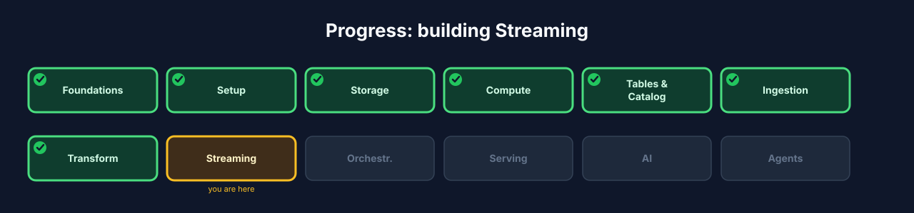
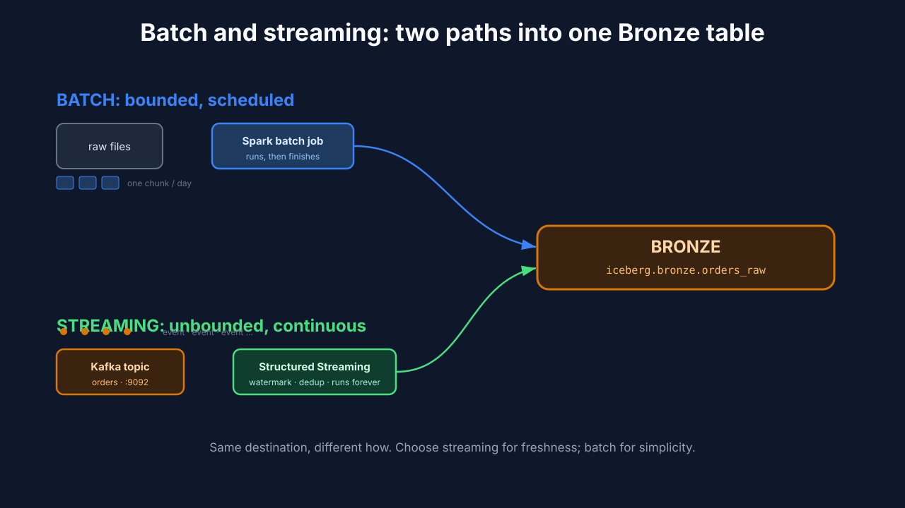
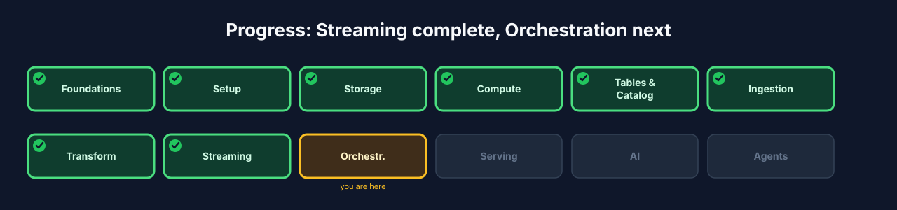

# Chapter 8: Streaming

This is the real-time path. In Chapter 6 you ingested a bounded batch of orders. Now you'll feed the same Bronze table continuously: orders arrive as an event stream on Kafka, and a Spark Structured Streaming job lands them into Iceberg as they happen. You'll handle the hard parts of streaming honestly, unbounded data, late events with watermarks, and exactly-once deduplication, and see exactly when to reach for streaming instead of batch.

Streaming is where a lot of learners get intimidated, and understandably: "process data that never stops arriving, in the right order, exactly once, even when things fail" sounds daunting. It's not, once you have the right mental model, and building it here demystifies a topic that reads like black magic in job descriptions. The reassurance up front: streaming in Spark uses the same DataFrame API you already know. If you can write a batch transformation, you're most of the way to a streaming one.



**Figure 8.1**. Progress map with **Streaming** highlighted.

## Learning objectives

By the end of this chapter you'll be able to:

- Explain what an event stream and unbounded data are.
- Read from a Kafka topic with Spark Structured Streaming and write to Iceberg.
- Use a watermark to bound state and handle late-arriving events.
- Deduplicate a stream so the same event isn't landed twice.
- Decide when streaming is the right tool versus batch.

## Streaming vs. batch

> **Streaming** *(canonical term)*: processing unbounded data continuously, as each event arrives, rather than in scheduled bounded chunks.

> **Event stream** *(canonical term)*: an unbounded, ordered sequence of records, here a Kafka topic of order events.

Batch asks "process today's orders." Streaming asks "process each order the moment it appears, forever." The data never ends, it's unbounded, so a streaming job is a long-running process, not a script that finishes. You choose streaming when freshness matters (fraud checks, live dashboards, alerting); you choose batch when periodic is fine and simplicity wins. Crucially, both can feed the same Bronze table: streaming is a different how, not a different destination.

The honest trade-off, stated plainly: streaming buys you freshness and costs you simplicity. A batch job starts, processes a known chunk, and stops, easy to reason about, easy to retry, easy to test. A streaming job runs forever, holds state, must cope with events arriving out of order and late, and can never just "start over" cleanly. That complexity is worth paying when minutes or seconds matter; a fraud check that runs nightly is useless. It's not worth paying when a daily refresh is fine. A common and healthy instinct in the industry: default to batch; reach for streaming only when the freshness requirement genuinely demands it. Plenty of "real-time" requirements turn out to be "within an hour is fine," which batch handles with far less operational burden.



**Figure 8.2**. Batch lands bounded chunks on a schedule; streaming lands individual events continuously. Both write to the same Iceberg Bronze table.

### Under the hood: a stream is really a table that never stops growing

Spark's Structured Streaming has a beautifully simple core idea: treat the unbounded stream as an unbounded table that new rows keep getting appended to. Your streaming query is conceptually the same query you'd write against a static table; Spark just re-runs it incrementally as new rows arrive, in small micro-batches. This is why the API is identical to batch: in Spark's model, a stream literally is a table, just one that's never finished. Hold onto this mental image; it's what makes streaming feel manageable instead of alien.

## The streaming challenges: order, lateness, duplicates

Real streams are messy. Events arrive out of order and late (a phone was offline; a retry fired an hour later), and the same event can arrive twice (an at-least-once producer). A correct streaming job must handle all three.

To make this concrete: imagine a customer places an order on a train, loses signal in a tunnel, and their phone re-sends the order three times over the next ten minutes as it reconnects. Your stream now has the same order arriving three times, out of order relative to other customers' orders, and later than when it was actually placed. A naive job would land three duplicate orders. A correct job lands exactly one, dated to when the order was really placed. The tools for that are watermarks and deduplication.

> **Watermark** *(canonical term)*: the streaming engine's moving clock, "I will not wait for events older than this," which bounds how much state is kept and decides when late data is too late to include.

> **Dedup / idempotency** *(canonical term)*: dropping repeated events (by key plus event time) so each real event lands exactly once.

Without a watermark, the engine would have to remember every event forever to catch possible late-arrivers, unbounded state, eventual crash. The watermark says "after this much lateness, stop waiting," letting Spark drop old state safely.

Think of the watermark as a restaurant's kitchen closing time. The kitchen will happily serve you if you order a little late, but at some point it closes; it can't stay open all night on the chance one more diner shows up. The watermark is that closing time for late data: "I'll accept events up to 10 minutes late, but after that the kitchen's closed and I've cleaned up." Without a closing time, the kitchen (your job's memory of past events) would have to stay staffed forever, which is impossible. The watermark is the promise that lets Spark forget old state and keep running indefinitely.

### Under the hood: Structured Streaming on Connect

Structured Streaming runs through the same Spark Connect server you started in Chapter 4 (streaming support was added to Connect in the Spark 4.x line). The streaming DataFrame API is identical to batch, `readStream`/`writeStream` instead of `read`/`write`, so everything you learned transfers directly. This is the promise from the chapter intro made concrete: your streaming code is a thin client shipping a plan to the same remote engine, just one that runs continuously.

## Build: stream orders from Kafka into Bronze

Streaming adds one new service, Kafka, the event streaming platform that holds the `orders` topic and buffers events between the producer and your Spark job. Kafka needs a coordination service (Zookeeper here), and because every other service in this course runs on the bridge network, Kafka does too.

**Step 1: add Kafka to your Compose file.** The one subtlety is listeners. Your Spark Connect server reaches Kafka from inside the network at `kafka:9092`, but a producer you run from your host reaches it on a published port at `localhost:29092`. Kafka has to advertise both, which is what the dual-listener config below does.

```yaml
  zookeeper:
    image: confluentinc/cp-zookeeper:7.5.0
    environment:
      ZOOKEEPER_CLIENT_PORT: 2181
      ZOOKEEPER_TICK_TIME: 2000
    volumes:
      - zookeeper-data:/var/lib/zookeeper/data
      - zookeeper-log:/var/lib/zookeeper/log
    networks:
      - lakehouse-network

  kafka:
    image: confluentinc/cp-kafka:7.5.0
    depends_on:
      - zookeeper
    ports:
      - "29092:29092"      # host access; in-network peers use kafka:9092
    environment:
      KAFKA_BROKER_ID: 1
      KAFKA_ZOOKEEPER_CONNECT: zookeeper:2181
      KAFKA_LISTENER_SECURITY_PROTOCOL_MAP: INTERNAL:PLAINTEXT,EXTERNAL:PLAINTEXT
      KAFKA_LISTENERS: INTERNAL://0.0.0.0:9092,EXTERNAL://0.0.0.0:29092
      KAFKA_ADVERTISED_LISTENERS: INTERNAL://kafka:9092,EXTERNAL://localhost:29092
      KAFKA_INTER_BROKER_LISTENER_NAME: INTERNAL
      KAFKA_OFFSETS_TOPIC_REPLICATION_FACTOR: 1
    volumes:
      - kafka-data:/var/lib/kafka/data   # topics + messages survive a recreate
    networks:
      - lakehouse-network
```

Bring them up and confirm Kafka is healthy:

```bash
docker compose up -d zookeeper kafka
docker compose ps
docker compose logs kafka | grep "started (kafka.server.KafkaServer)"
```

The last command should print one line ending in `started (kafka.server.KafkaServer)`; give it a few seconds after `up` if it doesn't yet.

Add the three volumes to the top-level `volumes:` block, next to the others:

```yaml
volumes:
  # ...the volumes from earlier chapters...
  zookeeper-data:
  zookeeper-log:
  kafka-data:
```

Without them, the topic and every message in it live inside the container, so the next `docker compose down` / `up` (Chapter 13) brings Kafka back empty. Your stream's checkpoint would then point at offsets in a topic that no longer exists, and the stream fails on restart with `UnknownTopicOrPartitionException`.

Now create the `orders` topic explicitly, once:

```bash
docker compose exec kafka kafka-topics --bootstrap-server kafka:9092 \
    --create --if-not-exists --topic orders --partitions 1 --replication-factor 1
# Created topic orders.
```

Kafka will auto-create a topic the first time a producer writes to it, but the streaming job in Step 3 subscribes to `orders` and fails with `UnknownTopicOrPartitionException` if it starts before any producer has written. Creating the topic up front removes that race, and makes the topic's settings (one partition, no replication, fine for a laptop) something you chose rather than a default you inherited.

**What just happened?** You started Kafka, the durable pipe between a source and your streaming job. The dual-listener setup is the Chapter 2 networking lesson again: `kafka:9092` is the address inside the Compose network (what Spark will use), `localhost:29092` is the published address for clients on your host (what the producer below will use). Mixing these up is the single most common Kafka-on-Docker mistake.

Put both addresses in your config, next to the others, so no module hardcodes either one. Add to `lakehouse/config.py`:

```python
# Kafka has two addresses (Chapter 8): the host-side listener for clients on your
# laptop, and the in-network listener for code that runs on the Spark cluster.
KAFKA_BOOTSTRAP        = os.environ.get("KAFKA_BOOTSTRAP", "localhost:29092")
KAFKA_BOOTSTRAP_SPARK  = os.environ.get("KAFKA_BOOTSTRAP_SPARK", "kafka:9092")
CHECKPOINT_PREFIX      = os.environ.get("CHECKPOINT_PREFIX", "s3a://lakehouse/_checkpoints")
```

**Step 2: produce a live stream of order events.** In production this would be your application emitting events. To keep it self-contained, add a producer module, `lakehouse/stream_source.py`, the streaming counterpart to the batch `generate.py`. Like the batch generator, it's deliberately imperfect, because the train-in-the-tunnel scenario from earlier is exactly what the watermark and dedup are for: now and then it re-sends an event it already sent (an at-least-once producer retrying), and now and then it sends an event stamped a few minutes in the past (a phone that was offline). Install the Kafka client first:

```bash
pip install kafka-python
```

```python
# lakehouse/stream_source.py
"""Stand-in for an application emitting order events to Kafka, warts and all:
some events are re-sent (an at-least-once producer retrying) and some arrive
late (a phone that was offline). `python -m lakehouse.stream_source`"""
import json
import random
import time
from datetime import datetime, timedelta, timezone

from kafka import KafkaProducer

from lakehouse.config import KAFKA_BOOTSTRAP

STATUSES = ["placed", "placed", "placed", "shipped", "cancelled"]


def produce(rate_per_sec: float = 5.0, limit: int | None = None, topic: str = "orders") -> None:
    producer = KafkaProducer(
        bootstrap_servers=KAFKA_BOOTSTRAP,          # host-side listener
        value_serializer=lambda v: json.dumps(v).encode("utf-8"),
    )
    recent = []                                      # recently sent events, for re-sends
    i = 0
    while limit is None or i < limit:
        i += 1
        now = datetime.now(timezone.utc)
        roll = random.random()
        if roll < 0.05 and recent:
            event, kind = random.choice(recent), "RESEND"     # duplicate delivery
        else:
            created = now - timedelta(minutes=3) if roll < 0.10 else now
            event = {
                "order_id": f"o-s{int(time.time() * 1000)}-{i}",
                "customer_id": f"c-{random.randint(1, 200)}",
                "amount": round(random.uniform(5, 500), 2),
                "status": random.choice(STATUSES),
                "created_at": created.isoformat(timespec="milliseconds"),
            }
            kind = "late" if roll < 0.10 else "sent"
            recent = (recent + [event])[-50:]
        producer.send(topic, event)
        print(f"{kind:>6} {event['order_id']}  created_at={event['created_at']}")
        time.sleep(1.0 / rate_per_sec)
    producer.flush()


if __name__ == "__main__":
    produce()
```

Run it in its own terminal and leave it running:

```bash
python -m lakehouse.stream_source
#   sent o-s1791805123456-1  created_at=2026-10-12T12:06:10.123+00:00
#   sent o-s1791805123657-2  created_at=2026-10-12T12:06:10.324+00:00
#   late o-s1791805123858-3  created_at=2026-10-12T12:03:10.525+00:00
# RESEND o-s1791805123456-1  created_at=2026-10-12T12:06:10.123+00:00
# ...
```

(kafka-python may print a `DeprecationWarning` about `value_serializer`; it's harmless.)

**What just happened?** The producer publishes an order event roughly every 200 ms into the `orders` topic (Kafka creates the topic on first use). Each line tells you what kind of event it was: `sent` is a normal event, `late` is one whose `created_at` is three minutes old, and `RESEND` is a duplicate of an event already sent, same `order_id` and all. Kafka durably holds every one of them, duplicates included; Kafka moves bytes, it doesn't judge them. If your streaming consumer is down for a while, the events wait for it rather than being lost. The producer connects on `localhost:29092` because it runs on your host, outside the Compose network.

**Step 3: write the streaming ingest.** The consumer is a module too, `lakehouse/stream_ingest.py`, so it can be started, stopped, and restarted like any other part of the project. Read it top to bottom; the next two steps walk through what each part does.

```python
# lakehouse/stream_ingest.py
"""Kafka -> Structured Streaming -> the SAME Bronze table the batch ingest writes.
`python -m lakehouse.stream_ingest` (long-running; Ctrl-C to stop)."""
from pyspark.sql import functions as F
from pyspark.sql.types import DoubleType, StringType, StructField, StructType, TimestampType

from lakehouse.config import CATALOG, CHECKPOINT_PREFIX, KAFKA_BOOTSTRAP_SPARK
from lakehouse.ingest import BRONZE
from lakehouse.session import get_spark

EVENT_SCHEMA = StructType([
    StructField("order_id", StringType()), StructField("customer_id", StringType()),
    StructField("amount", DoubleType()),   StructField("status", StringType()),
    StructField("created_at", TimestampType()),
])

CHECKPOINT = f"{CHECKPOINT_PREFIX}/bronze_orders_stream"


def start(starting_offsets: str = "latest"):
    spark = get_spark("orders-stream")
    # The dedup state is split into shuffle partitions, and each one writes its own
    # files to the checkpoint on every micro-batch. The default (200) is sized for
    # big batch jobs; for a trickle of events it just litters the bucket.
    spark.conf.set("spark.sql.shuffle.partitions", "4")

    raw = (spark.readStream
           .format("kafka")
           .option("kafka.bootstrap.servers", KAFKA_BOOTSTRAP_SPARK)   # in-network address
           .option("subscribe", "orders")
           .option("startingOffsets", starting_offsets)
           .load())

    # Kafka values are bytes; parse the JSON payload into typed columns.
    events = (raw.select(F.from_json(F.col("value").cast("string"), EVENT_SCHEMA).alias("e"))
                 .select("e.*"))

    deduped = (events
        .withWatermark("created_at", "10 minutes")          # tolerate 10 min lateness
        .dropDuplicatesWithinWatermark(["order_id"]))        # one row per order_id

    # Match Bronze's schema exactly: created_at stays a string (faithful capture),
    # plus the same ingestion-metadata columns the batch job adds.
    bronze = (deduped
        .withColumn("created_at",   F.date_format("created_at", "yyyy-MM-dd'T'HH:mm:ss.SSS"))
        .withColumn("_ingested_at", F.current_timestamp())
        .withColumn("_source",      F.lit("orders-stream"))
        .withColumn("_ingest_date", F.to_date("_ingested_at")))

    return (bronze.writeStream
        .format("iceberg")
        .outputMode("append")
        .trigger(processingTime="10 seconds")               # one Iceberg commit per 10s
        .option("checkpointLocation", CHECKPOINT)
        .toTable(BRONZE))


if __name__ == "__main__":
    query = start()
    print("streaming into", BRONZE, "- checkpoint", CHECKPOINT)
    query.awaitTermination()
```

**Reading from Kafka.** `readStream` instead of `read` is the one word that turns a batch source into a streaming one; everything after it is the familiar DataFrame API. The read runs on the Connect server, so it uses the in-network address `kafka:9092` (from `KAFKA_BOOTSTRAP_SPARK`). Kafka hands you raw bytes in a `value` column, so you parse the JSON payload into real typed columns with `from_json` and the declared `EVENT_SCHEMA`; giving the data structure is your job on the read side. (The Kafka source itself is the `spark-sql-kafka` package, configured server-side on the Connect server alongside the Iceberg packages in Chapter 4.)

**Watermark, dedup, write.** This is the train-in-the-tunnel scenario handled in a few lines. `withWatermark("created_at", "10 minutes")` sets the kitchen's closing time: accept events up to 10 minutes late. The producer's late events are three minutes old, well inside it, so they land. `dropDuplicatesWithinWatermark(["order_id"])` lands each `order_id` once even when the producer sends it twice. Then the rows are shaped to match the Bronze table the batch job created in Chapter 6: `created_at` goes back to a string (faithful capture), and the same `_ingested_at` / `_source` / `_ingest_date` metadata columns are added. The `_source` is `orders-stream`, which puts these rows in their own partitions, so a batch re-ingest of today (Chapter 6's partition-by-source decision) can never overwrite them. `trigger(processingTime="10 seconds")` gathers events into one micro-batch, and so one Iceberg commit, every 10 seconds; without a trigger, Spark starts a new micro-batch as soon as the last finishes, which on a table means a stream of tiny commits and tiny files. Finally, `toTable(BRONZE)` writes to the same `iceberg.bronze.orders_raw` the batch job writes: streaming is a different how, same destination.

The `spark.conf.set("spark.sql.shuffle.partitions", "4")` line at the top of `start()` comes from watching this job run. Deduplication is stateful: Spark remembers recently seen `order_id`s, and that state is split into shuffle partitions, each of which writes its own small files into the checkpoint on every micro-batch. With Spark's default of 200 partitions (sized for big batch jobs), a few minutes of a slow trickle left thousands of tiny objects under the checkpoint's `state/` folder. Four is plenty for a few events a second. Note that the setting is fixed into a query's checkpoint the first time it starts; changing it later requires a fresh checkpoint.

**Step 4: start the stream.** In a second terminal (leave the producer running in the first):

```bash
python -m lakehouse.stream_ingest
# streaming into iceberg.bronze.orders_raw - checkpoint s3a://lakehouse/_checkpoints/bronze_orders_stream
```

It then sits there: `awaitTermination()` reflects that this job never finishes; it runs until you stop it with Ctrl-C.

**Step 5: from another client, watch the Bronze count climb as events flow.** Open a third terminal with a Python session (leave the producer and the stream running) and run the counts a few times, ten seconds or so apart:

```python
from lakehouse.session import get_spark
spark = get_spark()
bronze = spark.table("iceberg.bronze.orders_raw")
bronze.count(), bronze.where("_source = 'orders-stream'").count()
# (1095, 75)    <- the batch rows from Chapter 6, plus the first streamed events
# (1141, 121)   <- ten seconds later
# (1189, 169)   <- and climbing, roughly 5 a second
```

Your exact numbers depend on how many days you batch-ingested in Chapter 6 and when you started the stream; what matters is that the first number starts at your batch total and climbs in steps every ten seconds (one micro-batch, one commit).

**What just happened?** Two things, and the second is the real lesson. First, the number climbs, proof the stream is live: events flow from the producer, through Kafka, through your Structured Streaming job, into Iceberg, in near-real-time. Second, look at where it *started*: your batch rows from Chapter 6. The stream is appending into the **same** `iceberg.bronze.orders_raw` table the batch job wrote. That is the convergence argument from the chapter intro made physical: one Bronze table, fed by both a scheduled batch job and a continuous stream, and a downstream reader can't tell which rows arrived which way (unless it looks at `_source`). One stack, not two.

**Step 6: prove the dedup worked.** The producer has been re-sending events the whole time, so if dedup were broken you'd see the same `order_id` more than once:

```python
spark.sql("""
    SELECT count(*) AS rows, count(DISTINCT order_id) AS ids
    FROM iceberg.bronze.orders_raw WHERE _source = 'orders-stream'
""").show()
# +----+---+
# |rows|ids|
# +----+---+
# | 263|263|
# +----+---+
```

`rows` equals `ids`: every order landed exactly once even though Kafka holds duplicates. You can compare against what's actually in the topic: `docker compose exec kafka kafka-run-class kafka.tools.GetOffsetShell --broker-list kafka:9092 --topic orders` prints `orders:0:<n>`, the number of messages Kafka holds, which is larger than `rows` by the re-sends (plus whatever arrived after the last micro-batch).

## Why the checkpoint matters

The `checkpointLocation` is what makes a streaming job restartable and idempotent across failures: it durably records which Kafka offsets have been processed and the watermark state. Kill the job and restart it, and it resumes from the last committed offset; it will not skip events or double-write them. Delete the checkpoint and it starts over. Treat the checkpoint as part of your data: one checkpoint per streaming query, never shared.

Don't take that on faith either, look at what the checkpoint wrote. List its location in the bucket while the stream runs:

```bash
aws --endpoint-url http://localhost:8333 s3 ls s3://lakehouse/_checkpoints/bronze_orders_stream/
#                            PRE commits/     <- which micro-batches committed successfully
#                            PRE offsets/     <- the Kafka offsets read up to each micro-batch
#                            PRE sources/     <- the source's own bookkeeping (where Kafka reading began)
#                            PRE state/       <- the watermark + dedup state (dropDuplicatesWithinWatermark)
# 2026-10-12 12:06:21     45 metadata         <- the stream's identity
aws --endpoint-url http://localhost:8333 s3 ls s3://lakehouse/_checkpoints/bronze_orders_stream/offsets/
# one small file per micro-batch: 0, 1, 2, ...
```

Those are the stream's memory. `offsets/` is the bookmark into Kafka ("I've read up to here"); `commits/` records which batches finished; `state/` holds the in-flight watermark and the set of recently-seen `order_id`s used for dedup. On restart, Spark reads `offsets/` and `commits/` to find exactly where it left off and `state/` to restore the dedup window, which is precisely why a restart neither skips nor double-writes. Delete this directory and all of that memory is gone, so the next start reads the topic from scratch.

This is the streaming equivalent of the idempotency you built in Chapter 6, and it matters for the same reason: things fail, and recovery must be safe. A batch job retries by re-running a bounded chunk. A streaming job can't "re-run", it never stopped, so instead it remembers its exact position (the Kafka offsets) and its in-flight state (the watermark) in the checkpoint. On restart, it reads that bookmark and continues precisely where it left off. Without the checkpoint, a restart would either re-process events (duplicates) or skip them (data loss). The checkpoint is what turns a fragile long-running process into a reliable one. Never point two different queries at the same checkpoint location, and never delete it unless you truly mean "start this stream over from scratch."

Prove it rather than trust it. Stop the stream with Ctrl-C (leave the producer running), note the streamed count, wait half a minute so events pile up in Kafka, then start it again with the same command:

```bash
python -m lakehouse.stream_ingest
```

Re-run the Step 6 query after a micro-batch or two. The count jumps past where it stopped (it caught up on everything produced while it was down), and `rows` still equals `ids`: nothing was skipped and nothing was written twice. That's the checkpoint, plus the dedup state stored inside it, doing its job.

When you're done, stop both terminals with Ctrl-C.

## Troubleshooting

- **The streaming query starts but no rows land.** With `startingOffsets` set to `latest` (the default in `start()`), a brand-new query only sees events produced after it started. Confirm the producer is actively running, or call `start("earliest")` with a new checkpoint to read from the start of the topic. Rows also arrive in steps, one commit per 10-second trigger, so wait a trigger or two.
- **"Cannot connect to Kafka" or broker errors from the streaming job.** The job runs on the Connect server, so it must use the in-network address `kafka:9092` (`KAFKA_BOOTSTRAP_SPARK`), not `localhost`. A host producer uses `localhost:29092` (`KAFKA_BOOTSTRAP`). Getting these backwards is the usual cause.
- **`Could not rename` or `destination parent is not a directory` errors under `_checkpoints/`.** Checkpoint files are committed by rename, which depends on the object store handling S3A's directory markers correctly. Use the SeaweedFS version pinned in Chapter 3.
- **The checkpoint folder fills with thousands of tiny files.** The stateful dedup is using the default 200 shuffle partitions. Keep the `spark.sql.shuffle.partitions` line in `start()`; it only takes effect for a new checkpoint.
- **Row count doesn't grow.** Either the producer stopped, the schema doesn't match the JSON (so `from_json` yields nulls), or the watermark/dedup is dropping everything. Inspect a few parsed rows before the write.
- **"Checkpoint location already exists" or corrupt-state errors on restart.** You changed the query in an incompatible way, or two queries share a checkpoint. Use a fresh checkpoint path for a genuinely new query.
- **Streaming Connect errors.** As in Chapter 4, read the last line of the Connect-style traceback first.

## Checkpoint (yours, not the stream's)

- Kafka is healthy and your `lakehouse/stream_source.py` producer is publishing order events, including re-sends and late ones.
- Your Structured Streaming job reads the `orders` topic over `sc://` and appends to `iceberg.bronze.orders_raw`.
- The job uses a watermark and `dropDuplicatesWithinWatermark` for exactly-once.
- A `checkpointLocation` is set, the Bronze row count grows as events arrive, and streamed rows equal distinct `order_id`s.
- You stopped and restarted the stream and it resumed without duplicates or gaps.
- You can state one case where streaming beats batch and one where it doesn't.

## Try it yourself

1. **Kill and restart.** Stop the streaming query, note the Bronze count, restart the same job (same checkpoint), and confirm it resumes without duplicating or skipping. That's the checkpoint earning its keep.
2. **Read from the beginning.** Start a fresh query that reads the topic from the start, with its own checkpoint, by setting `CHECKPOINT_PREFIX=s3a://lakehouse/_checkpoints/replay` and calling `start("earliest")`. Does the dedup still hold when the whole topic is replayed? (Think about which rows are already in Bronze from the first query, and whether this second query knows about them.)
3. **Tune the watermark.** The producer's late events are three minutes old. Change the watermark from 10 minutes to 1 minute (in a fresh checkpoint) and reason about what happens to them. What are you trading?
4. **Make the batch-vs-streaming call.** For three imaginary requirements ("nightly finance report," "live fraud alerts," "hourly inventory sync"), decide batch or streaming and justify each in one sentence.

## Check your understanding

- What does "unbounded" mean, and why does it make a streaming job a long-running process rather than a script?
- Explain the "a stream is a table that never stops growing" model.
- What problem does a watermark solve, and what's the kitchen-closing-time analogy?
- What does the checkpoint store, and what breaks if you delete or share it?

## Recap and what's next

- Streaming processes unbounded event streams continuously; batch processes bounded chunks. Both can feed the same Bronze table.
- Streaming buys freshness and costs simplicity. Default to batch, reach for streaming when freshness genuinely demands it.
- Watermarks bound state and handle lateness; dedup within the watermark gives exactly-once landing.
- Checkpoints make streaming jobs restartable and idempotent.
- Structured Streaming uses the same Connect transport and DataFrame API as batch.
- **Next, Chapter 9, Orchestration:** schedule the batch medallion pipeline as a DAG with retries and backfills.



**Figure 8.3**. Progress map with **Streaming done** and **Orchestration** next.
