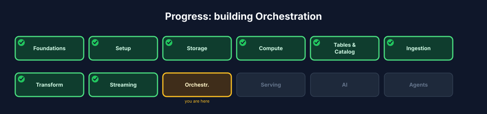
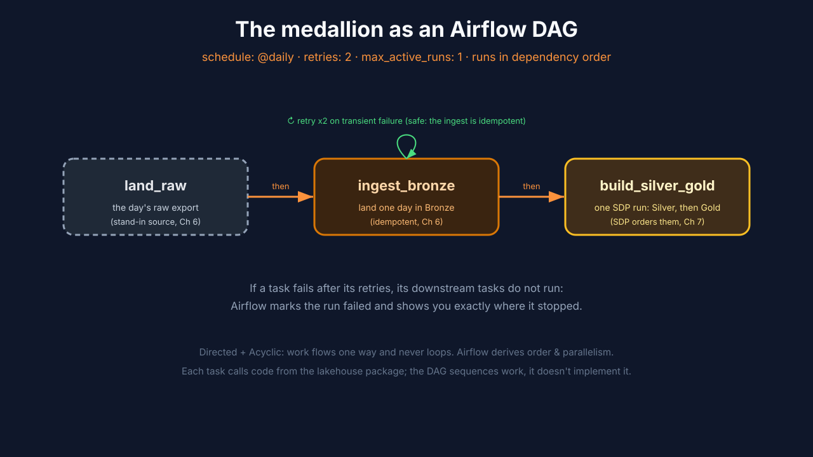
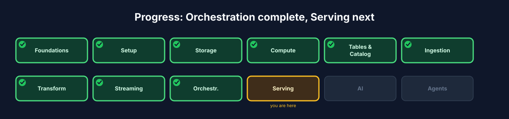

# Chapter 9: Orchestration

This is the conductor. You can run the medallion pipeline by hand, but a real lakehouse runs it on a schedule, recovers from failures, and can re-run history on demand. That's orchestration. You'll wrap the batch medallion (Chapter 7) in an Apache Airflow DAG, give it a schedule and retries, and run a backfill to populate past dates. Airflow becomes the thing that keeps the lakehouse fed without you babysitting it.

Everything you've built so far, you've run by hand: typing commands, watching them finish. That's fine for learning, but no real data platform works that way. In production, pipelines run themselves: at 2 a.m., reliably, retrying transient failures, alerting a human only when something truly needs attention. Orchestration is what turns your hand-run pipeline into infrastructure that operates itself. It's the difference between a science project and a system.



**Figure 9.1**. Progress map with **Orchestration** highlighted.

## Learning objectives

By the end of this chapter you'll be able to:

- Explain what orchestration is and why a scheduler beats cron for pipelines.
- Read and reason about a DAG: tasks and their dependencies.
- Give a DAG a schedule and configure retries for resilience.
- Run a backfill to process historical dates.

## What orchestration is, and why not just cron?

> **Orchestration** *(canonical term)*: scheduling tasks and wiring them into a dependency-aware pipeline that runs reliably, recovers from failure, and can be re-run over past time windows.

Scheduling alone (plain cron) fires a command at a time. Orchestration adds what production actually needs: dependencies (run Silver only after Bronze succeeds), retries (a transient failure shouldn't need a human), visibility (which runs passed, which failed, why), and backfills (re-run last month because logic changed). Airflow is the industry-standard tool for this.

It's worth dwelling on why cron isn't enough, because "just use cron" is a tempting simplification that falls apart quickly. Say you set three cron jobs: Bronze at 2:00, Silver at 2:30, Gold at 3:00. What happens when Bronze takes 45 minutes one night because there was more data? Silver fires at 2:30 against incomplete Bronze and produces wrong results, and cron has no idea anything went wrong. What happens when Silver fails? Gold runs at 3:00 anyway, on stale data. What happens when you need to see why last Tuesday's run failed? Cron kept no record. Cron knows about time; it knows nothing about dependencies, success, failure, or history. Orchestration is cron plus all the things you actually need to run a pipeline you can trust. The jump from cron to an orchestrator feels like overkill until the first time it saves you, and then you never go back.

## The DAG: tasks and dependencies

> **DAG** *(canonical term)*: a Directed Acyclic Graph, the pipeline's tasks and the dependency edges between them. "Directed" and "acyclic" mean work flows one way and never loops.

In Airflow you express your pipeline as a DAG: each step is a task, and you declare which tasks must finish before others start. Airflow figures out the order, runs independent tasks in parallel, and stops a downstream task if its upstream failed. Our medallion is a natural DAG: `ingest_bronze` then `build_silver` then `build_gold`.

Let's unpack the jargon, because "Directed Acyclic Graph" sounds more intimidating than it is. A graph is just boxes (tasks) connected by arrows (dependencies). Directed means the arrows point one way: Bronze comes before Silver, not the reverse. Acyclic means no loops: you can't have Bronze depend on Gold which depends on Bronze, because then nothing could ever start. That's the whole concept: a set of tasks with one-way "must happen before" arrows and no circular waiting. Any pipeline you can draw as boxes-and-arrows-without-loops is a DAG, and Airflow's job is to run it correctly.



**Figure 9.2**. The medallion DAG: `ingest_bronze` to `build_silver` to `build_gold`, scheduled daily, each task with retries; a failed task blocks its downstream.

### Under the hood: the DAG triggers work, it isn't the work

A common confusion: the DAG doesn't contain your Spark logic, it triggers it. Each task typically calls the pipeline you already built (for example, runs the SDP pipeline or a Spark job over Connect). Keep heavy transformation in Spark and let Airflow do what it's good at: scheduling, ordering, retrying, and reporting. This separation is why the same pipeline runs identically whether you launch it by hand or Airflow launches it at 2 a.m.

This separation of concerns is a design principle, not just a detail. Airflow is a conductor, not a musician: it tells the orchestra when each section plays, but it doesn't play the instruments. Your Spark/SDP code is the musician that does the actual work. Keeping them separate means you can test your pipeline logic without Airflow, swap the orchestrator without rewriting your pipelines, and reason about each layer independently. A frequent beginner mistake is stuffing heavy data processing directly into Airflow tasks; resist it. Airflow triggers; Spark transforms.

## Build: a scheduled medallion DAG

Airflow is the most involved service in the stack: it's really several processes (a scheduler, an API/web server, and a metadata database). Rather than hand-write all of that, start from Airflow's official `docker-compose.yaml` (the project publishes one) and adapt it into your stack. Four adaptations are what matter:

1. **Join the same network.** Put the Airflow services on `lakehouse-network` so their tasks can reach `spark-connect:15002`, `seaweedfs:8333`, and `unity-catalog:8080` by service name.
2. **Mount your DAGs folder.** Point Airflow's `dags/` volume at a `dags/` directory in your project so your DAG file is picked up.
3. **Keep it small for local use.** `AIRFLOW__CORE__EXECUTOR=LocalExecutor` and `AIRFLOW__CORE__LOAD_EXAMPLES=false` keep the footprint sane on a laptop. The API/web UI comes up on port 8085.
4. **Give the tasks what they call.** The DAG below runs `spark-pipelines` and talks to Spark Connect from inside the Airflow container, so that image needs the client installed (`pip install 'pyspark[pipelines]==4.1.0'`, via a custom Airflow image or `_PIP_ADDITIONAL_REQUIREMENTS`) and your `pipelines/` directory mounted (for example at `/opt/pipelines`) so the SDP project is on disk where the task's working directory expects it.

Bring up the Airflow services and confirm the UI answers:

```bash
docker compose up -d airflow-init airflow-scheduler airflow-apiserver
docker compose ps
curl -s http://localhost:8085/api/v2/monitor/health
```

**What just happened?** You started Airflow's cooperating processes: a scheduler that decides what runs when, an API/web server for the UI and REST calls, and a metadata database that records every run. Open `http://localhost:8085` in your browser. The UI is where orchestration stops being abstract: you can see your pipeline as a graph, watch runs succeed or fail, and drill into any task's logs. Spend a minute clicking around; the visibility the UI provides is half the reason orchestrators exist.

**Step 2: write the DAG.** Save this as `dags/lakehouse_medallion_pipeline.py`. It schedules the pipeline daily, with retries, and expresses the medallion order. Note the Spark Connect address: these tasks run inside the Airflow container, so they reach the Connect server at the in-network name `spark-connect:15002`, not `localhost`.

```python
from datetime import datetime, timedelta
from airflow import DAG
from airflow.operators.python import PythonOperator

default_args = {
    "retries": 2,                          # transient failures auto-retry
    "retry_delay": timedelta(minutes=5),
}

CONNECT = "sc://spark-connect:15002"       # in-network address, not localhost

def ingest_bronze(**_):
    # the batch ingest from Chapter 6, pointed at the in-network Connect server
    from pyspark.sql import SparkSession, functions as F
    spark = SparkSession.builder.remote(CONNECT).getOrCreate()
    raw = spark.read.json("s3a://lakehouse/raw/orders/")
    bronze = (raw
        .withColumn("_ingested_at", F.current_timestamp())
        .withColumn("_source",      F.lit("orders-generator"))
        .withColumn("_ingest_date", F.to_date(F.current_timestamp())))
    bronze.writeTo("iceberg.bronze.orders_raw").overwritePartitions()  # idempotent

def build_silver_gold(**_):
    # run the SDP medallion from Chapter 7 against the Connect server
    import subprocess
    subprocess.run(
        ["spark-pipelines", "run", "--remote", CONNECT],
        cwd="/opt/pipelines/medallion", check=True,
    )

with DAG(
    dag_id="lakehouse_medallion_pipeline",
    start_date=datetime(2026, 1, 1),
    schedule="@daily",                      # run once a day
    catchup=False,                          # don't auto-run all history on deploy
    default_args=default_args,
) as dag:
    t_bronze = PythonOperator(task_id="ingest_bronze", python_callable=ingest_bronze)
    t_silver_gold = PythonOperator(task_id="build_silver_gold", python_callable=build_silver_gold)

    t_bronze >> t_silver_gold               # the dependency edge = the DAG
```

**What just happened?** The last line is the heart of it: `t_bronze >> t_silver_gold` literally draws the arrow of the DAG, "Bronze before the medallion transform." That `>>` operator is how Airflow expresses dependencies. Notice also `catchup=False`: without it, deploying a DAG with a `start_date` in the past would make Airflow immediately try to run every missed day since that date, a classic surprise that floods a new pipeline with hundreds of runs. And each task function is deliberately thin: it calls the pipeline work you already built (the Chapter 6 ingest, the Chapter 7 SDP run), honoring the "conductor, not musician" principle. SDP still derives the Silver-then-Gold order internally, so Airflow only needs to sequence "ingest, then transform."

**Step 3: trigger a run and watch the tasks go green in order.** From the UI's trigger button, or from the CLI inside the scheduler container:

```bash
docker compose exec airflow-scheduler airflow dags trigger lakehouse_medallion_pipeline
```

Expected: `ingest_bronze` runs first; only when it succeeds does `build_silver_gold` start. In the UI's graph view each task turns green in sequence. You can confirm the same thing without the UI, which is how you'd check it in a script or an alert:

```bash
docker compose exec airflow-scheduler \
    airflow dags list-runs -d lakehouse_medallion_pipeline
# dag_id                        | run_id            | state   | ...
# lakehouse_medallion_pipeline  | manual__2026-...  | success | ...
```

A `state` of `success` means both tasks ran in order and finished; `failed` or `running` tells you to open that run's task logs in the UI. (The exact column layout varies by Airflow version.)

**What just happened?** You watched dependency enforcement in action. The transform did not start until the ingest succeeded; if the ingest had failed, the transform would never have run, sparing you a pile of wrong downstream data. That "don't run downstream if upstream failed" behavior is exactly what cron can't do and what makes an orchestrated pipeline trustworthy.

## Retries and backfills: the production payoff

**Retries.** With `retries: 2`, a task that hits a transient error (a momentary storage blip) is retried automatically before the run is marked failed. You wake up to a green pipeline, not a 2 a.m. page. This only works safely because your tasks are idempotent (Chapter 6): a retry re-runs the task, and idempotency guarantees that re-running doesn't duplicate data. Retries and idempotency are a team: retries give you automatic recovery, idempotency makes that recovery safe. Neither is much use without the other.

> **Backfill** *(canonical term)*: running a pipeline over past dates to populate or re-populate history.

**Backfill.** Suppose you fixed a Gold aggregation and need last week re-computed. Because each Airflow run is tied to a date (its "logical date"), you can backfill a range and Airflow runs one pipeline execution per day in that window. You can start a backfill from the UI, or from the CLI inside the scheduler container:

```bash
docker compose exec airflow-scheduler \
    airflow dags backfill --start-date 2026-01-01 --end-date 2026-01-07 \
    lakehouse_medallion_pipeline
```

(The exact backfill flags shift between Airflow versions; if the CLI rejects them, the UI's backfill form is the version-proof path.)

Expected: seven dated runs execute, each re-deriving that day's Silver/Gold from the untouched Bronze, the payoff of the ELT and idempotency choices from Chapter 6.

**What just happened?** This is where several earlier chapters' decisions pay a dividend at once. You changed some logic and needed to fix a week of history. Because Bronze is a faithful permanent record (ELT, Chapter 6), the raw data is still there to re-derive from. Because each run is idempotent, re-running those seven days overwrites cleanly instead of duplicating. And because Airflow ties runs to dates, "redo January 1 to 7" is one command. A backfill that would have been a terrifying manual data-surgery operation in a fragile system is routine here. That's the whole architecture working together.

## Troubleshooting

- **The DAG doesn't appear in the UI.** Airflow didn't parse the file. Check for Python syntax errors in the DAG file and confirm it's in the mounted `dags/` folder Airflow scans; the UI often shows an import-error banner.
- **Tasks can't reach Spark.** They're using `localhost` instead of the in-network name. Airflow tasks run in the Airflow container, so Spark Connect is `spark-connect:15002`, not `localhost:15002`.
- **On deploy, Airflow runs a flood of past dates.** You forgot `catchup=False` (or set it `True`) with a past `start_date`. Set `catchup=False` unless you genuinely want automatic historical runs.
- **A task fails but downstream runs anyway.** You wired the dependencies wrong. Confirm the `>>` chain reflects the real order; a missing edge lets tasks run independently.
- **Retries make duplicate data.** Your task isn't idempotent. Revisit Chapter 6; retries are only safe on idempotent tasks.
- **Backfill does nothing or errors.** Check the date range and that the DAG's `start_date` precedes it; Airflow won't run logical dates before `start_date`.

## Checkpoint

- `docker compose ps` shows the Airflow services healthy; the UI opens on 8085.
- The `lakehouse_medallion_pipeline` DAG shows `ingest_bronze` then `build_silver_gold`.
- A triggered run turns the tasks green in dependency order.
- `retries` are configured, and you ran a backfill over a date range.
- You can explain why cron is insufficient and what "DAG" means.

## Try it yourself

1. **Force a failure.** Make the transform task raise an error on purpose, trigger the DAG, and confirm the run stops there. Then fix it and re-run. That's dependency enforcement protecting you.
2. **Watch retries.** Make a task fail intermittently (fail the first attempt), and watch Airflow retry it per your `retries` setting before giving up.
3. **Backfill and verify.** Backfill a three-day range and confirm each day's Gold was re-derived. Check that running the backfill twice doesn't duplicate data (idempotency plus orchestration together).
4. **Draw your own DAG.** Sketch the DAG you'd build if Gold had two independent downstream tables (say, a dashboard export and a model-training trigger). Which tasks could run in parallel?

## Check your understanding

- Give three things orchestration provides that plain cron does not.
- What do "directed" and "acyclic" mean in DAG, and why does acyclic matter?
- Explain "Airflow is a conductor, not a musician." What belongs in the DAG versus in Spark?
- Why are retries and idempotency described as a team? What goes wrong if you have one without the other?

## Recap and what's next

- Orchestration schedules, orders, retries, and reports on pipeline tasks, everything cron can't.
- A DAG expresses tasks and dependencies; Airflow derives order and parallelism.
- The DAG triggers your Spark/SDP work; it doesn't replace it. Conductor, not musician.
- Retries give resilience; backfills re-run history, made safe by idempotency.
- **Next, Chapter 10, Serving:** expose the finished Gold tables to other engines through the one open catalog.



**Figure 9.3**. Progress map with **Orchestration done** and **Serving** next.
