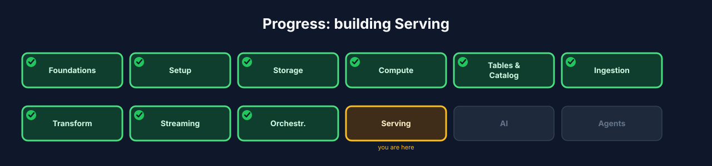
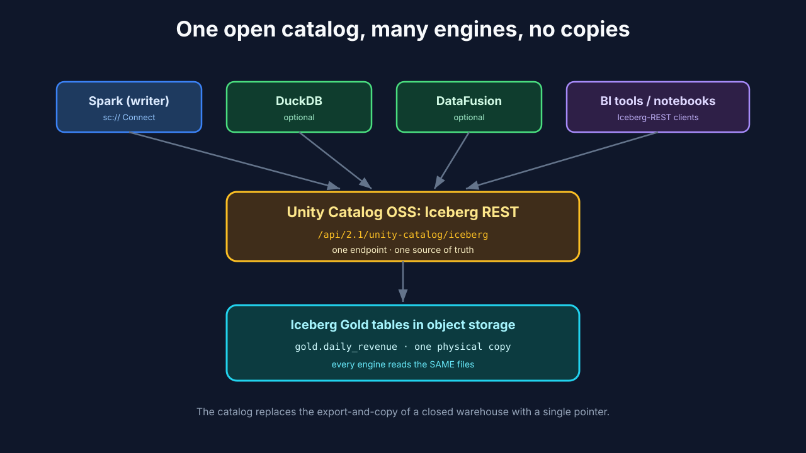
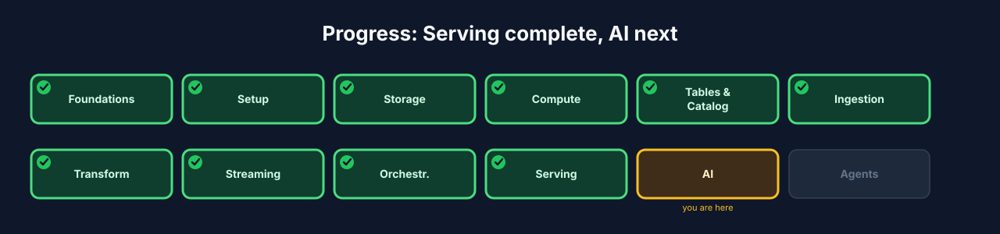

# Chapter 10: Serving

This is the payoff of "open." Your Gold tables are built, refreshed, and scheduled. Now you serve them: make them available to whatever wants to read, a second query engine, a BI tool, a notebook, a model. And here the open lakehouse earns its name, because every table lives in Unity Catalog OSS as an open Iceberg table, any Iceberg-aware engine reads the same data through one catalog endpoint, with no copies, no exports, and no per-tool metastore. You'll prove it by querying your Gold table from a different engine than the one that wrote it.

This is the chapter that justifies the word "open" in "open lakehouse," and it's genuinely the thing a closed warehouse cannot do. Everything up to now you could, in principle, have built inside a proprietary system. But the moment you want a different tool to read your data without copying it out first, the closed systems fall down and the open lakehouse shines. When you see DuckDB return the exact same rows Spark wrote, with zero export step, the whole architecture's payoff clicks into place.



**Figure 10.1**. Progress map with **Serving** highlighted.

## Learning objectives

By the end of this chapter you'll be able to:

- Define the serving layer and who consumes it.
- Explain how one Iceberg REST catalog enables multi-engine access.
- Read a Gold table from a second engine and get identical results.
- Describe how serving differs from a closed warehouse's export-and-copy model.

## What serving is

> **Serving** *(canonical term)*: making finished data available to consumers (BI tools, other query engines, apps, and models), ideally engine-neutrally.

Serving is a read/consumption concern, defined by the consumer, not the producer. The test of a good serving layer: can something other than the tool that produced the data get at it, easily and without a copy? In a closed warehouse the answer is usually "export it first." In the open lakehouse the answer is "point your engine at the catalog," because the data was never locked in a proprietary format to begin with.

It helps to see where serving sits in the story you've built. Ingestion brought data in. Transformation refined it up through the medallion. Serving sends it out to whoever needs it. It's the last mile, the point where all the pipeline work becomes useful to an actual human looking at a dashboard, an analyst running a query, or a model reading training data. A pipeline that never gets served is a tree falling in an empty forest; serving is what makes the work count.

## One catalog, many engines

The mechanism is the one you stood up in Chapter 5: Unity Catalog OSS's Iceberg REST catalog at `http://localhost:8081/api/2.1/unity-catalog/iceberg`. It's a standard protocol, so many engines speak it. Spark wrote the tables; DuckDB, DataFusion, Trino, and others can read them, all pointing at that single URL, all seeing the same current snapshot.

> **Multi-engine / interoperability** *(canonical term)*: the same open tables read by different engines, because they share one catalog and one open format.

Why is this such a big deal? Because different engines are good at different things, and being able to use the right tool without copying data is transformative. Spark is great for large distributed transformations. DuckDB is fantastic for fast local analytical queries on your laptop. Trino excels at federated interactive SQL across huge datasets. A BI tool renders dashboards. In a closed world you'd need the data copied into each tool's preferred home. In the open lakehouse, they all read the same Iceberg tables through the same catalog: you pick the best engine for each job and none of them owns the data. The data sits still; the engines come to it.



**Figure 10.2**. Spark, DuckDB, DataFusion, and BI tools all read the same Iceberg Gold tables through the one Unity Catalog OSS REST endpoint, with no data copied.

### Under the hood: serving vs. a closed warehouse

In a closed warehouse, "giving another team access" often means an ETL job that copies data out to wherever they can read it, and now you have two copies that drift. The open lakehouse replaces the copy with a pointer: the catalog. Every consumer reads the one authoritative table. Fewer copies, no drift, and governance stays in one place (Chapter 12's agents and any BI tool hit the same governed tables).

The drift problem is worth making vivid, because it's the quiet killer of data trust in real organizations. Team A builds the revenue table. Team B needs it, so a job copies it into Team B's system. Now there are two revenue tables. Team A fixes a bug in theirs; Team B's copy still has the bug. Someone in a meeting says "revenue was $2M" and someone else says "no, $1.8M," and both are reading a real table, just different copies that drifted apart. Multiply that across dozens of teams and tables and you get the "which number is right?" chaos that plagues data teams. One catalog, one authoritative table, many readers: that's the cure, and it's only possible because the format is open and shareable.

## Build: serve Gold to a second engine

The primary, always-available path is Spark itself reading through the catalog, but the point of this chapter is a different engine, so we also read the same table from DuckDB.

**Step 1: confirm Gold is present via the catalog** (Spark Connect client):

```python
from lakehouse.session import get_spark
spark = get_spark()
spark.table("iceberg.gold.daily_revenue").orderBy("order_date", "status").show()
```

Expected: the Gold table from Chapter 7. With only the `2026-01-05` batch loaded it is these three rows (the generator is seeded, so yours match); if you ran Chapter 9's backfill you'll also see one row per status for every other day you loaded:

```
+----------+---------+---------+-----------+
|order_date|   status|  revenue|order_count|
+----------+---------+---------+-----------+
|2026-01-05|cancelled| 48309.50|        200|
|2026-01-05|   placed|134321.32|        552|
|2026-01-05|  shipped| 49997.14|        193|
+----------+---------+---------+-----------+
```

**What just happened?** Nothing new yet: this is Spark reading its own table through the catalog, establishing the "before" baseline. Note the exact rows it returns; you're about to get the identical rows from a completely different engine.

**Step 2: read the same table from DuckDB,** pointing at the one Iceberg REST catalog. DuckDB is not required infrastructure; it's a lightweight in-process engine that proves interoperability. It runs on your host, so it uses the host-side addresses: the catalog at `localhost:8081` and SeaweedFS at `localhost:8333`. Install it into your project's environment:

```bash
pip install duckdb==1.5.6
```

DuckDB needs two things from you, and each one teaches something about how a REST catalog works:

1. **Where the catalog is, and how to authenticate to it.** That's the `ATTACH`. Our local Unity Catalog has authentication turned off, so you say so with `AUTHORIZATION_TYPE 'none'`. (DuckDB defaults to OAuth2, the common case for a real deployment, and refuses to attach without credentials.)
2. **How to reach the files.** The catalog only hands DuckDB metadata: table locations like `s3://lakehouse/warehouse/...`. DuckDB then reads the Parquet and Avro files itself, straight from object storage. Unity Catalog can *vend* temporary storage credentials along with the metadata, but it vends only keys, no endpoint, so a client that relied on them would go looking for the bucket on real AWS. So you give DuckDB an S3 secret pointing at SeaweedFS, and tell the attach not to request vended credentials (`ACCESS_DELEGATION_MODE 'none'`).

In the DuckDB CLI, or in Python with `duckdb.sql(...)`:

```sql
INSTALL iceberg; LOAD iceberg;

-- How to reach the files: SeaweedFS, from your host.
CREATE SECRET seaweedfs (
    TYPE s3,
    KEY_ID 'lakehouse', SECRET 'lakehouse-secret',   -- your S3_ACCESS_KEY / S3_SECRET_KEY
    ENDPOINT 'localhost:8333', URL_STYLE 'path', USE_SSL false, REGION 'us-east-1'
);

-- Where the catalog is: the SAME Unity Catalog Iceberg REST endpoint Spark uses.
-- 'iceberg' is the Unity Catalog catalog name (the warehouse you created in Chapter 5).
ATTACH 'iceberg' AS uc (
    TYPE iceberg,
    ENDPOINT 'http://localhost:8081/api/2.1/unity-catalog/iceberg',
    AUTHORIZATION_TYPE 'none',
    ACCESS_DELEGATION_MODE 'none'
);

SHOW ALL TABLES;

SELECT order_date, status, revenue, order_count
FROM uc.gold.daily_revenue
ORDER BY order_date, status;
```

`SHOW ALL TABLES` lists every table the catalog knows: `uc.bronze.orders`, `uc.bronze.orders_raw`, `uc.silver.orders`, `uc.gold.daily_revenue`. You didn't register any of them with DuckDB; it discovered them by asking the catalog. The query returns the same rows Spark gave you, from a different engine:

```
┌────────────┬───────────┬───────────────┬─────────────┐
│ order_date │  status   │    revenue    │ order_count │
│    date    │  varchar  │ decimal(20,2) │    int64    │
├────────────┼───────────┼───────────────┼─────────────┤
│ 2026-01-05 │ cancelled │      48309.50 │         200 │
│ 2026-01-05 │ placed    │     134321.32 │         552 │
│ 2026-01-05 │ shipped   │      49997.14 │         193 │
└────────────┴───────────┴───────────────┴─────────────┘
```

Put this next to Step 1's output: same dates, same statuses, same revenue, same counts, even the same `decimal(20,2)` type that Silver's cleaning chose in Chapter 7. Spark rendered its table with `+---+` borders and DuckDB with box-drawing characters, but the data is identical because both engines read the very same Parquet files through the very same catalog. That is the whole demonstration: not a copy that matches, the same bytes, read twice.

**Step 3: prove it, rather than eyeball it.** Two printouts that look alike are not proof. Have the machine compare them, every row of the table, in one Python script that asks both engines:

```python
import duckdb
from lakehouse.session import get_spark

query = "SELECT order_date, status, revenue, order_count FROM {t} ORDER BY order_date, status"

spark_rows = [tuple(r) for r in get_spark().sql(query.format(t="iceberg.gold.daily_revenue")).collect()]

con = duckdb.connect()
con.sql("INSTALL iceberg; LOAD iceberg;")
con.sql("""CREATE SECRET seaweedfs (TYPE s3, KEY_ID 'lakehouse', SECRET 'lakehouse-secret',
           ENDPOINT 'localhost:8333', URL_STYLE 'path', USE_SSL false, REGION 'us-east-1')""")
con.sql("""ATTACH 'iceberg' AS uc (TYPE iceberg,
           ENDPOINT 'http://localhost:8081/api/2.1/unity-catalog/iceberg',
           AUTHORIZATION_TYPE 'none', ACCESS_DELEGATION_MODE 'none')""")
duck_rows = con.sql(query.format(t="uc.gold.daily_revenue")).fetchall()

print(len(spark_rows), "rows from Spark,", len(duck_rows), "rows from DuckDB")
print("identical:", spark_rows == duck_rows)
```

Expected: the same row count from each engine, and `identical: True`. Both sides come back as plain Python values (dates, strings, `Decimal`s, ints), so the comparison is exact, not "close enough".

**Step 4: look at the table's history from DuckDB.** The second engine doesn't just see the current rows; it sees the same snapshot history Spark wrote, because that history is in the shared metadata:

```sql
SELECT snapshot_id, timestamp_ms, operation
FROM iceberg_snapshots(uc.gold.daily_revenue)
ORDER BY timestamp_ms DESC
LIMIT 4;
```

Expected: the most recent snapshots of Gold, alternating `append` and `delete`. That pattern is the materialized-view refresh from Chapter 7 made visible: each refresh resets the table (a `delete` snapshot), then inserts the new result (an `append`). Compare the newest `snapshot_id` with the `current-snapshot-id` Spark reports (`SHOW TBLPROPERTIES iceberg.gold.daily_revenue`) and they match: two engines, one history.

**What just happened?** Pause on this, because it's the intellectual climax of the course. DuckDB, a completely separate engine that knows nothing about Spark, just read the tables Spark wrote, and got identical results, down to the decimal type and the snapshot ids. There was no export, no copy, no "DuckDB format" conversion. DuckDB asked the catalog where the table lives, then read the same underlying files. This is what "open" means in practice: your data isn't trapped in one engine's world. Every choice earlier in the course, Iceberg over a proprietary format, Unity Catalog OSS as a standard REST catalog, was made so this moment would work.

Notice also what you *did* have to tell DuckDB: the storage endpoint and keys. The catalog is shared, but every engine still needs a network path to the bytes. In the cloud, that's usually handled by credential vending plus the provider's standard S3 endpoint, which is why a real deployment needs less configuration here than a local SeaweedFS does.

> Note: DuckDB and DataFusion are optional garnish, nice for proving the point and for lightweight local analytics. Unity Catalog OSS is the one catalog everything goes through; the second engine is interchangeable.

**Step 5 (optional): point a BI tool or notebook at the same catalog.** Any Iceberg-REST-aware client uses the identical endpoint and sees the identical tables, subject to the same two questions: how it authenticates to the catalog, and how it reaches object storage.

## Troubleshooting

- **`AUTHORIZATION_TYPE is 'oauth2', yet no 'secret' was provided`.** You left `AUTHORIZATION_TYPE 'none'` out of the `ATTACH`. DuckDB defaults to OAuth2; the local Unity Catalog has authentication disabled.
- **`HTTP 403` / `InvalidAccessKeyId` reading a URL like `https://lakehouse.s3.us-west-2.amazonaws.com/...`.** DuckDB went to real AWS. The catalog worked (it found the table), but DuckDB didn't use your SeaweedFS secret: either the `CREATE SECRET` is missing or wrong, or you left out `ACCESS_DELEGATION_MODE 'none'`, so DuckDB used the catalog's vended keys against Amazon. Create the secret with `ENDPOINT 'localhost:8333'` and `URL_STYLE 'path'`, and attach with delegation off.
- **"Could not connect" to `seaweedfs:8333`.** You used the in-network address from your host. DuckDB runs on your laptop, so the endpoint is `localhost:8333` (Chapter 2's two-address rule).
- **"unknown catalog type iceberg" or `ATTACH` options rejected.** Your DuckDB is too old or the iceberg extension didn't load. Run `INSTALL iceberg; LOAD iceberg;` and use the version pinned above; option names track the extension version, so check its docs if you're on a newer release.
- **DuckDB attaches but finds no tables.** The endpoint is wrong or the catalog is down. Confirm Unity Catalog OSS is healthy and the URL exactly matches what Spark uses (`.../api/2.1/unity-catalog/iceberg`), and that the attached warehouse name is your actual UC catalog (`iceberg`).
- **Gold is empty in both engines.** That isn't a serving problem; Gold itself is empty. Check Chapter 7's refresh (Silver first, then Gold) and re-run it.
- **Results differ between engines.** Almost always one engine looked before a refresh finished and the other after. Re-run both reads. Because both engines read the same files through the same catalog, a persistent mismatch should be impossible; it means one side is looking at old state.
- **"Connection refused" to :8081.** The catalog service isn't running. Start it and re-check `docker compose ps`.

## Checkpoint

- Your Gold table is visible through the Unity Catalog OSS Iceberg REST catalog.
- You queried `gold.daily_revenue` from a second engine (DuckDB) using the same endpoint Spark uses.
- The second engine returned identical results with no data copied or exported, and the programmatic comparison printed `identical: True`.
- You can explain why this beats a warehouse's export-and-copy model.
- You can describe the "drift" problem and how one catalog cures it.

## Try it yourself

1. **Query differently in each engine.** Run a slightly different aggregation over `daily_revenue` in DuckDB than you did in Spark. Confirm both work against the same underlying data, proof that each engine brings its own SQL but shares the tables.
2. **Add a row in Spark, read it in DuckDB.** Write a new row from Spark, then re-run the DuckDB query. Watch the new row appear without any export, the pointer, not a copy.
3. **Explain the drift cure.** In your own words, write the two-sentence version of why "one catalog, many engines" prevents the "which revenue number is right?" problem.
4. **Map the consumers.** List every kind of consumer that might read your Gold tables (dashboard, notebook, model, another team's pipeline). Note that all of them use the same catalog endpoint.

## Check your understanding

- What is the "test" of a good serving layer, and how does the open lakehouse pass it where a closed warehouse fails?
- Why is multi-engine access valuable? Give two engines and what each is best at.
- Explain the data-drift problem and how a single catalog solves it.
- When DuckDB reads a table Spark wrote, what is it actually pointing at, and what did not happen (that a closed warehouse would require)?

## Recap and what's next

- Serving exposes finished data to consumers, engine-neutrally, the last mile that makes the pipeline count.
- One Iceberg REST catalog (Unity Catalog OSS) lets many engines read the same tables, with no copies, no drift, one authoritative version.
- DuckDB and DataFusion are optional second engines; the catalog is the constant.
- **Next, Chapter 11, AI:** train a model on the Gold table and track it with MLflow, the data feeding intelligence.



**Figure 10.3**. Progress map with **Serving done** and **AI** next.
