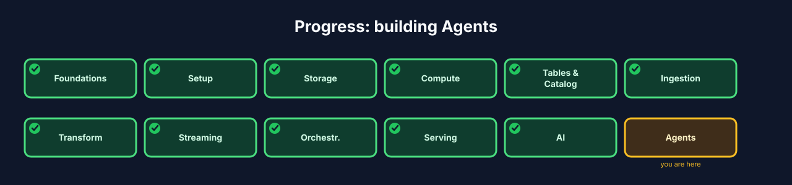
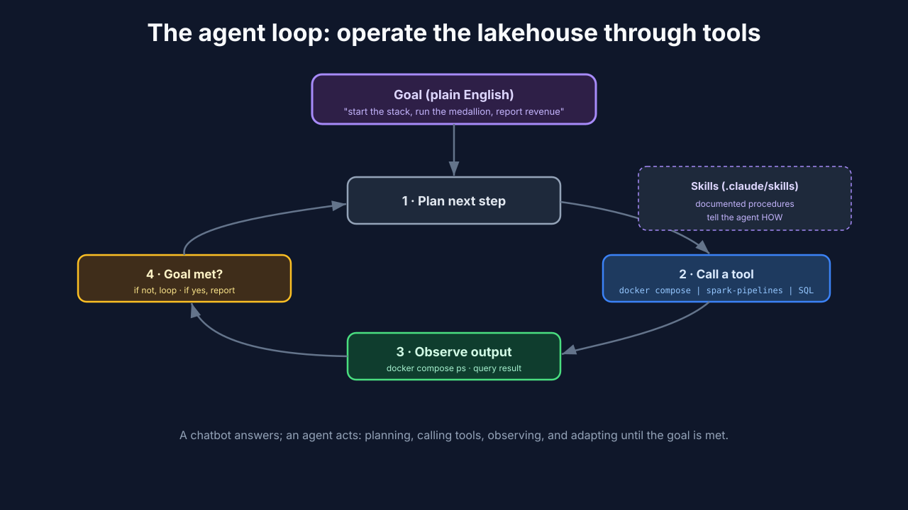
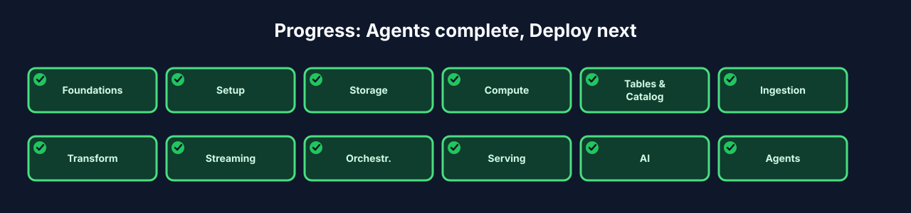

# Chapter 12: Agents

This is the newest layer, and a fitting capstone: an agent, an LLM that operates the lakehouse for you. You've built every layer by hand; now you hand the controls to an AI that drives the same interfaces you've used all course, Docker Compose for the stack's lifecycle, `spark-pipelines` to run the medallion, and SQL over Spark Connect to query the results. You'll ask it, in plain English, to bring up the stack, run the pipeline, and report on the Gold tables, and watch it use tools to actually do it.

This is the frontier layer, the one that didn't exist in data engineering courses a couple of years ago and that most still skip. It's also the one that ties a bow on everything you've built: every earlier chapter created a clean, uniform way to operate the lakehouse, and that uniformity is exactly what makes it operable by an AI. The agent isn't magic bolted on top; it's the natural payoff of having built the whole system behind a small set of consistent interfaces. By the end you'll understand both how agents work and why good engineering discipline is what makes them possible.



**Figure 12.1**. Progress map with **Agents** highlighted.

## Learning objectives

By the end of this chapter you'll be able to:

- Define an agent and what distinguishes it from a chatbot.
- Explain tool use and how an agent operates infrastructure through defined actions.
- Have an agent operate the lakehouse via Docker Compose, `spark-pipelines`, and SQL.
- Describe the guardrails that make agent-operated infrastructure safe.

## What an agent is

> **Agent** *(canonical term)*: an LLM that takes actions through tools to accomplish a goal, not just generating text, but doing work and observing results.

A chatbot answers; an agent acts. Given a goal ("run today's pipeline and tell me revenue by status"), an agent plans steps, calls tools to execute them, reads the results, and adapts, looping until the goal is met. The lakehouse is an ideal thing for an agent to operate because it already exposes a small, uniform set of interfaces: the same Docker Compose, `spark-pipelines`, and Spark Connect SQL you've used in every chapter.

The distinction between a chatbot and an agent is the whole conceptual leap, so make it crisp. A chatbot is a very knowledgeable person locked in a room with a phone: they can tell you how to run the pipeline, but they can't touch anything. An agent is that same knowledgeable person, but now they're standing in front of the actual controls, with hands. They can plan, press buttons, look at what happened, and adjust. The "hands" are tools, the concrete actions the agent is allowed to take. An LLM without tools can only talk; an LLM with tools can do. Everything interesting about agents comes from that one addition: the ability to act and then observe the result of acting.

> **Tool use** *(canonical term)*: the defined actions an agent can invoke. Here the tools are shell commands (`docker compose`, `spark-pipelines`) and SQL executed over Spark Connect, the same actions you've performed by hand.



**Figure 12.2**. The agent loop: goal, plan, call a tool (`docker compose`, `spark-pipelines`, or a SQL query), observe output, repeat until done.

The loop in Figure 12.2 is the beating heart of every agent, and it's worth naming each step: the agent plans (decides the next action toward the goal), acts (calls a tool), observes (reads the tool's output), and repeats. This observe-and-adapt loop is what separates an agent from a script. A script runs fixed steps blindly; an agent looks at each result and decides what to do next. If `docker compose ps` shows a service unhealthy, the agent can notice and react; a hardcoded script would barrel ahead.

## Why the lakehouse is agent-ready

Two things make this lakehouse operable by an agent without inventing anything:

1. **A small, uniform set of interfaces.** Lifecycle is `docker compose up/down/ps`. The pipeline is `spark-pipelines run`, wrapped in a `make pipeline` target (Chapter 13). Querying is SQL over Spark Connect. An agent that can run shell commands and issue SQL can operate the whole platform, and `docker compose ps` (optionally `--format json`) gives it machine-readable state to reason over.
2. **Documented, predictable structure.** The project has a README, a single `docker-compose.yml`, and a known layout (the `lakehouse/` package plus the `config/`, `pipelines/`, `dags/`, and `ml/` folders from Chapter 2). A coding agent reads those the same way a new teammate would, and follows a proven path instead of improvising. If you want to make this explicit, drop an `AGENTS.md` at the repo root describing how to run and verify each piece.

Here's the deeper lesson, and it's one that will make you a better engineer whether or not you ever deploy an agent: the qualities that make a system agent-friendly are the same qualities that make it human-friendly. A small consistent set of commands, machine-readable status output, and clear written procedures are things you'd want for yourself and your teammates. It's no accident that the well-designed lakehouse is also the agent-operable one. Building for clarity, few front doors, predictable outputs, documented procedures, pays off twice: humans onboard faster, and agents can drive it. If there's one takeaway from this chapter beyond "agents are cool," it's that good structure is the real enabler.

### Under the hood: documentation is the API

When your documentation is consistent and complete enough that an agent can follow it without guessing, you've also made it good enough that a new human teammate can. A coding agent "programs against" your README and your Compose file: it reads how services are named and wired, how the pipeline is run, how to check health, and it uses exactly those. Well-structured docs aren't just for humans anymore; they're the interface an agent operates through. That is why the plain, predictable choices earlier in the course (one Compose file, service names that mean something, a documented layout) quietly made this chapter possible.

## Build: have an agent run the lakehouse

**Step 1: point a coding agent at the repo, and give it an `AGENTS.md`.** A coding agent (Claude Code, Cursor, or similar) onboards by reading the project's README, the `docker-compose.yml`, and an `AGENTS.md` if one exists, the same files a human would read first. No special integration is required; the agent learns the system by reading its docs. The one artifact worth writing for this is `AGENTS.md`: a short operator's guide that spells out the interfaces and the limits. Create it at the repo root:

```markdown
# AGENTS.md: operating the lakehouse

## Services (all on the `lakehouse-network` Docker network)
- seaweedfs       object store, S3 API   host: localhost:8333  in-net: seaweedfs:8333
- spark-connect   Spark Connect (gRPC)   host: localhost:15002 in-net: spark-connect:15002
- unity-catalog   Iceberg REST catalog   host: localhost:8081  in-net: unity-catalog:8080
- kafka           event stream           host: localhost:29092 in-net: kafka:9092
- airflow-apiserver  orchestration UI/API  host: localhost:8085
- mlflow          model tracking         host: localhost:5000

## How to operate (prefer the Makefile targets)
- Health:     `make ps` (or `docker compose ps --format json` for machine-readable state)
- Lifecycle:  `make up` / `make down`
- Bronze:     `make ingest DATE=YYYY-MM-DD` (idempotent: re-running a date replaces only that date)
- Silver+Gold: `make pipeline` (one SDP run; it builds Silver, then Gold)
- Tests:      `make test`        Train: `make train`
- Query:      SQL over Spark Connect (`from lakehouse.session import get_spark`);
              tables are iceberg.bronze.orders_raw, iceberg.silver.orders, iceberg.gold.daily_revenue
- Snapshots:  `python -c "from lakehouse.catalog import print_snapshots; print_snapshots('gold','daily_revenue')"`

## Guardrails (do NOT violate without explicit human confirmation)
- Never run `docker compose down -v` (deletes all data volumes).
- Never `DROP TABLE`, delete objects under s3://lakehouse/, or delete a stream checkpoint.
- Prefer read-only SQL (`SELECT`, `SHOW`, `DESCRIBE`); confirm before any write or DDL.
- Run `make ps` before and after any lifecycle change, and report what changed.
```

This file is the agent's API. Everything in it, service names, ports, the `make` targets, the catalog's table names, is something you built and verified in earlier chapters; you're just writing it down where an agent (or a new teammate) will read it first. It points at the `Makefile` targets rather than raw commands on purpose: `make pipeline` already knows that Silver and Gold refresh as two steps (Chapter 7), so the agent can't get that ordering wrong. (The `Makefile` itself is in Chapter 13; write it now if you're following along with an agent.) The guardrails are specific rather than vague. "Be careful" gives an agent nothing to check; "never `docker compose down -v`" and "never delete objects under `s3://lakehouse/`" are rules it can test a command against before running it.

**Step 2: give it a plain-English goal.**

```
You: Bring up the lakehouse stack, run the batch medallion pipeline,
     then show me daily revenue by status from the Gold table.
```

**Step 3: watch the agent operate.** It plans and calls tools in sequence, observing each result before the next step:

```text
agent -> make ps                       # what's running? (reads state before acting)
agent -> make up                       # bring the stack up
agent -> make ps                       # confirm every service is Up before continuing
agent -> make pipeline                 # one SDP run: Silver, then Gold
agent -> (SQL over sc://localhost:15002) SELECT order_date, status, revenue, order_count
         FROM iceberg.gold.daily_revenue ORDER BY order_date, status
agent -> "Here's daily revenue by status: ..."   # reports back
```

Expected: the agent brings the stack up, runs the pipeline you built in Chapter 7, reads the Gold table through the catalog, and summarizes the numbers, all from one English instruction, using only the tools you already have.

**What just happened?** Trace what the agent did against the loop. It planned a sequence (bring up storage, compute, and catalog; verify; run the pipeline; read results). It acted by calling the exact commands you've typed all course. It observed, notice the `docker compose ps` call, where it checks health before proceeding rather than assuming success. And it reported back in plain language. Every tool it used is one you've used; the agent added planning and adaptation on top of the interfaces you already built.

Then verify it, because trusting an agent blindly is the whole danger. Run the agent's final query yourself and confirm the numbers match what it reported:

```python
from lakehouse.session import get_spark
get_spark().table("iceberg.gold.daily_revenue").orderBy("order_date", "status").show()
```

For a second, engine-independent check, ask the catalog which snapshot of Gold you're looking at, and confirm the agent's pipeline run actually produced a new one:

```bash
python -c "from lakehouse.catalog import print_snapshots; print_snapshots('gold', 'daily_revenue')"
```

The newest snapshot (marked `*`) should be an `append` committed at the time the agent ran `make pipeline`. If the newest one predates the agent's run, the pipeline didn't do what the agent said it did.

The rows should be exactly what the agent summarized. This is the habit to keep even once agents are doing the work: the lakehouse gives you an independent way to check the agent's claim (the same catalog, the same table), so the agent is a fast operator you can audit, not an oracle you have to believe.

**Step 4: try a follow-up that requires adaptation,** for example "now tear it all down cleanly." The agent runs `make down`, checking `make ps` before and after, planning and verifying, not just firing commands. Notice what it should *not* do: reach for `docker compose down -v` to be "thorough". That's the guardrail in `AGENTS.md` earning its place.

**What just happened?** The follow-up shows the observe step earning its keep. A good agent checks state before tearing down (what's actually running?) and after (did it stop cleanly?), rather than blindly firing a command and hoping. That verify-don't-assume behavior is exactly what you'd want a careful human operator to do, and it's why machine-readable status output is such an important part of making the lakehouse agent-ready.

## Guardrails: agent-operated, not agent-out-of-control

Handing infrastructure to an agent demands limits. The practitioner guardrails:

- **Scoped tools.** Give the agent the specific commands it needs (`docker compose`, `spark-pipelines`, read-oriented SQL), not unrestricted root shell. Its action space should be the platform's own operations.
- **Read-then-act.** `docker compose ps` and a `SELECT` let the agent check state before and after changes, so it verifies rather than assumes.
- **Reversibility.** `docker compose down` stops services but preserves named volumes by default, so data survives; a mistake is recoverable, echoing the time-travel safety net from Chapter 5.
- **Human in the loop for destructive steps.** Operations that wipe data (`docker compose down -v`, a `DROP TABLE`, deleting a stream checkpoint) should require explicit confirmation, not silent execution.

The principle uniting these is least privilege plus reversibility: give the agent exactly the powers it needs and no more, and make sure anything it does can be undone. This is the same instinct you'd apply to a new team member on their first day: let them run the safe, everyday commands freely, but require a second pair of eyes before anything destructive or irreversible. An agent is a fast, tireless operator, which makes it wonderful for routine work and dangerous if handed a loaded gun. Scoped tools and human approval for destructive steps are how you get the upside without the downside. Note how the lakehouse's earlier design choices, a reversible teardown, preserved volumes, Iceberg time travel, mean the safety net was already there before the agent arrived.

## Troubleshooting

- **The agent can't figure out how to operate the repo.** Its instruction files are thin. Make sure the README and `docker-compose.yml` actually describe how to run and verify things, or add an `AGENTS.md`; the agent is only as good as the docs it reads.
- **The agent runs a command that fails and gives up.** Often the underlying stack isn't healthy. Run `docker compose ps` yourself; fix the real issue and the agent will proceed. The agent surfaces problems, it doesn't invent fixes for broken infrastructure.
- **The agent tries something destructive.** Your guardrails are too loose. Restrict its tools and require confirmation for commands like `docker compose down -v`.
- **The agent "hallucinates" a command or table that doesn't exist.** It's improvising instead of reading the docs. Point it at the README, the Compose file, or `docker compose ps` so it uses real service names and real tables, not invented ones.

## Checkpoint

- You pointed an agent at the repo; it read the README and Compose file for instructions.
- From one English goal, the agent brought up the stack, ran the medallion, and reported Gold results using `docker compose`, `spark-pipelines`, and SQL.
- It used `make ps` (or `docker compose ps`) to verify state before and after actions.
- You can name three guardrails that keep agent operation safe.
- You can explain why the qualities that make a system agent-ready also make it human-friendly.

## Try it yourself

1. **Give it a multi-step goal.** Ask the agent to land a new day (`make ingest DATE=2026-01-10`), rebuild Silver and Gold, and report the top revenue day. Then check its claim yourself with one query. Watch how it sequences and verifies each step.
2. **Watch it recover.** Stop a service the agent will need, then give it a goal that requires it. Observe whether it notices the unhealthy state (via `docker compose ps`) and reacts, versus barreling ahead.
3. **Tighten a guardrail.** Decide which commands you'd never let an agent run without confirmation, and write down the rule. You've just designed an agent safety policy.
4. **Reflect on the meta-lesson.** In a paragraph, explain why building the lakehouse behind a few clean interfaces made this whole chapter possible, and how that same choice helps human operators.

## Check your understanding

- What is the one thing that turns an LLM from a chatbot into an agent?
- Name the four steps of the agent loop and what each does.
- Why is this lakehouse "agent-ready" without inventing anything new? Give the two reasons.
- State the "least privilege plus reversibility" principle and give two guardrails that implement it.

## Recap and what's next

- An agent takes actions through tools to reach a goal, looping through plan, act, observe, repeat.
- The lakehouse is agent-ready because of a small uniform set of interfaces (Compose, `spark-pipelines`, SQL) and documented structure, the same qualities that make it human-friendly.
- Guardrails (scoped tools, read-then-act, reversibility, human approval for destructive ops) keep it safe: least privilege plus reversibility.
- **Next, Chapter 13, Deploy and Teardown:** take the lakehouse to the cloud (a tour), tear it down cleanly, and map where to go next.



**Figure 12.3**. Progress map with **Agents done** and **Deploy** next.
