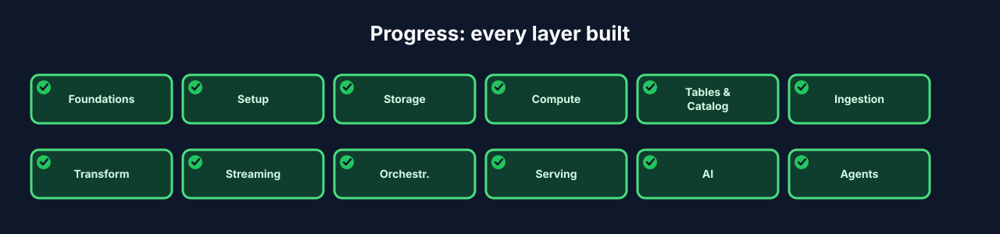
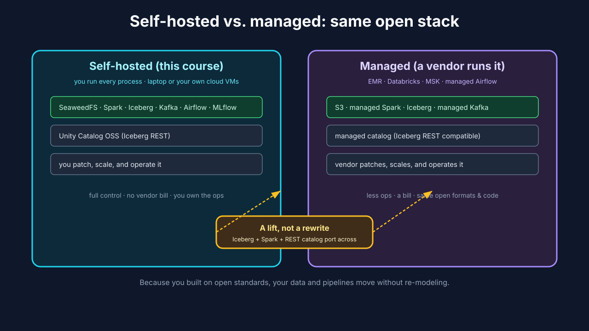

# Chapter 13: Deploy, Teardown, and Where to Go Next

This is the wrap-up. You've built the whole lakehouse, storage to agents, on your laptop. This final chapter zooms out: a narrated tour of taking it to the cloud (so you understand the path without spending a dollar), a clean teardown that gives your machine back, and a roadmap of where to grow next. No new required infrastructure; this is about understanding the full lifecycle and leaving you with next steps.

Take a moment first to appreciate what you've done. Thirteen chapters ago, "open lakehouse" was probably a buzzword. Now you've built one, every layer, by hand, from the object store up to an AI agent operating the whole thing. That's not a toy; it's the same architecture, the same open components, that power real data platforms at real companies. This chapter is about landing the plane: understanding how what you built relates to production, cleaning up, and knowing where to go from here.



**Figure 13.1**. Progress map: every layer complete.

## Learning objectives

By the end of this chapter you'll be able to:

- Contrast self-hosted and managed deployments and pick sensibly.
- Describe the cloud deploy path (Terraform) at a high level.
- Tear the local lakehouse down cleanly, understanding what's preserved versus wiped.
- Name concrete next steps to deepen each layer.

## What you built: one real repository

Before the victory lap, look at the actual artifact. Everything in this course accreted into one coherent, installable project, not a folder of disconnected scripts:

```
open-lakehouse/
├── docker-compose.yml      # every service: SeaweedFS, Spark, Unity Catalog, Kafka, Airflow, MLflow
├── pyproject.toml          # the installable `lakehouse` package
├── Makefile                # one-command operations (below)
├── AGENTS.md               # how an agent (or a new teammate) operates the stack
├── .env / .env.example     # secrets (gitignored) and the names they need (committed)
├── .gitignore              # .env, data/, .venv/, __pycache__/
├── config/
│   ├── spark/spark-defaults.conf        # Connect server: jars, S3, the Iceberg catalog
│   └── unity-catalog/server.properties  # catalog: storage bucket + credentials
├── docker/
│   ├── airflow/Dockerfile  # Airflow + a JRE + the Spark Connect client (Chapter 9)
│   └── mlflow/Dockerfile   # MLflow + boto3 for S3 artifacts (Chapter 11)
├── lakehouse/              # the shared package every layer imports
│   ├── config.py           # one source of truth for endpoints + catalog name
│   ├── session.py          # get_spark() factory
│   ├── catalog.py          # ask the catalog directly: table metadata, snapshots
│   ├── generate.py         # the seeded, per-day source-data generator
│   ├── ingest.py           # idempotent, date-parameterized Bronze ingest
│   ├── quality.py          # reusable Silver cleaning
│   ├── stream_source.py    # Kafka producer standing in for an app
│   └── stream_ingest.py    # Kafka -> Structured Streaming -> Bronze
├── pipelines/medallion/    # the SDP project (Silver + Gold)
│   ├── spark-pipeline.yml
│   └── transformations/medallion.py
├── dags/lakehouse_medallion_pipeline.py   # Airflow DAG, imports lakehouse.generate + ingest
├── ml/train.py             # MLflow training on a pinned Gold snapshot
├── tests/test_quality.py   # tests for the cleaning rules
└── data/                   # local scratch, gitignored
```

Notice the shape: `lakehouse/` holds the logic once, and `dags/`, `ml/`, `pipelines/`, and `tests/` all import from it. The DAG runs the same `generate_orders` and `ingest_orders` you call by hand; the pipeline cleans with the same `clean_orders` the test verifies. That one-definition-per-thing is what separates a real codebase from a pile of chapter snippets, and it's why this is a stack you could actually keep running rather than a demo you'd throw away.

## Operate it with one command

Production systems don't make you memorize a dozen incantations. Tie the common operations together in a `Makefile` at the repo root (recipe lines are tab-indented):

```makefile
# Makefile: the operator surface for you, a teammate, or an agent (Chapter 12).
# Recipe lines must start with a TAB.
SPARK_REMOTE ?= sc://localhost:15002
DATE         ?= 2026-01-05
export SPARK_REMOTE

.PHONY: up down ps ingest pipeline test train

up:            ## bring the whole stack up
	docker compose up -d
down:          ## stop everything, keep data volumes
	docker compose down
ps:            ## health check
	docker compose ps
ingest:        ## land one day's raw drop and ingest it into Bronze (make ingest DATE=2026-01-06)
	python -m lakehouse.generate $(DATE)
	python -m lakehouse.ingest $(DATE)
pipeline:      ## rebuild Silver, then Gold (two refreshes; see Chapter 7)
	cd pipelines/medallion && spark-pipelines run --remote $(SPARK_REMOTE) --refresh silver.orders
	cd pipelines/medallion && spark-pipelines run --remote $(SPARK_REMOTE) --refresh gold.daily_revenue
test:          ## run the tests (needs the Connect server up)
	pytest tests/ -q
train:         ## train + log a model on Gold
	python ml/train.py
```

Now the whole lifecycle is `make up`, `make ingest`, `make pipeline`, `make test`, `make train`, `make down`. Three details make it more than a list of aliases:

- **Variables with defaults.** `make ingest` lands the default day; `make ingest DATE=2026-01-10` lands any other. `SPARK_REMOTE ?=` means "use the environment's value if there is one", so the same Makefile drives a remote cluster with `SPARK_REMOTE=sc://... make pipeline`, the Chapter 4 portability idea once more.
- **The pipeline target encodes a lesson.** It refreshes Silver, then Gold, as two runs, because of the SDP limitation from Chapter 7. Whoever runs `make pipeline` (you next month, a teammate, an agent) gets the right order without having to know why.
- **`.PHONY`.** These targets are commands, not files, and `.PHONY` tells make never to skip them because a file with the same name happens to exist.

That is the operator surface a teammate, or an agent (Chapter 12), drives, and it's the final touch that makes the project feel like a product instead of an exercise. (If `make` complains about a "missing separator", a recipe line was indented with spaces instead of a tab.)

## Self-hosted vs. managed

> **Self-hosted vs. managed** *(canonical term)*: you run the infrastructure yourself (this whole course) versus a cloud vendor runs it for you (EMR, Databricks, MSK, managed Airflow).

Everything you built is self-hosted: you own every process. The exact same open components also exist as managed services, and because you built on open standards, moving is a lift, not a rewrite: your Iceberg tables, Spark jobs, SDP pipelines, and Airflow DAGs port over. That's the whole payoff of the open-source choice from Chapter 1: the skills and the artifacts transfer.

So which should you use in real life? The honest tradeoff: managed services buy you time and cost you money and control. A managed Spark or Airflow means you don't babysit servers, patch security holes, or get paged when a node dies; the vendor does that. You pay for it, both in dollars and in some loss of control and flexibility. Self-hosting is cheaper and infinitely tweakable but puts the operational burden on you. Most teams end up managed for production (their engineers' time is worth more than the server savings) and value people who understand the open guts underneath, which, having built it all yourself, you now do. That understanding is exactly what makes you effective on a managed platform: you know what the buttons actually do.



**Figure 13.2**. The same open components, self-hosted (you run them) versus managed (a vendor runs them); the open formats and code carry across.

## The cloud path (a tour, not a bill)

Taking this to the cloud doesn't change the architecture, only who runs the boxes. The standard way to describe a cloud deployment is Terraform, infrastructure as code. We tour the shape here rather than running it, so you don't incur cloud costs to learn the path. Two shapes are worth knowing:

- **Self-hosted on cloud:** the same open components, just on cloud infrastructure. Spark on ECS or EMR, object storage on S3, and the catalog's database moved from the embedded file it uses locally (the `uc-db` volume) to Postgres on RDS. You still run the open stack; the cloud provides the machines.
- **Fully managed:** a platform like Databricks runs Spark, the catalog, and the pipelines for you. Your Iceberg tables and SDP/Spark code still port over, because they're open.

To make "declare the infrastructure" concrete, here is the *shape* of the self-hosted-on-cloud path in Terraform. This is illustrative, not something you apply in this course (that would mean a cloud account and a bill); read it for the mapping from each local service to its cloud counterpart:

```hcl
# ILLUSTRATIVE ONLY: the shape of a cloud deployment, not a deployment to run.

resource "aws_s3_bucket" "lakehouse" {
  bucket = "my-org-lakehouse"            # replaces local SeaweedFS (same S3 API)
}

resource "aws_db_instance" "catalog" {
  engine         = "postgres"            # the catalog's metadata DB, now managed
  instance_class = "db.t3.micro"
}

# Spark would run on EMR or ECS; Unity Catalog on a small instance or managed host.
# Your Iceberg tables, SDP definitions, and Spark code do not change: only the
# endpoints and credentials in your config point at these cloud resources instead
# of localhost. That is the whole "lift, not rewrite" claim, in a config file.
```

Notice what is *not* in that file: any change to your pipeline logic or table definitions. You swap `localhost:8333` for the S3 bucket's endpoint and `seaweedfs`'s keys for IAM, and the stack you built runs unchanged.

> **Infrastructure as code** means the deployment is declared in Terraform and applied reproducibly, the same declarative philosophy you saw in SDP (Chapter 7) and Airflow DAGs (Chapter 9): describe the desired state, let the tool converge to it.

Notice the pattern repeating one more time: declarative shows up at every layer of this course. SDP declares tables and lets the engine derive the build order. Airflow declares task dependencies and derives the run order. Terraform declares cloud infrastructure and derives the steps to create it. Once you internalize "describe the desired end state, let the tool figure out how to get there," you have a mental model that transfers across the entire modern data and infrastructure stack. It's arguably the single most portable idea in the whole book.

### Under the hood: why "lift, not rewrite" is true

Your data is in Iceberg, an open table format any engine and any cloud reads. Your catalog speaks the Iceberg REST protocol. Your transforms are Spark. None of these are proprietary, so a managed service consumes them directly. Contrast a closed warehouse, where migrating means exporting and re-modeling everything. Open standards are what make your work portable; that was the bet in Chapter 1, and this is where it pays off. The bet has a name in the industry: avoiding lock-in. You made it deliberately in Chapter 1, carried it through every layer, and now it means you're never trapped. Your data and pipelines can move to any engine, any cloud, any vendor, because none of them owns the format.

## Teardown: give your machine back

**Step 1: stop everything, preserving your data.** `docker compose down` removes the containers and the network but keeps your named volumes, so your Iceberg tables and catalog data stay on disk:

```bash
docker compose down
docker compose ps
```

Expected: all services stop and the containers are removed; `docker compose ps` shows nothing running. The named volumes remain, and `docker volume ls` shows them, prefixed with your project name:

- `seaweedfs-data`: every object in the bucket, so your Iceberg data and metadata files, the raw drops, the stream checkpoint, and the MLflow artifacts.
- `uc-db`: Unity Catalog's embedded database, which holds the catalog, schemas, and each table's pointer to its current `metadata.json`.
- `airflow-db`: Airflow's run history.
- `mlflow-db`: MLflow's runs and model registry.
- `zookeeper-data`, `zookeeper-log`, and `kafka-data`: the Kafka broker's state, including the `orders` topic and its messages. Without them the topic vanishes on recreate and the streaming job fails with `UnknownTopicOrPartitionException` when it restarts against a broker that no longer has it.

Each of those volumes was a deliberate line in an earlier chapter, and each one is what turns "the container restarted" into a non-event. Without `uc-db`, for example, your Parquet files would survive in SeaweedFS but the catalog would forget every table that points at them: storage intact, lakehouse gone.

**What just happened?** `docker compose down` is the gentle option: it halts and removes the running services but leaves your data volumes intact. Think of it as closing the shop for the night, not demolishing it. When you come back and `docker compose up -d`, your Iceberg tables, catalog entries, and everything else are exactly where you left them. This is the command for "I'm done for today," not "I'm done forever."

Prove it, don't trust it. Bring the stack back up and confirm your Gold table survived the full stop/start:

```bash
docker compose up -d
# wait for the catalog and Spark to be ready (docker compose logs spark-connect), then:
python3 -c "from lakehouse.session import get_spark; \
print(get_spark().table('iceberg.gold.daily_revenue').count(), 'Gold rows survived')"
```

Expected: the same row count you had before the teardown. Check the other layers the same way: the MLflow Models tab still lists every version of `orders-order-count`, the Airflow UI still shows every past run, and the `orders` topic is still in Kafka, so the stream job can restart from its checkpoint. In verification, all three survived a full `down`/`up`. The containers were destroyed and recreated, but the state lived in named volumes, not in the containers, so it is exactly where you left it. (Give the Connect server a minute after `up`: it re-downloads its jars at startup.) That separation of compute (ephemeral containers) from storage (durable volumes) is the same decoupling principle from Chapter 1, now visible in your teardown habit.

**Step 2: full reset, only if you want a clean slate (this wipes data).** The `-v` flag removes the named volumes too:

```bash
docker compose down -v      # destructive: removes data volumes + metadata
```

Expected: volumes and state are cleared. Use this to reclaim disk or start fresh, and note this is exactly the kind of destructive operation that should require human confirmation when an agent (Chapter 12) is at the controls.

**What just happened?** This is the demolition option: `-v` removes the data volumes, not just the running services. Everything is gone: tables, catalog, checkpoints. Use it deliberately when you want to reclaim disk space or begin completely fresh, and never casually. It's the perfect example of the "human-in-the-loop for destructive steps" guardrail from Chapter 12: a fast operator (human or agent) should have to consciously confirm before wiping data. Reversible operations can be automatic; irreversible ones deserve a pause.

> Teardown discipline is a feature, not an afterthought: because everything runs in containers with explicit volumes, "give my laptop back" is one command, and there are no stray processes left behind. This clean lifecycle, stand it all up with one command, tear it all down with another, is one of the quiet luxuries of building on containers, and it's why you could experiment fearlessly throughout the course.

## Where to go next

You've built the core. Concrete ways to deepen each layer:

- **Storage / Tables:** table maintenance, compaction, snapshot expiration, and partition evolution on your Iceberg tables.
- **Transformation:** add a real data-quality suite and more Gold marts; explore incremental SDP refresh in depth.
- **Streaming:** exactly-once end to end, schema-registry-backed Kafka, and windowed aggregations in the stream.
- **Serving:** wire a BI tool (or a semantic layer) onto the Gold tables; try Trino as a third engine.
- **AI:** batch inference writing predictions back to an Iceberg table, and model promotion workflows in the registry.
- **Agents:** a retrieval/analytics agent that answers questions by querying Gold through the catalog (text-to-SQL over the lakehouse).
- **Governance:** deepen Unity Catalog OSS: access control, lineage, and audit.

Pick one that excites you and go deep, rather than trying to do all seven. The fastest way to solidify what you've learned is to change the system, add a Gold table, wire in a new engine, extend the agent, because that forces you to understand how the layers connect, not just how each works alone. You have a complete, working lakehouse to experiment on; use it as a sandbox.

## Checkpoint: you built an open lakehouse

Look back at the cold open from Chapter 1. You now have:

- **Storage** (object store) holding open **Iceberg** tables via **Unity Catalog OSS**.
- **Compute** driven by **Spark Connect**.
- **Ingestion** (batch) and **Streaming** (Kafka) both feeding **Bronze**.
- **Transformation** into Silver/Gold with **Spark Declarative Pipelines**.
- **Orchestration** via **Airflow**.
- **Serving** to multiple engines through one open catalog.
- **AI** trained and tracked with **MLflow**.
- **Agents** operating it all through Compose, `spark-pipelines`, and SQL.

Every layer, built by you, running on your own machine, entirely open source. If you can look at that list and, for each item, explain what it does, why it's there, and roughly how you built it, you don't just have a running lakehouse, you have the mental model of a data engineer. That's the real deliverable of this course.

## Try it yourself

1. **Do a full round-trip.** `docker compose down`, confirm everything's down, then `docker compose up -d` the stack again and verify your Gold table survived. Feel the difference between stopping and wiping.
2. **Sketch the Terraform.** For the self-hosted-on-cloud path, write down which cloud resource replaces each local component (S3 for the object store, RDS Postgres for the catalog's database (and Airflow's), EMR or ECS for Spark). You're mapping a production deployment without paying for one.
3. **Write your own roadmap.** From the "where to go next" list, pick one item and write down the first three concrete steps you'd take. Commit to actually doing it.
4. **Teach it back.** The ultimate test: explain the whole architecture, storage to agents, to someone else (or to a rubber duck) in five minutes, using the Chapter 1 architecture diagram. If you can, you've truly got it.

## Check your understanding

- What's the real tradeoff between self-hosted and managed, and why do most production teams choose managed?
- Why is migrating this lakehouse to the cloud a "lift, not a rewrite"?
- Where does the "declarative" idea appear across the course? Name at least three places.
- What's the difference between `docker compose down` and `docker compose down -v`, and which deserves a confirmation gate?

## Recap

- What you built is one installable `lakehouse` project with a shared package, SDP pipelines, DAGs, training, tests, and a `Makefile`, operated with one command, not a pile of snippets.
- Self-hosted (this course) and managed run the same open stack; open standards make migration a lift, not a rewrite, the anti-lock-in bet from Chapter 1 paying off.
- The cloud path is Terraform, declarative infrastructure, toured here without cost; "declare the end state, let the tool converge" recurs at every layer.
- Teardown is one command; `docker compose down` preserves data, `docker compose down -v` wipes it. Reversible steps can be automatic, irreversible ones deserve a pause.
- The roadmap deepens every layer; you have the foundation, and the mental model, to grow.


**Figure 13.3**. Every layer checked: the finished open lakehouse.
